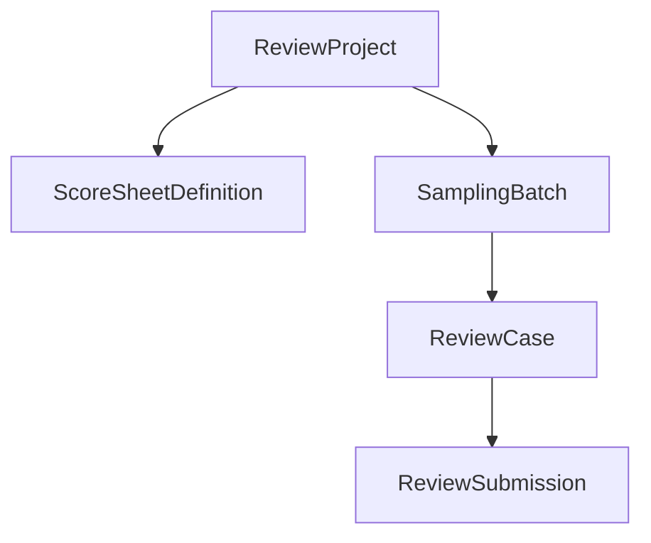

# 品質審查系統 Aggregate 設計稿 v1

這一版以你目前的需求書為 authority source，先做戰術設計骨架，不延伸到尚未被需求書確認的 UI、API 或實體表細節。需求書已明確定義審查專案、抽選批次、審查案件、評分表、審查結果、狀態與追溯要求，因此這些會成為本輪設計主軸。

---

## 1. Aggregate：ReviewProject

### 角色

審查專案的管理主體。
負責承載某一個審查專案的有效設定、版本與啟用狀態。

### 為什麼是 aggregate root

需求書明確定義「審查專案」是抽選、分派、評分與複審的管理主體。
因此：

* 抽選規則不是游離設定
* 評分規則不是獨立散件
* 複審規則也不是外掛欄位

它們都應以 `ReviewProject` 為主體聚合與發布。

### 建議邊界

**包含**

* 專案基本資料
* 院區
* 適用病歷類型
* 審查對象設定
* 日期條件設定
* 抽樣方式
* 分層依據
* 排除科別
* 審查醫師群設定
* 品質線
* 複審規則
* 生效期間
* 啟用狀態
* 版本資訊。

**不包含**

* 抽中的案件清單
* 歷次抽選批次明細
* 所有審查結果
* 報表統計資料

### 主要 Entity / Value Object

* `ProjectId`
* `HospitalId`
* `ProjectScope`
* `MedicalRecordTypeSet`
* `ReviewTargetPolicy`
* `DateCriteriaPolicy`
* `SamplingPolicy`
* `StratificationPolicy`
* `ExcludedDepartmentSet`
* `ReviewerPoolPolicy`
* `RereviewPolicy`
* `QualityThreshold`
* `EffectivePeriod`
* `ProjectVersion`

### 主要 Methods

* `create(...)`
* `activate()`
* `deactivate()`
* `publishNewVersion(...)`
* `replaceSamplingPolicy(...)`
* `replaceScoreSheetBinding(...)`
* `replaceReviewerPool(...)`
* `assertSamplingAllowed(atTime)`
* `snapshotForBatchExecution()`

### Domain Invariants

* 未啟用專案不得執行抽選
* 生效期間外不得建立新抽選批次
* 抽樣方式至少支援比例抽選與分層抽選，且須保留擴充彈性。
* 分層抽選現階段至少支援科別、病歷類型、醫師。
* 排除科別必須來自科別主檔且支援多選。
* 規則版本一旦被案件或批次採用，不得被後續修改污染。

### Domain Events

* `ReviewProjectCreated`
* `ReviewProjectActivated`
* `ReviewProjectDeactivated`
* `ReviewProjectVersionPublished`

---

## 2. Aggregate：ScoreSheetDefinition

### 角色

管理某專案可用的評分表版本與題目結構。

### 為什麼獨立成 aggregate

需求書明確要求：

* 不同專案可配置各自的評分項目與分數
* 題目分組、章節或構面管理
* 必填與條件顯示規則
* 評分版本控管。

這代表評分表不是 `ReviewProject` 的單純子物件，而是一個有自己版本生命週期的模型。

### 建議邊界

**包含**

* 評分表編號
* 所屬專案
* 版本
* 題目分組
* 題目
* 分數
* 權重
* 必填設定
* 條件顯示設定。

**不包含**

* 醫師對案件的實際作答
* 某次提交的總分結果
* 附件內容

### 主要 Entity / Value Object

* `ScoreSheetId`
* `ProjectId`
* `ScoreSheetVersion`
* `Section`
* `ScoreItem`
* `ScoreWeight`
* `RequiredRule`
* `VisibilityRule`

### 主要 Methods

* `createDraft(...)`
* `addSection(...)`
* `addScoreItem(...)`
* `changeWeight(...)`
* `publishVersion()`
* `freezeVersion()`
* `snapshotForSubmission()`

### Domain Invariants

* 已發布且被案件或批次採用的版本不可原地修改
* 題目、分數、權重異動需產生新版本
* 條件顯示規則與必填規則必須可被 deterministic 計算
* 同一題目識別碼在同一版本內不得重複

### Domain Events

* `ScoreSheetDraftCreated`
* `ScoreSheetVersionPublished`
* `ScoreSheetFrozen`

---

## 3. Aggregate：SamplingBatch

### 角色

代表一次抽選執行。

### 為什麼是 aggregate

需求書明確要求抽選作業要能：

* 手動執行
* 排程執行
* 建立抽選批次
* 記錄母體件數、符合件數、排除件數、抽中件數
* 查詢抽選依據
* 支援失敗重跑與異常紀錄。

這些都屬於一次執行的交易邊界。

### 建議邊界

**包含**

* 批次編號
* 所屬專案
* 執行時間
* 執行狀態
* 母體件數
* 符合件數
* 排除件數
* 抽中件數
* 執行訊息
* 規則快照
* 抽中案件參照。

**不包含**

* 案件完整審查歷程
* 實際評分內容
* 報表彙總資料

### 主要 Entity / Value Object

* `BatchId`
* `ProjectId`
* `BatchStatus`
* `BatchMetrics`
* `RuleSnapshot`
* `CandidateCaseRef`
* `SelectedCaseRef`
* `ExecutionMessage`

### 主要 Methods

* `start(...)`
* `recordCandidateCount(...)`
* `recordEligibleCount(...)`
* `recordExcludedCount(...)`
* `selectCases(...)`
* `complete(...)`
* `fail(reason)`
* `markRetryOf(previousBatchId)`

### Domain Invariants

* 批次完成後不得再修改規則快照
* 母體 / 符合 / 排除 / 抽中數量不可為負
* 抽中件數不得大於符合件數
* 同一批次不可重複完成
* 失敗重跑不得靜默覆蓋原批次，應形成新批次或保留 retry 關聯
* 系統須避免重複抽選同一案件。

### Domain Events

* `SamplingBatchStarted`
* `SamplingCandidatesPrepared`
* `SamplingBatchCompleted`
* `SamplingBatchFailed`
* `ReviewCasesSelected`

---

## 4. Aggregate：ReviewCase

### 角色

審查案件生命週期的交易主體。

### 為什麼它是核心 aggregate

需求書明確列出案件需要：

* 指派審查醫師
* 指派複審醫師
* 保存目前狀態
* 截止日
* 是否進入複審
* 最終分數
* 最終結論。

而且案件狀態也有完整生命週期要求。

### 建議邊界

**包含**

* 案件編號
* 批次編號
* 病歷識別資訊
* 病歷類型
* 院區
* 科別
* 審查對象資訊
* 初審 / 複審指派
* 狀態
* 截止日
* 是否進入複審
* 最終分數
* 最終結論
* 規則快照參照
* 評分表版本參照。

**不包含**

* 評分表定義本身
* 報表統計
* 全部附件二進位內容

### 主要 Entity / Value Object

* `CaseId`
* `BatchId`
* `CaseSubject`
* `MedicalRecordIdentity`
* `DepartmentId`
* `ReviewTargetRef`
* `ReviewerAssignment`
* `RereviewerAssignment`
* `CaseStatus`
* `Deadline`
* `ReviewDecision`
* `RuleSnapshotRef`
* `ScoreSheetVersionRef`

### 主要 Methods

* `createFromSelection(...)`
* `assignReviewer(reviewerId, dueDate)`
* `reassignReviewer(...)`
* `startInitialReview()`
* `completeInitialReview(submissionId, totalScore, threshold)`
* `assignRereviewer(...)`
* `startRereview()`
* `completeRereview(submissionId, finalScore, finalConclusion)`
* `returnToInitialReview(reason)`
* `cancel(reason)`
* `closeWithoutRereview(...)`

### Domain Invariants

* 已抽中待分派前不得開始初審
* 未分派不得進入初審中
* 初審提交前不得決定是否進複審
* 初審分數超過品質線時，案件必須進入複審。
* 複審最終分數只能由複審醫師決定。
* 已結案不得直接覆寫結果
* 已取消案件不得再進入初審或複審
* 任一案件必須可追溯來源專案、抽選批次與規則版本。

### Domain Events

* `ReviewCaseCreated`
* `ReviewCaseAssigned`
* `InitialReviewStarted`
* `InitialReviewCompleted`
* `ReviewCaseEscalatedToRereview`
* `RereviewerAssigned`
* `RereviewStarted`
* `RereviewCompleted`
* `ReviewCaseClosed`
* `ReviewCaseCancelled`
* `ReviewCaseReturned`

---

## 5. Aggregate：ReviewSubmission

### 角色

某一案件、某一審查階段的一次實際提交。

### 為什麼我建議獨立 aggregate

需求書要求：

* 評分草稿保存
* 評分送出
* 評語與備註
* 附件上傳
* 審查結果提交時間
* 已送出資料不得無痕修改。

這些行為本身已經是一個完整交易單位，不適合只做成 `ReviewCase` 內部一列資料。

### 建議邊界

**包含**

* 結果編號
* 案件編號
* 審查階段
* 審查人
* 各題作答
* 總分
* 評語
* 附件參照
* 提交時間
* 草稿 / 已提交 / 已修正版狀態。

**不包含**

* 案件整體狀態機
* 複審指派
* 批次統計

### 主要 Entity / Value Object

* `SubmissionId`
* `CaseId`
* `ReviewStage`
* `ReviewerId`
* `AnswerSet`
* `ScoreTotal`
* `Comment`
* `AttachmentRef`
* `SubmissionStatus`
* `RevisionNo`

### 主要 Methods

* `createDraft(...)`
* `saveDraft(...)`
* `attachFile(...)`
* `submit()`
* `reviseFromSubmitted(...)`

### Domain Invariants

* 已提交內容不得直接原地覆寫
* 修正應建立新 revision 或保留修正紀錄
* 提交後必須保留提交時間與提交者
* 總分計算必須基於當時版本的評分表快照
* 附件需保留與提交版本的對應關係

### Domain Events

* `ReviewDraftSaved`
* `ReviewSubmissionSubmitted`
* `ReviewSubmissionRevised`
* `ReviewAttachmentAdded`

---

# Aggregate 之間的關係

關係說明：

* `ReviewProject` 發布有效規則版本
* `ScoreSheetDefinition` 提供評分表版本
* `SamplingBatch` 執行時取用 `ReviewProject` 快照
* `ReviewCase` 由 `SamplingBatch` 產生
* `ReviewSubmission` 掛在 `ReviewCase` 下，但交易上建議獨立 aggregate

---

# 這一版設計的幾個關鍵判斷

## 1. 規則與版本一定要做 immutable

因為需求書已經明講：

* 規則版本或評分表版本一旦被案件或批次採用，不得因後續修改而影響既有案件結果。

所以這案子不適合「直接 update 設定表」的思維。

## 2. ReviewCase 不應承載全部作答內容

`ReviewCase` 負責狀態與決策；
`ReviewSubmission` 負責作答內容與修正留痕。
這樣才能避免一個 aggregate 過大。

## 3. Reporting 不應直接塞進 transaction model

需求書要大量查詢、統計、報表、匯出。
這部分建議 read model / reporting model 另做，不直接壓進 aggregate。
