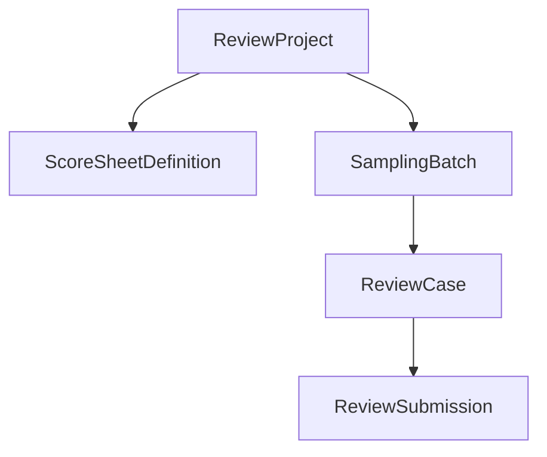

# Domain Model Spec v2

## 1. 文件目的

本文件定義品質審查系統的核心 domain model，作為以下設計與實作的基礎：

- bounded context 劃分
- aggregate 設計
- entity / value object 邊界
- domain invariant
- domain event 觸發點
- application service orchestration 邊界

本文件只處理 **domain 應如何保證業務一致性**。  
不處理 UI 顯示、API path、授權細節、資料遮罩與 query scope；這些應由 permission matrix、API spec、read model 與 security policy 處理。

---

## 2. 設計原則

本系統 domain model 遵守以下原則：

1. 以 `ReviewProject` 作為抽選、分派、評分與複審的管理主體。
2. 抽選批次、案件、提交結果、規則版本都必須可追溯。
3. 規則版本或評分表版本一旦被批次或案件採用，不得被後續修改污染既有結果。
4. 已提交審查結果不得直接覆寫；如允許修正，必須建立新 revision。
5. `CLOSED` 為終止狀態；結案後不允許 revision。
6. 複審最終分數由複審醫師決定。
7. 同一案件的重複抽選限制範圍為 **同批次**，不延伸到跨批次或跨週期。
8. 權限與資料可見性不是 domain invariant；這些由 permission matrix 與 access policy 處理。

---

## 3. Ubiquitous Language

### 3.1 ReviewProject
審查專案。  
定義某一審查活動的管理主體，包含抽選條件、評分表綁定、醫師群、品質線、複審規則與生效狀態。

### 3.2 ScoreSheetDefinition
評分表定義。  
定義評分表版本、章節、題目、權重、必填規則與顯示規則。

### 3.3 SamplingBatch
抽選批次。  
代表一次抽選執行，記錄執行模式、統計結果、規則快照與抽中案件參照。

### 3.4 ReviewCase
審查案件。  
由抽選結果產生，承載案件生命週期、初審 / 複審指派、進複審判定、最終分數與結案結果。

### 3.5 ReviewSubmission
審查提交。  
代表某案件於某審查階段的一次實際提交，可為草稿、已提交或被後續 revision 取代的版本。

### 3.6 Rule Snapshot
規則快照。  
代表批次或案件建立當下實際採用的規則內容，用於追溯與重現判定基礎。

### 3.7 Revision
修正版本。  
指已提交結果在 **未結案前** 由合法責任人重新提交的新版本，必須保留先前版本紀錄，不得覆寫原紀錄。

---

## 4. Bounded Context 劃分

| Bounded Context | Aggregate Root | 主要責任 |
|---|---|---|
| Review Project Configuration | `ReviewProject` | 專案設定、規則、生效與版本 |
| Review Project Configuration | `ScoreSheetDefinition` | 評分表版本、題目結構、權重與規則 |
| Sampling | `SamplingBatch` | 一次抽選執行、規則快照、抽選結果、失敗重跑關聯 |
| Assignment and Review | `ReviewCase` | 案件生命週期、初審 / 複審指派、升級複審、結案 |
| Assignment and Review | `ReviewSubmission` | 草稿、提交、revision、附件、總分 |
| Audit and Reporting | 讀模型為主 | 查詢、統計、報表、稽核與歷程投影 |

### 4.1 Context 邊界說明

- `ReviewProject` 不直接持有歷次批次與全部案件集合。
- `SamplingBatch` 不承載完整審查內容。
- `ReviewCase` 不直接承載整份評分表定義。
- `ReviewSubmission` 不負責案件狀態機與醫師指派。
- 稽核與報表不直接作為 transactional aggregate，建議使用 read model 投影。

---

## 5. Aggregate 詳細規格

---

## 5.1 ReviewProject

### Identity

- `projectId`

### 主要欄位

```yaml
ReviewProject:
  projectId: ProjectId
  hospitalId: HospitalId
  name: string
  medicalRecordTypes:
    - OUTPATIENT
    - INPATIENT
    - EMERGENCY
  reviewTargetPolicy: ReviewTargetPolicy
  dateCriteriaPolicy: DateCriteriaPolicy
  samplingPolicy: SamplingPolicy
  stratificationPolicy: StratificationPolicy
  excludedDepartments:
    - DepartmentId
  reviewerPoolPolicy: ReviewerPoolPolicy
  rereviewPolicy: RereviewPolicy
  qualityThreshold: QualityThreshold
  effectivePeriod: EffectivePeriod
  status: ProjectStatus
  currentVersion: ProjectVersion
```

### 核心責任

* 建立 / 啟用 / 停用審查專案
* 維護抽選與複審規則
* 綁定評分表版本
* 發布新版本
* 輸出供批次使用的 project snapshot

### Domain Invariants

* 未啟用專案不得執行抽選
* 生效期間外不得建立新批次
* 已被採用之 project version 不可原地修改
* 分層抽選維度只允許系統支援的維度集合
* 排除科別必須來自主檔
* 專案發布後，供新批次使用的永遠是正式 published version，而非 draft

### 主要 Methods

* `create(...)`
* `activate()`
* `deactivate()`
* `publishNewVersion(...)`
* `replaceSamplingPolicy(...)`
* `replaceScoreSheetBinding(...)`
* `replaceReviewerPool(...)`
* `snapshotForBatchExecution()`

### Domain Events

* `ReviewProjectCreated`
* `ReviewProjectActivated`
* `ReviewProjectDeactivated`
* `ReviewProjectVersionPublished`

---

## 5.2 ScoreSheetDefinition

### Identity

* `scoreSheetId`

### 主要欄位

```yaml
ScoreSheetDefinition:
  scoreSheetId: ScoreSheetId
  projectId: ProjectId
  version: ScoreSheetVersion
  status: ScoreSheetStatus
  sections:
    - sectionId: string
      title: string
      items:
        - itemId: string
          code: string
          title: string
          scoreType: FIXED|RANGE|BOOLEAN
          maxScore: decimal
          weight: decimal
          requiredRule: RequiredRule
          visibilityRule: VisibilityRule
```

### 核心責任

* 維護評分表版本
* 維護章節與題目
* 發布與凍結版本
* 輸出供 submission 使用的 score sheet snapshot

### Domain Invariants

* 已發布且已被採用版本不可修改
* 同一版本內 `itemId` 不得重複
* 同一版本內 `code` 不得重複
* 必填規則與顯示規則必須可計算
* 題目分數上限不得為負
* 發布後僅能以新版本演進，不得回頭 patch 舊版內容

### 主要 Methods

* `createDraft(...)`
* `addSection(...)`
* `addScoreItem(...)`
* `changeWeight(...)`
* `publishVersion()`
* `freezeVersion()`
* `snapshotForSubmission()`

### Domain Events

* `ScoreSheetDraftCreated`
* `ScoreSheetVersionPublished`
* `ScoreSheetFrozen`

---

## 5.3 SamplingBatch

### Identity

* `batchId`

### 主要欄位

```yaml
SamplingBatch:
  batchId: BatchId
  projectId: ProjectId
  executionMode: MANUAL|SCHEDULED|RETRY
  startedAt: datetime
  finishedAt: datetime?
  status: BatchStatus
  metrics:
    populationCount: int
    eligibleCount: int
    excludedCount: int
    selectedCount: int
  ruleSnapshot: RuleSnapshot
  retryOfBatchId: BatchId?
  messageLog:
    - level: INFO|WARN|ERROR
      message: string
      at: datetime
  selectedCases:
    - selectedCaseRef:
        sourceCaseKey: string
        hospitalId: HospitalId
        medicalRecordType: MedicalRecordType
```

### 核心責任

* 建立一次抽選執行
* 保留當下實際使用的規則快照
* 記錄執行統計
* 輸出抽中案件參照
* 與前一失敗批次建立 retry 關聯

### Domain Invariants

* 完成後不得修改 rule snapshot
* `populationCount`、`eligibleCount`、`excludedCount`、`selectedCount` 不得為負
* `selectedCount <= eligibleCount`
* 失敗重跑需留 `retryOfBatchId` 關聯，不得靜默覆蓋原批次
* 同一 `sourceCaseKey` 在 **同一批次** 中不得重複抽中
* 跨批次重複抽選不在本版 invariant 限制範圍內

### 主要 Methods

* `start(...)`
* `recordCandidateCount(...)`
* `recordEligibleCount(...)`
* `recordExcludedCount(...)`
* `selectCases(...)`
* `complete(...)`
* `fail(reason)`
* `markRetryOf(previousBatchId)`

### Domain Events

* `SamplingBatchStarted`
* `SamplingCandidatesPrepared`
* `SamplingBatchCompleted`
* `SamplingBatchFailed`
* `ReviewCasesSelected`

---

## 5.4 ReviewCase

### Identity

* `caseId`

### 主要欄位

```yaml
ReviewCase:
  caseId: CaseId
  batchId: BatchId
  projectId: ProjectId
  hospitalId: HospitalId
  medicalRecordIdentity: MedicalRecordIdentity
  medicalRecordType: MedicalRecordType
  departmentId: DepartmentId
  reviewTargetRef: ReviewTargetRef
  reviewerAssignment: ReviewerAssignment?
  rereviewerAssignment: ReviewerAssignment?
  status: CaseStatus
  dueAt: datetime?
  rereviewRequired: boolean
  finalScore: decimal?
  finalConclusion: string?
  ruleSnapshotRef: RuleSnapshotRef
  scoreSheetVersionRef: ScoreSheetVersionRef
  latestInitialSubmissionId: SubmissionId?
  latestRereviewSubmissionId: SubmissionId?
```

### 核心責任

* 管理案件生命週期
* 指派初審 / 複審醫師
* 管理是否進入複審
* 關聯目前有效的 submission
* 關聯最終分數與結論
* 決定是否結案

### Domain Invariants

* 未分派不得開始初審
* 初審未提交不得判定是否進複審
* 初審分數超過品質線必須進複審
* 複審最終分數由複審醫師決定
* `CLOSED` 為 terminal state
* `CANCELLED` 為 terminal state
* 已結案案件不得建立新 revision
* 已結案案件不得重新開啟初審或複審流程
* 已取消案件不得再審
* 初審 revision 僅可由原審查醫師發起
* 複審 revision 僅可由複審醫師發起
* 任一案件必須可追溯至來源 project、batch、rule snapshot、score sheet version

### 主要 Methods

* `createFromSelection(...)`
* `assignReviewer(reviewerId, dueDate)`
* `reassignReviewer(...)`
* `startInitialReview()`
* `completeInitialReview(submissionId, totalScore, threshold)`
* `assignRereviewer(...)`
* `startRereview()`
* `completeRereview(submissionId, finalScore, finalConclusion)`
* `returnToInitialReview(reason)`
* `cancel(reason)`
* `closeWithoutRereview(...)`
* `assertRevisionAllowed(stage, actorId)`

### Domain Events

* `ReviewCaseCreated`
* `ReviewCaseAssigned`
* `InitialReviewStarted`
* `InitialReviewCompleted`
* `ReviewCaseEscalatedToRereview`
* `RereviewerAssigned`
* `RereviewStarted`
* `RereviewCompleted`
* `ReviewCaseClosed`
* `ReviewCaseCancelled`
* `ReviewCaseReturned`

---

## 5.5 ReviewSubmission

### Identity

* `submissionId`

### 主要欄位

```yaml
ReviewSubmission:
  submissionId: SubmissionId
  caseId: CaseId
  stage: INITIAL|REREVIEW
  reviewerId: ReviewerId
  status: DRAFT|SUBMITTED|SUPERSEDED
  revisionNo: int
  answerSet:
    - itemId: string
      answerValue: string|number|boolean|object
      derivedScore: decimal
  totalScore: decimal
  comment: string?
  attachmentRefs:
    - AttachmentRef
  submittedAt: datetime?
  basedOnScoreSheetSnapshot: ScoreSheetSnapshotRef
```

### 核心責任

* 保存草稿
* 提交結果
* 建立 revision
* 關聯附件
* 保存依快照計算出的總分

### Domain Invariants

* 已提交內容不得原地覆寫
* 修正必須建立新 revision
* `submittedAt` 在提交後必填
* `totalScore` 必須依當時 score sheet snapshot 計算
* 同一案件、同一階段、同一 `revisionNo` 不得重複
* 若關聯案件狀態為 `CLOSED`，則不得建立新 revision
* `INITIAL` 階段 revision 僅可由原審查醫師發起
* `REREVIEW` 階段 revision 僅可由複審醫師發起
* revision 建立後，前一有效版本應標記為 `SUPERSEDED`

### 主要 Methods

* `createDraft(...)`
* `saveDraft(...)`
* `attachFile(...)`
* `submit()`
* `reviseFromSubmitted(actorId, revisedAnswers)`

### Domain Events

* `ReviewDraftSaved`
* `ReviewSubmissionSubmitted`
* `ReviewSubmissionRevised`
* `ReviewAttachmentAdded`

---

## 6. Aggregate 關係



### 關係說明

* `ReviewProject` 決定批次執行時所採用的正式版本
* `ScoreSheetDefinition` 提供提交與計分使用的版本化快照
* `SamplingBatch` 使用 `ReviewProject` 快照產生案件
* `ReviewCase` 引用 project / batch / score sheet version
* `ReviewSubmission` 掛在 `ReviewCase` 下，但以獨立 aggregate 管理提交與 revision 邊界

---

## 7. Entity 與 Value Object

---

## 7.1 主要 Entity

### ReviewProject aggregate 內

* `ProjectVersion`

### ScoreSheetDefinition aggregate 內

* `Section`
* `ScoreItem`

### SamplingBatch aggregate 內

* `SelectedCaseRef`
* `ExecutionMessage`

### ReviewCase aggregate 內

* `ReviewerAssignment`
* `MedicalRecordIdentity`

### ReviewSubmission aggregate 內

* `Answer`

---

## 7.2 主要 Value Objects

```yaml
MedicalRecordType:
  - OUTPATIENT
  - INPATIENT
  - EMERGENCY

SamplingMethod:
  - RATIO
  - STRATIFIED

StratificationDimension:
  - DEPARTMENT
  - MEDICAL_RECORD_TYPE
  - DOCTOR

CaseStatus:
  - SELECTED_PENDING_ASSIGNMENT
  - PENDING_INITIAL_REVIEW
  - INITIAL_REVIEW_IN_PROGRESS
  - INITIAL_REVIEW_COMPLETED
  - PENDING_REREVIEW
  - REREVIEW_IN_PROGRESS
  - CLOSED
  - RETURNED
  - CANCELLED

BatchStatus:
  - STARTED
  - COLLECTING_CANDIDATES
  - SAMPLING
  - COMPLETED
  - FAILED
```

### 補充說明

* `QualityThreshold` 為 value object，不是 entity
* `EffectivePeriod` 為 value object
* `RuleSnapshotRef` 與 `ScoreSheetVersionRef` 為 value object
* `ReviewTargetPolicy`、`DateCriteriaPolicy`、`SamplingPolicy`、`RereviewPolicy` 皆屬 policy 型 value object 或 policy object

---

## 8. Revision Model

本系統採 **append-only revision model**。

### 8.1 原則

1. 已提交結果不得原地覆寫
2. revision 必須建立新版本記錄
3. 舊版本需保留，可供稽核與歷程查詢
4. 只有合法責任人可發起 revision
5. 只有未結案案件可 revision
6. revision 不直接代表重新開案；若未來需要 correction workflow，應另行設計

### 8.2 Revision 範圍

* `INITIAL` stage revision：僅原審查醫師
* `REREVIEW` stage revision：僅複審醫師
* `CLOSED` 後 revision：不允許

---

## 9. Snapshot Model

本系統採 **version reference + immutable snapshot** 雙軌策略。

### 9.1 批次層

`SamplingBatch` 建立時，保存當次抽選實際採用的 `RuleSnapshot`。

### 9.2 案件層

`ReviewCase` 保存 `ruleSnapshotRef` 與 `scoreSheetVersionRef`，作為後續提交與稽核的基礎參照。

### 9.3 提交層

`ReviewSubmission` 保存 `basedOnScoreSheetSnapshot`，確保總分計算與後續追溯都以當時版本為準。

### 9.4 Snapshot Invariants

* snapshot 一旦被批次 / 案件 / 提交採用，即不可修改
* 新版本只能新增，不得回頭 patch 舊快照
* 後續新規則不應污染既有 batch / case / submission

---

## 10. 不屬於本文件的事項

以下議題不在本文件定義範圍內：

* 哪個角色可查看完整作答明細
* 系統管理員可否查看附件內容
* 稽核角色是否可跨院查詢
* 哪個 API endpoint 需要哪個 authorization guard
* UI 上哪些按鈕可見 / 不可見
* read model 的查詢聚合方式

這些屬於：

* permission matrix
* API spec
* read model / reporting spec
* security / access policy

---

## 11. 後續落地要求

本文件定義的 domain 邊界與 invariant，應同步落地於：

* aggregate methods
* application service guard
* persistence constraints
* state machine 規則
* domain event 發布條件

若其他文件與本文件衝突，應優先檢查：

1. 需求書
2. decision log
3. domain model
4. state machine
5. application service
6. API / UI / persistence 實作
