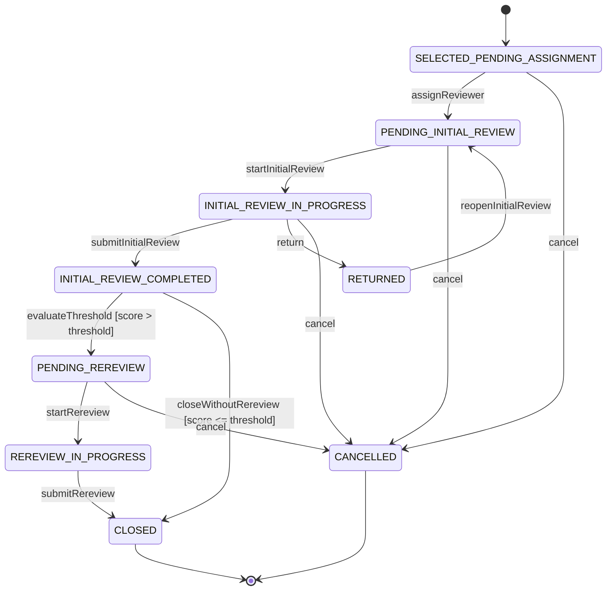
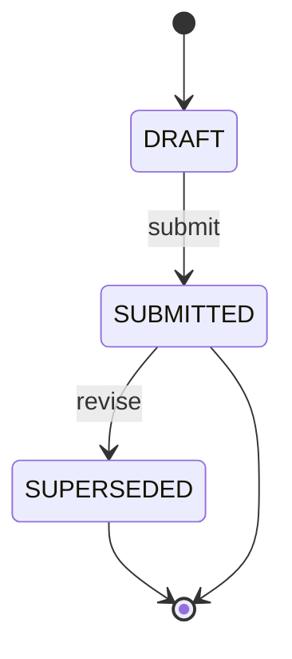
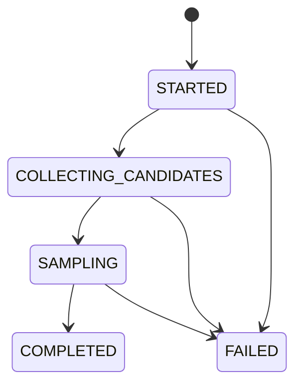

# State Machine Spec v2

## 1. 文件目的

本文件定義品質審查系統中主要 domain object 的狀態機，作為以下設計與實作的依據：

- aggregate 狀態轉移合法性
- application service orchestration guard
- API command 可接受時機
- audit trail 與事件語意
- UI 可操作狀態控制

本文件只處理 **狀態如何流轉、哪些狀態為終止狀態、哪些 trigger 合法**。  
不處理角色授權與資料可見性；這些由 permission matrix 負責。  
不處理版本快照結構；這些由 domain model / versioning 文件負責。

---

## 2. 設計原則

本系統狀態機遵守以下原則：

1. 案件狀態機是審查流程的主狀態機。
2. 初審與複審皆以案件狀態為主，不以 submission 狀態取代案件生命週期。
3. `CLOSED` 為 terminal state。
4. `CANCELLED` 為 terminal state。
5. 結案後不允許 revision。
6. 已取消案件不得再審。
7. revision 不等於 reopen；revision 只是在合法前提下建立新的 submission revision。
8. 初審是否進入複審由品質線判定。
9. 複審完成後案件進入 `CLOSED`，最終分數由複審醫師決定。

---

## 3. 案件主狀態機

## 3.1 狀態清單

```yaml
CaseStatus:
  - SELECTED_PENDING_ASSIGNMENT
  - PENDING_INITIAL_REVIEW
  - INITIAL_REVIEW_IN_PROGRESS
  - INITIAL_REVIEW_COMPLETED
  - PENDING_REREVIEW
  - REREVIEW_IN_PROGRESS
  - CLOSED
  - RETURNED
  - CANCELLED
```

### 狀態說明

* `SELECTED_PENDING_ASSIGNMENT`

  * 案件已由抽選產生，但尚未分派初審醫師

* `PENDING_INITIAL_REVIEW`

  * 已完成初審指派，等待初審醫師開始

* `INITIAL_REVIEW_IN_PROGRESS`

  * 初審已開始，可保存草稿、提交結果或退回

* `INITIAL_REVIEW_COMPLETED`

  * 初審提交已完成，等待品質線判定後決定是否進入複審或直接結案

* `PENDING_REREVIEW`

  * 已判定需複審，等待複審醫師開始

* `REREVIEW_IN_PROGRESS`

  * 複審已開始，可保存草稿或提交最終結果

* `CLOSED`

  * 案件已結案，為終止狀態

* `RETURNED`

  * 案件於初審中被退回，等待重新進入初審流程

* `CANCELLED`

  * 案件已取消，為終止狀態

---

## 3.2 案件狀態圖



---

## 3.3 案件狀態轉移規格表

| From                          | Trigger                | To                           | Guard                            | 說明        |
| ----------------------------- | ---------------------- | ---------------------------- | -------------------------------- | --------- |
| `SELECTED_PENDING_ASSIGNMENT` | `assignReviewer`       | `PENDING_INITIAL_REVIEW`     | reviewer 必填                      | 建立初審指派    |
| `SELECTED_PENDING_ASSIGNMENT` | `cancel`               | `CANCELLED`                  | 未開始審查                            | 取消案件      |
| `PENDING_INITIAL_REVIEW`      | `startInitialReview`   | `INITIAL_REVIEW_IN_PROGRESS` | 僅已指派初審醫師可啟動                      | 初審開始      |
| `PENDING_INITIAL_REVIEW`      | `cancel`               | `CANCELLED`                  | 未結案                              | 取消案件      |
| `INITIAL_REVIEW_IN_PROGRESS`  | `submitInitialReview`  | `INITIAL_REVIEW_COMPLETED`   | 初審 submission 狀態需為 `SUBMITTED`   | 初審完成      |
| `INITIAL_REVIEW_IN_PROGRESS`  | `return`               | `RETURNED`                   | 需有退回原因                           | 初審退回      |
| `INITIAL_REVIEW_IN_PROGRESS`  | `cancel`               | `CANCELLED`                  | 未結案                              | 取消案件      |
| `RETURNED`                    | `reopenInitialReview`  | `PENDING_INITIAL_REVIEW`     | 已重新指派或允許原指派延續                    | 回到待初審     |
| `INITIAL_REVIEW_COMPLETED`    | `evaluateThreshold`    | `PENDING_REREVIEW`           | `totalScore > qualityThreshold`  | 進入複審      |
| `INITIAL_REVIEW_COMPLETED`    | `closeWithoutRereview` | `CLOSED`                     | `totalScore <= qualityThreshold` | 不需複審，直接結案 |
| `PENDING_REREVIEW`            | `startRereview`        | `REREVIEW_IN_PROGRESS`       | 已指派複審醫師                          | 複審開始      |
| `PENDING_REREVIEW`            | `cancel`               | `CANCELLED`                  | 未結案                              | 取消案件      |
| `REREVIEW_IN_PROGRESS`        | `submitRereview`       | `CLOSED`                     | 複審 submission 狀態需為 `SUBMITTED`   | 複審完成並結案   |

---

## 3.4 終止狀態規則

```yaml id="0t1hku"
terminal_states:
  - CLOSED
  - CANCELLED
```

### 終止狀態約束

#### `CLOSED`

* 不可 reopen
* 不可重新進入初審或複審
* 不可建立新的 revision
* 不可重新提交初審或複審結果
* 保留查詢、稽核、歷程追蹤能力

#### `CANCELLED`

* 不可 reopen
* 不可再審
* 不可建立新的 revision
* 保留查詢、稽核、歷程追蹤能力

---

## 3.5 Revision 與狀態機的關係

revision 不是案件主狀態轉移。
revision 發生時，預設 **不改變案件主狀態**，而是在合法條件下建立新的 `ReviewSubmission` revision。

### 3.5.1 Revision 基本規則

```yaml id="b92yfo"
revision_state_rules:
  - revision 僅允許發生於非 CLOSED 且非 CANCELLED 的案件
  - revision 不構成 reopen
  - revision 不將案件主狀態退回前一狀態
  - revision 僅建立新的 submission revision
```

### 3.5.2 Revision guard 依賴

本文件不重複定義 actor 權限，但 revision 需同時滿足：

* 案件未結案
* 案件未取消
* `INITIAL` stage revision 僅由原審查醫師發起
* `REREVIEW` stage revision 僅由複審醫師發起

上述 actor 限制由：

* domain model invariant
* permission matrix
* application service guard

共同保證。

---

## 4. Submission 子狀態機

案件主狀態不等於 submission 狀態。
submission 自身也有獨立狀態，但它不取代案件主狀態機。

---

## 4.1 Submission 狀態清單

```yaml
SubmissionStatus:
  - DRAFT
  - SUBMITTED
  - SUPERSEDED
```

### 狀態說明

* `DRAFT`

  * 草稿狀態，可保存但尚未正式送出

* `SUBMITTED`

  * 正式送出，可作為初審 / 複審完成依據

* `SUPERSEDED`

  * 已被後續 revision 取代，但仍保留歷史紀錄

---

## 4.2 Submission 狀態圖



---

## 4.3 Submission 狀態轉移規格表

| From        | Trigger  | To           | Guard                 | 說明               |
| ----------- | -------- | ------------ | --------------------- | ---------------- |
| `DRAFT`     | `submit` | `SUBMITTED`  | 必填欄位與計分完成             | 正式提交             |
| `SUBMITTED` | `revise` | `SUPERSEDED` | 案件未結案且建立新 revision 成功 | 舊版被新 revision 取代 |

### Submission 補充規則

1. `SUBMITTED` 不得原地覆寫。
2. revision 必須建立新的 submission record。
3. 原 `SUBMITTED` 版本在新 revision 成立後轉為 `SUPERSEDED`。
4. 若案件已 `CLOSED` 或 `CANCELLED`，則不得從 `SUBMITTED` 進入 revision 流程。

---

## 5. 抽選批次狀態機

---

## 5.1 批次狀態清單

```yaml
BatchStatus:
  - STARTED
  - COLLECTING_CANDIDATES
  - SAMPLING
  - COMPLETED
  - FAILED
```

### 狀態說明

* `STARTED`

  * 批次建立並開始執行

* `COLLECTING_CANDIDATES`

  * 查詢母體、套用條件與排除規則

* `SAMPLING`

  * 依比例或分層抽樣

* `COMPLETED`

  * 抽選完成並產生案件參照

* `FAILED`

  * 執行失敗，保留訊息與 retry 關聯線索

---

## 5.2 批次狀態圖



---

## 5.3 批次狀態轉移規格表

| From                    | Trigger             | To                      | Guard              | 說明     |
| ----------------------- | ------------------- | ----------------------- | ------------------ | ------ |
| `STARTED`               | `prepareCandidates` | `COLLECTING_CANDIDATES` | 批次已啟動              | 開始蒐集母體 |
| `COLLECTING_CANDIDATES` | `runSampling`       | `SAMPLING`              | 母體與符合件數已計算         | 進入抽樣   |
| `SAMPLING`              | `complete`          | `COMPLETED`             | 已產生 selected cases | 完成批次   |
| `STARTED`               | `fail`              | `FAILED`                | 發生不可恢復錯誤           | 啟動失敗   |
| `COLLECTING_CANDIDATES` | `fail`              | `FAILED`                | 查詢或套用規則失敗          | 蒐集失敗   |
| `SAMPLING`              | `fail`              | `FAILED`                | 抽樣或寫入失敗            | 抽樣失敗   |

---

## 5.4 批次完成與失敗規則

### `COMPLETED`

* rule snapshot immutable
* metrics immutable
* selected case refs immutable
* 若需重跑，應建立新批次，不得覆寫既有 completed batch

### `FAILED`

* 保留錯誤訊息
* 可作為 retry 來源
* retry 必須建立新批次並保留 `retryOfBatchId` 關聯
* 不得直接把 failed batch 改寫為 completed

---

## 6. 狀態機與 Domain Event 的關係

狀態轉移通常會對應 domain event，但兩者不是同一件事。

### 6.1 典型對應

| 狀態轉移                                    | 可能對應的 Domain Event                      |
| --------------------------------------- | --------------------------------------- |
| `assignReviewer`                        | `ReviewCaseAssigned`                    |
| `submitInitialReview`                   | `InitialReviewCompleted`                |
| `evaluateThreshold -> PENDING_REREVIEW` | `ReviewCaseEscalatedToRereview`         |
| `startRereview`                         | `RereviewStarted`                       |
| `submitRereview -> CLOSED`              | `RereviewCompleted`, `ReviewCaseClosed` |
| `closeWithoutRereview -> CLOSED`        | `ReviewCaseClosed`                      |
| `submission revise`                     | `ReviewSubmissionRevised`               |
| `batch complete`                        | `SamplingBatchCompleted`                |

### 6.2 補充

* event 是否發布，由 aggregate 與 application service 協同決定
* 若狀態未合法轉移，不得發布對應 domain event

---

## 7. 不屬於本文件的事項

以下議題不在本文件定義範圍內：

* 哪個角色有權觸發某個 command
* 哪個角色可以看到完整作答內容
* revision API 的 path 與 request body
* score sheet snapshot 結構
* batch 去重實作細節
* read model 的查詢聚合策略

這些屬於：

* permission matrix
* domain model
* application service
* API spec
* persistence model
* reporting / audit read model

---

## 8. 後續落地要求

本文件定義的狀態機規則應同步落地於：

* aggregate methods
* application service command guard
* API command validation
* event publication condition
* UI 狀態操作控制

若與其他文件衝突，應優先檢查：

1. 需求書
2. decision log
3. domain model
4. state machine
5. application service
6. API / persistence / UI 實作
