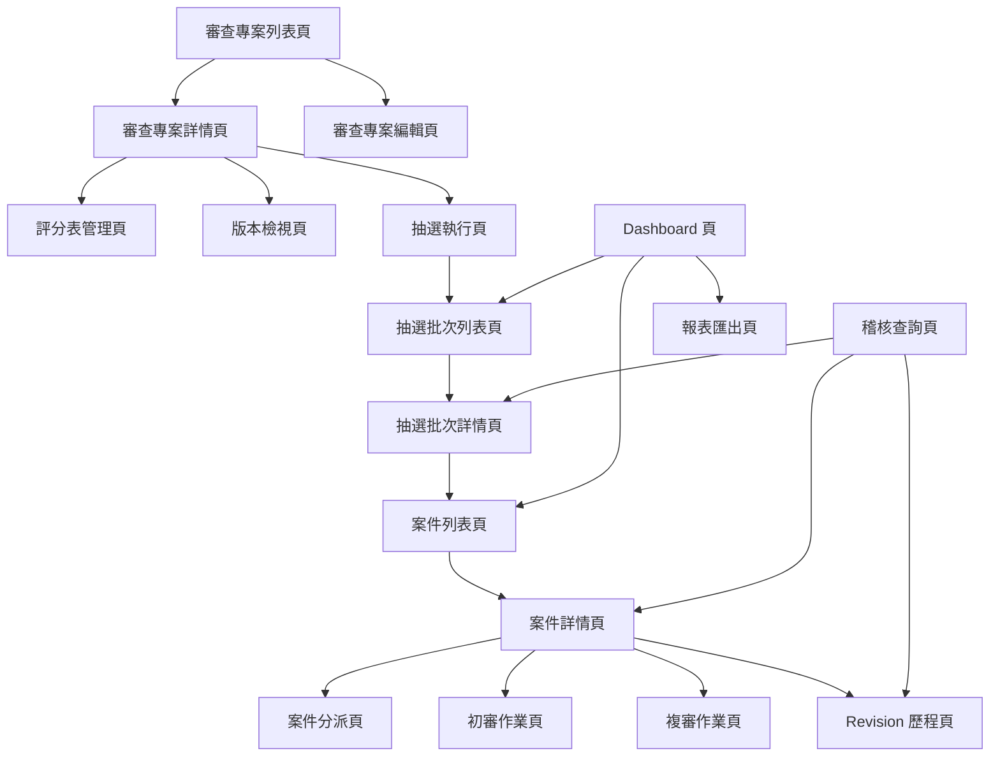

# UI Information Architecture v1

## 1. 文件目的

本文件用於定義品質審查系統的 UI 資訊架構，作為以下工作的依據：

- 導航結構設計
- 頁面群組與層級規劃
- 角色導向入口規劃
- 畫面之間的主要跳轉路徑
- 前端模組與 route 群組切分

本文件不處理：
- 欄位逐項規格
- wireframe
- component 樣式
- API request / response 細節
- form validation 細節

---

## 2. 設計原則

1. 導航應優先依業務任務分群，而不是依資料表或 API 分群。
2. 主要導航應控制在少量高辨識度模組，避免第一層選單過深。
3. 詳情頁、作業頁、歷程頁可視為從屬頁，不一定全部出現在主導航。
4. 共用頁面可依角色切換內容與操作，不優先為每個角色複製一套頁面。
5. metadata only 與 full detail view 的差異，應在頁面內容層處理，不必額外拆成兩套頁。
6. Phase 1 應優先支持主流程：
   - 專案設定
   - 抽選
   - 分派
   - 初審
   - 複審

---

## 3. IA 分層總覽

本系統 UI 資訊架構分為三層：

### Layer 1：主導航模組
使用者進系統後最上層可見的模組入口。

### Layer 2：功能頁
對應具體業務任務的頁面，例如列表頁、編輯頁、作業頁。

### Layer 3：從屬頁 / 任務頁
由列表頁或詳情頁進入的次級頁面，例如：
- 案件分派
- Revision 歷程
- 抽選批次詳情
- 版本檢視

---

## 4. 主導航結構

建議主導航如下：

```text
審查專案
抽選作業
案件作業
查詢與報表
```

### 4.1 審查專案

處理專案、規則、評分表、版本。

### 4.2 抽選作業

處理抽選預估、執行、批次追蹤。

### 4.3 案件作業

處理案件清單、案件詳情、分派、初審、複審、revision 歷程。

### 4.4 查詢與報表

處理 dashboard、稽核查詢、報表匯出。

---

## 5. 頁面樹狀結構

```text id="f5lbj1"
審查專案
  - 審查專案列表頁 [UI-001]
  - 審查專案詳情頁 [UI-002]
  - 審查專案編輯頁 [UI-003]
  - 評分表管理頁 [UI-004]
  - 版本檢視頁 [UI-005]

抽選作業
  - 抽選執行頁 [UI-006]
  - 抽選批次列表頁 [UI-007]
  - 抽選批次詳情頁 [UI-008]

案件作業
  - 案件列表頁 [UI-009]
  - 案件詳情頁 [UI-010]
  - 案件分派頁 [UI-011]
  - 初審作業頁 [UI-012]
  - 複審作業頁 [UI-013]
  - Revision 歷程頁 [UI-014]

查詢與報表
  - Dashboard 頁 [UI-015]
  - 稽核查詢頁 [UI-016]
  - 報表匯出頁 [UI-017]
```

---

## 6. 主使用路徑

本系統至少有 4 條主要使用路徑。

---

## 6.1 專案設定路徑

### 目標

建立專案、建立評分表、發布版本。

### 路徑

```text id="o6v53v"
審查專案列表頁
  -> 審查專案編輯頁
  -> 評分表管理頁
  -> 審查專案詳情頁
  -> 版本檢視頁
```

### 主要角色

* `HOSPITAL_MANAGER`

---

## 6.2 抽選執行路徑

### 目標

從已啟用專案執行正式抽選並查看批次結果。

### 路徑

```text id="2cwqoh"
審查專案詳情頁
  -> 抽選執行頁
  -> 抽選批次列表頁
  -> 抽選批次詳情頁
  -> 案件列表頁
```

### 主要角色

* `HOSPITAL_MANAGER`

---

## 6.3 案件審查路徑

### 目標

reviewer / rereviewer 完成審查任務。

### 初審路徑

```text id="j1j7lw"
案件列表頁
  -> 案件詳情頁
  -> 初審作業頁
  -> 案件詳情頁
```

### 複審路徑

```text id="tdyhzi"
案件列表頁
  -> 案件詳情頁
  -> 複審作業頁
  -> 案件詳情頁
```

### 主要角色

* `REVIEWER`
* `REREVIEWER`

---

## 6.4 稽核與查詢路徑

### 目標

查看統計、追蹤歷程、匯出報表。

### 路徑

```text id="vrtwlq"
Dashboard 頁
  -> 案件列表頁
  -> 案件詳情頁
  -> Revision 歷程頁
  -> 稽核查詢頁
  -> 報表匯出頁
```

### 主要角色

* `HOSPITAL_MANAGER`
* `AUDITOR`
* `SYSTEM_ADMIN` [aggregated / metadata only]

---

## 7. 頁面層級關係

---

## 7.1 主入口頁

這些頁面應作為主導航可直接進入的頁面：

* `UI-001 審查專案列表頁`
* `UI-006 抽選執行頁`
* `UI-007 抽選批次列表頁`
* `UI-009 案件列表頁`
* `UI-015 Dashboard 頁`
* `UI-016 稽核查詢頁`
* `UI-017 報表匯出頁`

---

## 7.2 從屬詳情頁

這些頁通常由列表頁或主入口頁進入，不一定直接放在主導航第一層：

* `UI-002 審查專案詳情頁`
* `UI-005 版本檢視頁`
* `UI-008 抽選批次詳情頁`
* `UI-010 案件詳情頁`
* `UI-014 Revision 歷程頁`

---

## 7.3 任務型作業頁

這些頁面主要承擔 command 操作，通常從詳情頁或列表頁 action 進入：

* `UI-003 審查專案編輯頁`
* `UI-004 評分表管理頁`
* `UI-011 案件分派頁`
* `UI-012 初審作業頁`
* `UI-013 複審作業頁`

---

## 8. 角色導向 IA

同一套 IA，可針對不同角色提供不同的首頁入口與導航預設。

---

## 8.1 HOSPITAL_MANAGER 視角

### 主要任務

* 建專案
* 管規則
* 執行抽選
* 分派案件
* 查詢本院結果
* 匯出報表

### 建議預設入口

* `Dashboard 頁`
* 或 `審查專案列表頁`

### 建議可見主導航

```text id="s3j12s"
審查專案
抽選作業
案件作業
查詢與報表
```

---

## 8.2 REVIEWER 視角

### 主要任務

* 查看待初審案件
* 進行初審
* 修正自己未結案的初審提交

### 建議預設入口

* `案件列表頁`，預設 tab = 待初審 / 初審中

### 建議可見主導航

```text id="h9cb4m"
案件作業
```

### 補充

* 不需暴露專案管理與抽選模組為主導航
* 如有需要，可透過唯讀入口查看部分案件來源資訊

---

## 8.3 REREVIEWER 視角

### 主要任務

* 查看待複審案件
* 執行複審
* 修正自己未結案的複審提交

### 建議預設入口

* `案件列表頁`，預設 tab = 待複審 / 複審中

### 建議可見主導航

```text id="5mj89d"
案件作業
```

---

## 8.4 AUDITOR 視角

### 主要任務

* 查詢案件與批次
* 查看 revision 歷程
* 查看 lifecycle / audit trail
* 查 dashboard 與報表

### 建議預設入口

* `Dashboard 頁`
* 或 `稽核查詢頁`

### 建議可見主導航

```text id="56csj6"
審查專案
抽選作業
案件作業
查詢與報表
```

### 補充

* scope 應限制於授權院區 / 授權範圍
* 不應顯示可修改類 action

---

## 8.5 SYSTEM_ADMIN 視角

### 主要任務

* 監控平台執行狀態
* 查看 metadata
* 查 audit header / 失敗批次 / 系統摘要

### 建議預設入口

* `Dashboard 頁` [aggregated only]
* 或 `稽核查詢頁` [metadata only]

### 建議可見主導航

```text id="0nz5nl"
抽選作業
案件作業
查詢與報表
```

### 補充

* 不應顯示會進入業務內容編輯的入口
* detail 頁仍可共用，但內容應是 metadata view

---

## 9. 導航與頁面關係圖



---

## 10. Route 群組建議

若前端要以 route module 方式設計，建議可分成：

```text id="yefal7"
/projects
/projects/:projectId
/projects/:projectId/edit
/projects/:projectId/versions
/score-sheets/:scoreSheetId

/sampling/execute
/sampling/batches
/sampling/batches/:batchId

/cases
/cases/:caseId
/cases/:caseId/assign
/cases/:caseId/initial-review
/cases/:caseId/rereview
/cases/:caseId/revisions

/reports/dashboard
/reports/export
/audit
```

### 補充

* route path 是建議，不是最終 OpenAPI / frontend router 定稿
* 之後可再依技術框架調整

---

## 11. 頁面切換原則

### 11.1 列表 -> 詳情

預設用 page navigation

### 11.2 詳情 -> 作業

視操作複雜度決定：

* 初審 / 複審建議用獨立頁
* 簡單分派可考慮 drawer / modal，但第一版建議仍先視為獨立頁

### 11.3 詳情 -> 歷程

建議以 tab 或從屬頁兩種方案擇一：

* 若要強調可追溯性，可獨立頁
* 若想縮短跳轉，可作為 detail page 下的 tab

本版先建議：

* `Revision 歷程頁` 保留獨立頁概念
* 後續可再收斂為 detail sub-tab

---

## 12. Phase 1 導航建議

若先做 MVP，建議主導航縮成：

```text id="exv90u"
審查專案
抽選作業
案件作業
```

### Phase 1 頁面

* UI-001
* UI-003
* UI-004
* UI-006
* UI-007
* UI-009
* UI-010
* UI-011
* UI-012
* UI-013

### Phase 1 不一定要進主導航的頁

* UI-002
* UI-005
* UI-008
* UI-014
* UI-015
* UI-016
* UI-017

---

## 13. Phase 2 導航擴充建議

Phase 2 加入：

```text id="5k7v1h"
查詢與報表
```

並補完整：

* Dashboard
* 稽核查詢
* 報表匯出
* 版本檢視
* Revision 歷程
* 批次詳情深化

---

## 14. 與其他文件的對應

| 文件                     | 與 IA 的關係          |
| ---------------------- | ----------------- |
| `ui-page-inventory.md` | 定義有哪些頁            |
| `permission-matrix.md` | 定義各角色看得到什麼、能做什麼   |
| `domain-model.md`      | 定義頁面背後的 domain 對象 |
| `state-machine.md`     | 定義哪些按鈕在什麼狀態可操作    |
| `api-spec.md`          | 定義頁面對接哪些 API      |
| `test-scenarios.md`    | 驗證頁面流程是否符合規則      |

---

## 15. 後續建議文件

本文件完成後，建議下一步補：

1. `ui-page-spec.md`
2. `ui-state-actions-matrix.md`

### 建議先做的 3 頁 page spec

* `案件列表頁`
* `案件詳情頁`
* `初審作業頁`

### 理由

這 3 頁能先定住：

* 清單查詢模式
* 角色差異
* terminal state UI 行為
* revision UI 行為
* reviewer 主操作流程

---

## 16. 不屬於本文件的事項

以下不在本文件定義範圍內：

* wireframe
* 組件 layout
* 欄位逐項規格
* form validation 規則
* loading / empty / error state 行為
* table 欄位最終排序
* 前端樣式系統

---

## 17. 維護原則

1. 若新增新頁面，先更新 `ui-page-inventory.md`，再更新本文件。
2. 若導航層級調整，優先更新本文件，再改 page spec。
3. 若某角色首頁入口改變，應同步更新本文件中的角色導向 IA。
