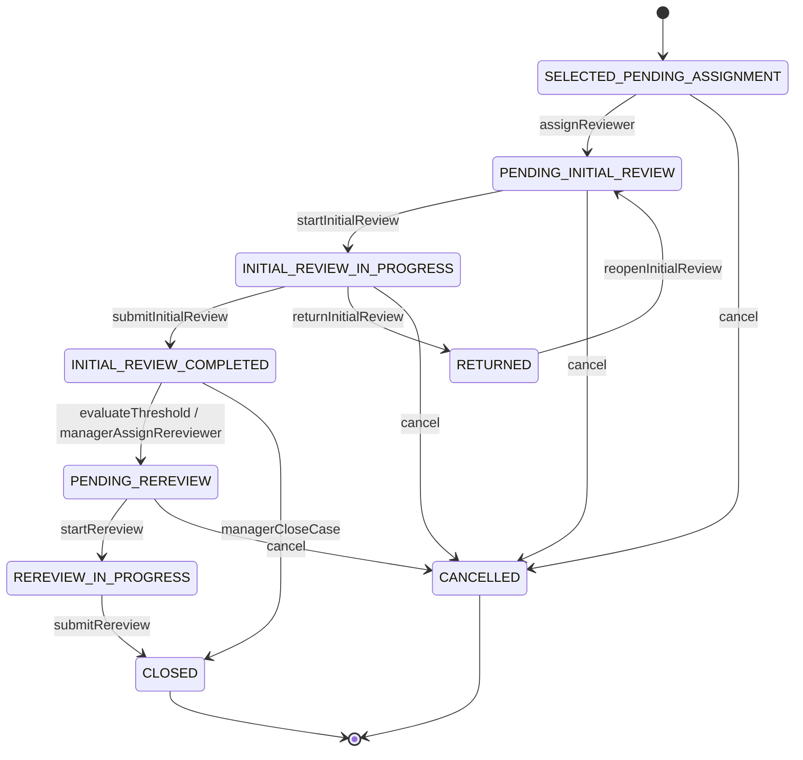
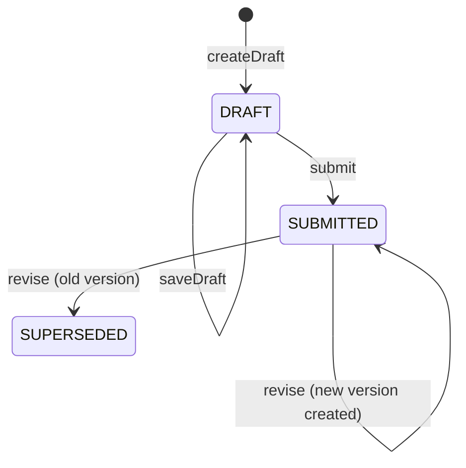
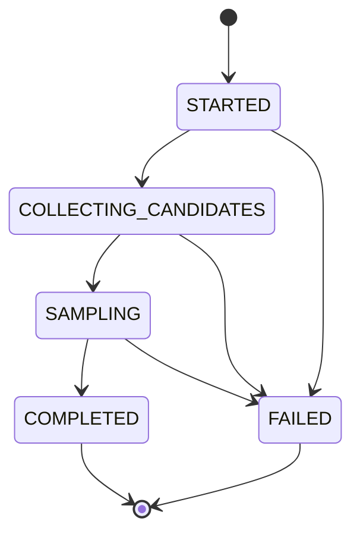

# State Machine Spec v3 (Foundational Convergence)

## 文件狀態
- 類型：更新（整合既有 `docs/02-ddd/state-machine.md`）
- 目的：收斂成可直接支援 frontend state-driven 設計的 domain state truth
- 範圍：ReviewCase / ReviewSubmission / SamplingBatch（sampling 僅最小必要）

---

## 1) Source Inputs

- `docs/01-requirements/decision-log.md`
- `docs/02-ddd/state-machine.md`（v2 既有內容）
- `docs/02-ddd/permission-matrix.md`
- `docs/03-contracts/api-spec.md`
- `docs/05-ui/ui-page-spec-ui006抽選執行頁.md`
- `docs/05-ui/ui-page-spec-ui007抽選批次列表頁.md`
- `docs/05-ui/ui-page-spec-ui009案件列表頁.md`
- `docs/05-ui/ui-page-spec-ui010案件詳情頁.md`
- `docs/05-ui/ui-page-spec-ui011案件分派頁.md`
- `docs/05-ui/ui-page-spec-ui012初審作業頁.md`
- `docs/05-ui/ui-page-spec-ui013複審作業頁.md`
- `docs/05-ui/ui-page-spec-ui014revision歷程頁.md`
- `docs/06-frontend/frontend-design-roadmap.md`

---

## 2) 收斂原則

1. 以 Decision Log accepted decisions 為優先 authority。
2. revision 與 case lifecycle 分離；revision 不等於 reopen。
3. terminal state 需具備 blocked / readonly 說明，供 UI guard 與 action policy 使用。
4. 僅保留現有 spec 可證實的狀態與轉移；無證據者標為 pending confirmation。

---

## 3) ReviewCase State Machine

### 3.1 State List

```yaml
ReviewCaseStatus:
  - SELECTED_PENDING_ASSIGNMENT
  - PENDING_INITIAL_REVIEW
  - INITIAL_REVIEW_IN_PROGRESS
  - INITIAL_REVIEW_COMPLETED
  - PENDING_REREVIEW
  - REREVIEW_IN_PROGRESS
  - RETURNED
  - CLOSED
  - CANCELLED
```

### 3.2 Transition Table

| From | Trigger / Command | To | Domain Guard / Note |
|---|---|---|---|
| SELECTED_PENDING_ASSIGNMENT | assignReviewer | PENDING_INITIAL_REVIEW | reviewer 必填 |
| SELECTED_PENDING_ASSIGNMENT | cancel | CANCELLED | 未開始審查 |
| PENDING_INITIAL_REVIEW | startInitialReview | INITIAL_REVIEW_IN_PROGRESS | 僅 assigned reviewer |
| PENDING_INITIAL_REVIEW | cancel | CANCELLED | 未結案 |
| INITIAL_REVIEW_IN_PROGRESS | submitInitialReview | INITIAL_REVIEW_COMPLETED | 先形成 submitted 初審版本 |
| INITIAL_REVIEW_IN_PROGRESS | returnInitialReview | RETURNED | 需有退回原因 |
| INITIAL_REVIEW_IN_PROGRESS | cancel | CANCELLED | 未結案 |
| RETURNED | reopenInitialReview | PENDING_INITIAL_REVIEW | 回到待初審 |
| INITIAL_REVIEW_COMPLETED | evaluateThreshold(score > threshold) | PENDING_REREVIEW | D-019 自動進複審 |
| INITIAL_REVIEW_COMPLETED | managerAssignRereviewer | PENDING_REREVIEW | D-019：手工派複審 |
| INITIAL_REVIEW_COMPLETED | managerCloseCase | CLOSED | D-019：手工關閉 |
| PENDING_REREVIEW | startRereview | REREVIEW_IN_PROGRESS | 僅 assigned rereviewer |
| PENDING_REREVIEW | cancel | CANCELLED | 未結案 |
| REREVIEW_IN_PROGRESS | submitRereview | CLOSED | 複審提交完成後結案 |

### 3.3 Terminal / Blocked Notes

```yaml
terminal_states:
  - CLOSED
  - CANCELLED
blocked_behavior:
  CLOSED:
    - no_state_transition
    - no_new_initial_submit
    - no_new_rereview_submit
    - allow_rereview_revision_exception: true
  CANCELLED:
    - no_state_transition
    - no_initial_or_rereview_commands
    - no_revision
```

### 3.4 Role / Assignment 關聯

- `startInitialReview`：需 actor = assigned `REVIEWER`
- `startRereview`：需 actor = assigned `REREVIEWER`
- assignment / re-assignment commands：`HOSPITAL_MANAGER`
- revision actor guard 見 ReviewSubmission lifecycle

### 3.5 Mermaid



---

## 4) ReviewSubmission Lifecycle

### 4.1 State List

```yaml
ReviewSubmissionStatus:
  - DRAFT
  - SUBMITTED
  - SUPERSEDED
stage:
  - INITIAL
  - REREVIEW
```

### 4.2 Transition Table

| From | Trigger / Command | To | Guard / Note |
|---|---|---|---|
| (none) | createDraft(initial/rereview) | DRAFT | 對應 stage 必須合法 |
| DRAFT | saveDraft | DRAFT | append field changes |
| DRAFT | submit | SUBMITTED | 觸發 case 主流程推進 |
| SUBMITTED | revise | SUBMITTED(new revision) + old->SUPERSEDED | append-only（D-004） |

### 4.3 Revision Guard

```yaml
revision_guard:
  initial_revision:
    actor_must_be_original_reviewer: true
    case_closed_allowed: false
    case_cancelled_allowed: false
  rereview_revision:
    actor_must_be_original_rereviewer: true
    case_closed_allowed: true   # D-021 exception
    case_cancelled_allowed: false
```

### 4.4 Readonly / Blocked Notes

- `SUBMITTED` 版本不可直接覆寫。
- revision 建立新 submission，不 reopen case，不回退 case status。
- `CANCELLED` 不允許任何 stage revision。

### 4.5 Mermaid



---

## 5) SamplingBatch Lifecycle（最小必要覆蓋）

### 5.1 State List

```yaml
SamplingBatchStatus:
  - STARTED
  - COLLECTING_CANDIDATES
  - SAMPLING
  - COMPLETED
  - FAILED
```

### 5.2 Transition Table（Minimal）

| From | Trigger | To | Note |
|---|---|---|---|
| STARTED | beginCollect | COLLECTING_CANDIDATES | 建立批次後進入候選蒐集 |
| COLLECTING_CANDIDATES | runSampling | SAMPLING | 開始抽選 |
| SAMPLING | samplingSucceeded | COMPLETED | 產生 selected cases |
| STARTED / COLLECTING_CANDIDATES / SAMPLING | samplingFailed | FAILED | 可由 manager 視規則重跑 |

### 5.3 Terminal / Blocked Notes（UI）

- `COMPLETED`：不再變更批次內容，允許查詢與導頁。
- `FAILED`：可顯示 retry action（僅 manager，且符合 API guard）。

### 5.4 Mermaid



---

## 6) 與 Roadmap 的關係

本文件輸出給 bridge phase 的直接輸入：

- `ui-route-module-map.md`：route guard 依 case/submission terminal 與 role constraints 建模
- `ui-view-model-spec.md`：page mode resolution 需使用本文件狀態與 transition guards
- `ui-api-binding-matrix.md`：command enable/disable 直接映射 trigger legality

---

## 7) Pending Confirmation

1. `INITIAL_REVIEW_COMPLETED -> CLOSED` 是否必為手工 command（本版採 D-019）。
2. `RETURNED` 後是否必須 reassign reviewer 才能 reopen（目前僅記為 guard note）。
3. sampling retry 的完整 state / error taxonomy 尚未在 DDD 層完整定稿（本版僅最小必要）。
4. [Resolved by approved backwrite O1-C] CLOSED 後複審 revision 採「UI-014 條件導頁 -> UI-013 例外修正模式」，且不構成 reopen。
