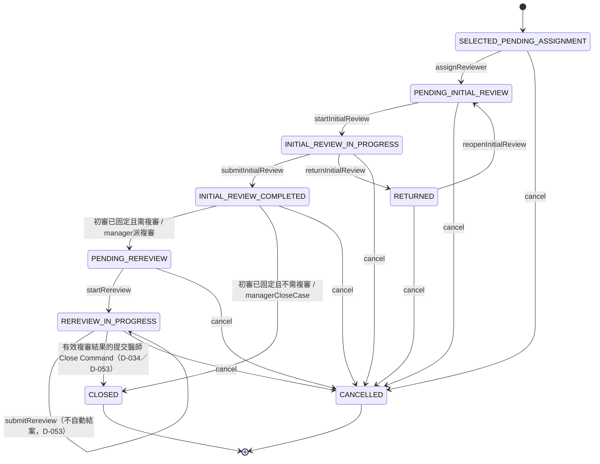
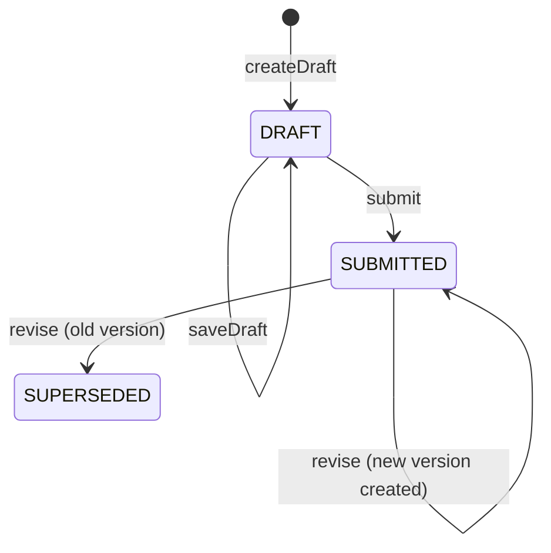
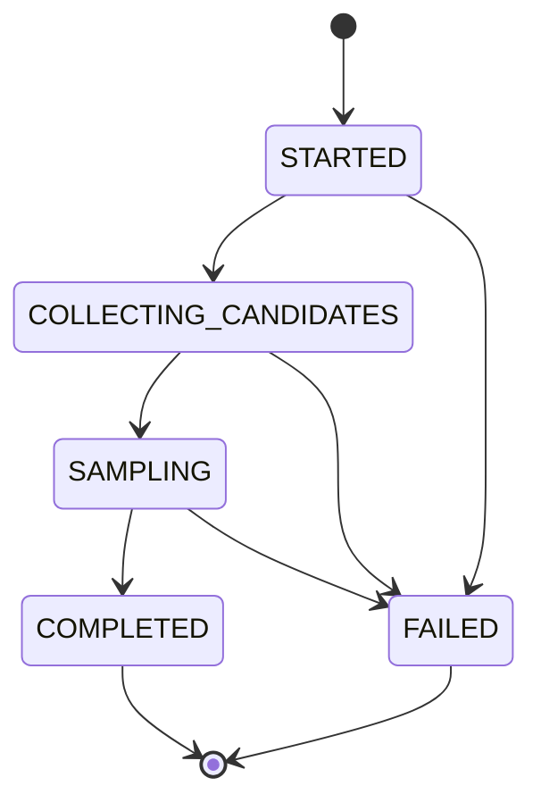

# State Machine Spec v3 (Foundational Convergence)

## 文件狀態
- 類型：更新（整合既有 `docs/02-ddd/state-machine.md`）
- 目的：收斂成可直接支援 frontend state-driven 設計的 domain state truth
- 範圍：ReviewCase / ReviewSubmission / SamplingBatch（sampling 僅最小必要）

---

## 1) Source Inputs

- `docs/01-requirements/decision-log.md`
- `docs/02-ddd/state-machine.md`（v2 既有內容）
- `docs/02-ddd/permission-matrix.md`
- `docs/03-contracts/api-spec.md`
- `docs/05-ui/ui-page-spec-ui006抽選執行頁.md`
- `docs/05-ui/ui-page-spec-ui007抽選批次列表頁.md`
- `docs/05-ui/ui-page-spec-ui009案件列表頁.md`
- `docs/05-ui/ui-page-spec-ui010案件詳情頁.md`
- `docs/05-ui/ui-page-spec-ui011案件分派頁.md`
- `docs/05-ui/ui-page-spec-ui012初審作業頁.md`
- `docs/05-ui/ui-page-spec-ui013複審作業頁.md`
- `docs/05-ui/ui-page-spec-ui014revision歷程頁.md`
- `docs/06-frontend/frontend-design-roadmap.md`

---

## 2) 收斂原則

1. 以 Decision Log accepted decisions 為優先 authority。
2. revision 與 case lifecycle 分離；revision 不等於 reopen。
3. terminal state 需具備 blocked / readonly 說明，供 UI guard 與 action policy 使用。
4. 僅保留現有 spec 可證實的狀態與轉移；無證據者標為 pending confirmation。

---

## 3) ReviewCase State Machine

### 3.1 State List

```yaml
ReviewCaseStatus:
  - SELECTED_PENDING_ASSIGNMENT
  - PENDING_INITIAL_REVIEW
  - INITIAL_REVIEW_IN_PROGRESS
  - INITIAL_REVIEW_COMPLETED
  - PENDING_REREVIEW
  - REREVIEW_IN_PROGRESS
  - RETURNED
  - CLOSED
  - CANCELLED
```

### 3.2 Transition Table

| From | Trigger / Command | To | Domain Guard / Note |
|---|---|---|---|
| SELECTED_PENDING_ASSIGNMENT | assignReviewer | PENDING_INITIAL_REVIEW | reviewer 必填 |
| SELECTED_PENDING_ASSIGNMENT | cancel | CANCELLED | 未開始審查 |
| PENDING_INITIAL_REVIEW | startInitialReview | INITIAL_REVIEW_IN_PROGRESS | 僅 assigned reviewer |
| PENDING_INITIAL_REVIEW | cancel | CANCELLED | 未結案 |
| PENDING_INITIAL_REVIEW | reassignReviewer | PENDING_INITIAL_REVIEW | D-082：改派初審醫師或期限；可改派給原本的醫師（只改期限） |
| INITIAL_REVIEW_IN_PROGRESS | submitInitialReview | INITIAL_REVIEW_COMPLETED | 先形成 submitted 初審版本 |
| INITIAL_REVIEW_IN_PROGRESS | returnInitialReview | RETURNED | 需有退回原因 |
| INITIAL_REVIEW_IN_PROGRESS | cancel | CANCELLED | 未結案 |
| RETURNED | reopenInitialReview | PENDING_INITIAL_REVIEW | 回到待初審；沿用原本的初審醫師與期限，不要求先改派（D-080） |
| RETURNED | cancel | CANCELLED | D-080：未結案 |
| INITIAL_REVIEW_COMPLETED | fixInitialReview（score ≤ threshold 或 threshold 為 null） | INITIAL_REVIEW_COMPLETED | D-054：狀態不變，記下 `initialFixedAt`／`initialFixedBy`／`initialFixedSubmissionId`；等 manager 派複審或結案 |
| INITIAL_REVIEW_COMPLETED | fixInitialReview（score > threshold） | PENDING_REREVIEW | D-031／D-054：以固定結果自動進複審；提交時不執行此轉移 |
| INITIAL_REVIEW_COMPLETED | managerAssignRereviewer | PENDING_REREVIEW | D-031：初審已固定，manager 手工派複審 |
| INITIAL_REVIEW_COMPLETED | managerCloseCase | CLOSED | D-031：初審已固定且不需複審，manager 手工結案 |
| INITIAL_REVIEW_COMPLETED | cancel | CANCELLED | D-080：未結案 |
| PENDING_REREVIEW | startRereview | REREVIEW_IN_PROGRESS | 僅 assigned rereviewer |
| PENDING_REREVIEW | cancel | CANCELLED | 未結案 |
| PENDING_REREVIEW | reassignRereviewer | PENDING_REREVIEW | D-082：須已指派複審醫師（否則 `NO_REREVIEWER_ASSIGNED`）；複審中不得改派（D-055） |
| REREVIEW_IN_PROGRESS | cancel | CANCELLED | D-080：未結案 |
| REREVIEW_IN_PROGRESS | submitRereview | REREVIEW_IN_PROGRESS（最新複審提交為 SUBMITTED） | D-032：合法提交且無其他既有阻擋條件即具資格；不自動固定／結案；不新增 enum（D-053） |
| REREVIEW_IN_PROGRESS（最新複審提交為 SUBMITTED） | 合法有效複審結果提交醫師另行 Close Command | CLOSED | D-032／034：執行時重驗資格與有效版本，同時固定尚未固定的複審結果；CLOSED 即代表已固定（D-053） |

### 3.3 Terminal / Blocked Notes

```yaml
terminal_states:
  - CLOSED
  - CANCELLED
blocked_behavior:
  CLOSED:
    - no_state_transition
    - no_new_initial_submit
    - no_new_rereview_submit
    - no_revision
  CANCELLED:
    - no_state_transition
    - no_initial_or_rereview_commands
    - no_revision
```

### 3.4 Role / Assignment 關聯

- `startInitialReview`：需 actor = assigned `REVIEWER`
- `startRereview`：需 actor = assigned `REREVIEWER`
- assignment / re-assignment commands：`HOSPITAL_MANAGER`
- revision actor guard 見 ReviewSubmission lifecycle

### 3.5 Mermaid



---

## 4) ReviewSubmission Lifecycle

### 4.1 State List

```yaml
ReviewSubmissionStatus:
  - DRAFT
  - SUBMITTED
  - SUPERSEDED
stage:
  - INITIAL
  - REREVIEW
```

### 4.2 Transition Table

| From | Trigger / Command | To | Guard / Note |
|---|---|---|---|
| (none) | createDraft(initial/rereview) | DRAFT | 對應 stage 必須合法 |
| DRAFT | saveDraft | DRAFT | append field changes |
| DRAFT | submit | SUBMITTED | 提交不等於固定；初審不立即進複審，複審不立即結案（D-031／032） |
| SUBMITTED | revise | SUBMITTED(new revision) + old->SUPERSEDED | append-only（D-004） |

### 4.3 Revision Guard

```yaml
revision_guard:
  initial_revision:
    actor_must_be_original_reviewer: true
    result_fixed_allowed: false
    case_closed_allowed: false
    case_cancelled_allowed: false
  rereview_revision:
    actor_must_be_original_rereviewer: true
    result_fixed_allowed: false
    case_closed_allowed: false  # D-032 supersedes D-021
    case_cancelled_allowed: false
```

### 4.4 Readonly / Blocked Notes

- `SUBMITTED` 版本不可直接覆寫。
- revision 建立新 submission，不 reopen case，不回退 case status。
- 結果固定後、`CLOSED` 或 `CANCELLED` 不允許任何 stage revision。

### 4.5 Mermaid



---

## 5) SamplingBatch Lifecycle（最小必要覆蓋）

### 5.1 State List

```yaml
SamplingBatchStatus:
  - STARTED
  - COLLECTING_CANDIDATES
  - SAMPLING
  - COMPLETED
  - FAILED
```

### 5.2 Transition Table（Minimal）

| From | Trigger | To | Note |
|---|---|---|---|
| STARTED | beginCollect | COLLECTING_CANDIDATES | 建立批次後進入候選蒐集 |
| COLLECTING_CANDIDATES | runSampling | SAMPLING | 開始抽選 |
| SAMPLING | samplingSucceeded | COMPLETED | 產生 selected cases |
| STARTED / COLLECTING_CANDIDATES / SAMPLING | samplingFailed | FAILED | 可由 manager 視規則重跑 |

### 5.3 Terminal / Blocked Notes（UI）

- `COMPLETED`：不再變更批次內容，允許查詢與導頁。
- `FAILED`：可顯示 retry action（僅 manager，且符合 API guard）。

### 5.4 Mermaid



---

## 6) 與 Roadmap 的關係

本文件輸出給 bridge phase 的直接輸入：

- `ui-route-module-map.md`：route guard 依 case/submission terminal 與 role constraints 建模
- `ui-view-model-spec.md`：page mode resolution 需使用本文件狀態與 transition guards
- `ui-api-binding-matrix.md`：command enable/disable 直接映射 trigger legality

---

## 7) Pending Confirmation

1. [Resolved D-031] 不需複審時僅 manager 在初審固定後手工結案；DD-03 已確認固定僅限目前有效初審結果的合法提交醫師。
2. [Resolved D-080] `RETURNED` 後不必先 reassign reviewer 即可 reopen；要換人或改期限，reopen 後以改派處理。
3. sampling retry 的完整 state / error taxonomy 尚未在 DDD 層完整定稿（本版僅最小必要）。
4. [Superseded D-032] CLOSED 複審 revision 例外撤銷。[Resolved D-053] 複審已提交未結案時，案件維持 `REREVIEW_IN_PROGRESS`、最新複審提交為 `SUBMITTED`；不新增 enum。

## 8) 固定與流程 guard（D-031～D-033）

固定為業務事實，不新增 CaseStatus／SubmissionStatus；D-054 定案以案件欄位 `initialFixedAt`（有值即已固定）、`initialFixedBy`、`initialFixedSubmissionId` 表示。初審提交後保持初審完成，未固定不得自動／手工進複審或由 manager 結案；固定後禁止初審 revision。閾值 >、≤、null 分支不變。DD-03：固定僅限目前有效初審結果的合法提交醫師，須驗證有效版本及既有 scope／ownership guard。
複審提交建立合法結果與結案資格，不 CLOSED；原複審提交者可在未固定、未結案、未取消時 revision。正式結案須具資格且 actor 合法，同時固定複審結果。CLOSED 禁止所有 revision／reopen。提交後案件維持 `REREVIEW_IN_PROGRESS`、最新複審提交為 `SUBMITTED`（D-053）。
§3.5 的圖已畫出複審提交與獨立結案（D-053）。盲審不依 CaseStatus 或 SUBMITTED 狀態解除（D-033）。

## DD-03 固定操作 guard

初審已提交且未固定、案件未 CLOSED／CANCELLED，經既有角色／scope／ownership 驗證的目前有效 submission 提交醫師才可固定。無有效提交、DRAFT、SUPERSEDED、actor 不符或 terminal case 均拒絕。固定不是新狀態 enum；成功後禁止直接修改及 revision，並依 §3.2 處理後續流向。
固定與 revision 競爭須在一致的有效版本上判斷：revision 先完成時不可再固定舊版；固定先完成時 revision 拒絕。不得出現同一結果既固定又成功修訂。重複固定的回應語意 UNKNOWN，不預設冪等成功或特定拒絕碼。


## D-034 複審獨立 Close Command 對齊

初審固定後，不需複審由 HOSPITAL_MANAGER 另行結案；需要複審則先合法執行及提交，再由目前有效結果的合法提交醫師另行 Close Command，才進 CLOSED。提交後未結案時，案件維持 `REREVIEW_IN_PROGRESS`、最新複審提交為 `SUBMITTED`，不新增 enum（D-053）。
Close 執行時拒絕 DRAFT、SUPERSEDED、過期／跨案／錯 stage 目標、錯誤 actor／scope，以及 CLOSED／CANCELLED 的新結案轉移。revision 先完成則指向舊版的 close 拒絕；close 先完成則 revision 拒絕，不回退主狀態。既有 CLOSED／CANCELLED 禁止 revision 與 CLOSED 禁止 reopen 不變；已成功 close 的重試回 `CASE_TERMINAL`，不會再次轉移（D-053）。
