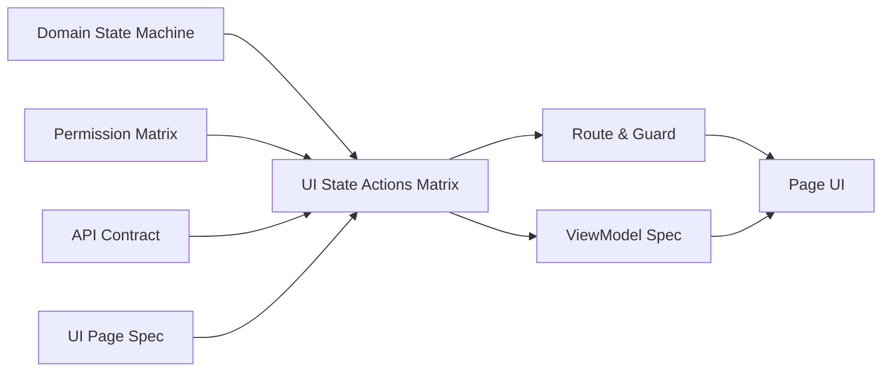

# Frontend Design Method (Foundational Design Truth)

## 文件狀態
- 類型：新增
- 目的：定義本專案 frontend 設計工作規格（非泛用介紹）

---

## 1) 方法目標

本方法固定為：

**UI specification-first / state-driven / domain-aligned / repo-aligned**

目標：在不偷跑 UI implementation 的前提下，先建立可工程化、可驗證、可銜接 Angular/MFE 骨架的設計真相。

---

## 2) Authority Chain

1. `docs/01-requirements/decision-log.md`
2. `docs/02-ddd/permission-matrix.md`
3. `docs/02-ddd/state-machine.md`
4. `docs/03-contracts/api-spec.md`
5. `docs/05-ui/ui-information-architecture.md`
6. `docs/05-ui/ui-page-inventory.md`
7. `docs/05-ui/ui-page-spec-*.md`
8. `docs/06-frontend/frontend-design-roadmap.md`
9. 本文件與同層 foundational 文件

---

## 3) 設計原則

1. 先定義 page responsibility，再談 component。
2. page 是 use-case boundary，不是 container。
3. 先解 business page mode，再處理 loading/data/error。
4. action visibility/executability 必須由統一 policy 推導。
5. metadata-only / FULL 用同頁 projection 切換，不複製頁面。
6. tab 是 query preset，不是新 page。
7. review pages（UI-012/UI-013）是 command pages。
8. UI-010 是 control center，不是欄位全集頁。
9. route/module/view-model/API binding 必須對齊 repo 骨架。
10. 無 spec 證據者只能列 pending confirmation。

---

## 4) 文件分層（Layer 0~3）

```yaml
layer_0_authority:
  - decision-log
  - ddd-state-machine
  - ddd-permission-matrix
  - api-spec

layer_1_ui_authority:
  - ui-information-architecture
  - ui-page-inventory
  - ui-page-specs

layer_2_foundational_frontend_truth:
  - frontend-design-method.md
  - state-machine.md (docs/02-ddd, converged)
  - permission-matrix.md (docs/02-ddd, converged)
  - ui-state-actions-matrix.md
  - frontend-test-scenarios.md

layer_3_bridge_and_execution_next_round:
  - ui-route-module-map.md
  - ui-view-model-spec.md
  - ui-api-binding-matrix.md
  - ui-layout-archetypes.md
  - ui-component-map.md
  - ui-visual-baseline.md
  - ui-wireframe-brief.md
  - ui-design-decisions.md
  - ui-implementation-plan.md
```

---

## 5) page / route / domain / state / action / view-model 關係



---

## 6) Projection 原則（metadata-only / FULL）

- projection 是 `view-mode`，不是 route 分叉。
- route identity 不變：同一 pageId。
- action policy 必須引用 projection：
  - metadata-only：隱藏或降級內容/操作
  - FULL：依 role + status 顯示完整合法能力

---

## 7) Command Page vs Detail Page

| 類型 | 代表頁 | 核心責任 | 禁止事項 |
|---|---|---|---|
| Detail Page | UI-010 | control center、判讀狀態、導頁 | 不在此頁直接 submit/revise |
| Command Page | UI-011/UI-012/UI-013 | 執行 command + guard feedback | 不把 command 語意退化為一般編輯 |

---

## 8) Tab = Query Preset 原則

- tab 只改查詢條件與預設工作視角。
- tab 不得改 page identity、route identity、permission truth。
- tab 切換應保留可追溯 query state（便於 e2e / QA）。

---

## 9) Page Mode 建模原則

```yaml
page_mode_definition:
  must_include:
    - business_semantic_name
    - entry_guard
    - visible_sections
    - action_policy
    - blocked_reason_contract
  must_not:
    - generic_loading_success_error_only
```

---

## 10) Action Policy 建模原則

```yaml
action_policy:
  dimensions:
    - visible
    - executable
    - blocked_reason
  derived_from:
    - role
    - scope
    - assignment_ownership
    - domain_status
    - projection_mode
    - terminal_state
  consistency_rule:
    - same action must share same guard expression across pages
```

---

## 11) Repo-aligned 原則

需可直接銜接 `frontends/quality-inspection-frontend` 骨架：

- `guards/`：route guard + scope guard
- `state/`：page mode state + policy result
- `services/`：API command/query binding
- `features/`、`pages/`：以 page responsibility 建模
- `shell/`：角色導向導航與 entry strategy

---

## 12) 從 foundational truth 銜接 roadmap bridge

1. 以 `ui-state-actions-matrix.md` 產生 route guard 清單。
2. 以 converged state/permission 文件產生 view-model 欄位與 capability flags。
3. 以 action policy 產生 API binding matrix。
4. bridge 文件完成後才進入 layout/component/wireframe/implementation plan。

---

## 13) Definition of Done（frontend design）

以下全滿足才算本階段完成：

- foundational 5 文件齊備且可互相引用。
- 每頁 page mode 有明確業務語意與 blocked reason。
- 每個 action 可追溯至 role + scope + state + API guard。
- metadata-only/FULL 已以 projection 策略落地，不拆平行頁。
- 已列出 spec gaps / pending confirmation。
- 可直接餵給下一輪 `ui-route-module-map`、`ui-view-model-spec`、`ui-api-binding-matrix`。

補充：

- 本文件的完成只代表 frontend design truth / bridge 準備完成，不代表 wireframe、Figma artifact 或可執行 prototype 已完成。
- 若後續要進 wireframe / prototype execution，一般情況下可直接執行，不需要先等待使用者批准。
- 若涉及 Figma / Figma MCP、付費能力，或遇到額度 / 權限 / API / MCP / 方案限制，必須先停下來回報。
- 免費 / 本地方案優先；Figma 不是預設方案。
- 沒有實際 artifact，不得宣稱該 execution 任務完成。

---

## 14) Pending Confirmation

1. UI-011 在 `REREVIEW_IN_PROGRESS` 改派策略仍需 authority 決策定稿。
2. sampling 最小覆蓋之外的 retry taxonomy 仍待補強。
