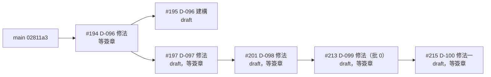

# 工作交接：2026-11-27 三個修法 PR 等簽章、建構先於裁決的缺口、事件的 `detail`

> 交接負責人：Claude Code（本 session，2026-11-26～27）。本文件只整理現況，沒有修改程式。
> 事實的權威來源依序是：`docs/01-requirements/decision-log.md`、GitHub PR 與 CI 紀錄、`docs/harness/25-topic-backlog.md`。本文件與它們衝突時，以它們為準。
> **2026-11-27 稍晚補充**：交接文件寫完之後又做了兩件不需要簽章的工作（及格線對新的偵測器重做、前端回應型別與 HTTP 契約的核對，#203）。結果在第 E-5、E-6 節；剩下還能做的事整理在第 J 節。第 A、D、E-3、H、I 節已跟著更新。
> **第二次補充**：修了 F-1（#204），做了漏網紀錄的盤點（#205）。第 A、D-2、E-3、E-6、H、J 節已跟著更新；新增第 E-7 節。
> **第三次補充（2026-11-28 台北時間，另一個 session 接手時寫）**：#202～#212、#214 都已合併，`main` = `02811a3`。等簽章的鏈多了兩個修法 PR：#213（D-099）、#215（D-100）。第 A、B、C、F、H、I、J 節已改成現況；第 D-1、D-2、E-3、E-6、E-7 節補上後續；新增第 E-8、E-9 節。第 D-3、E-1、E-2、E-4、E-5、G 節沒有動，內容仍是 2026-11-27 的版本。這次補充起初只依據 GitHub 的 PR 清單與各 PR 的說明；之後負責人要求核對 #205～#215，結果在第 D-1c 節（本機重跑了前後端的測試、重算了雜湊、查了 CI）。核對之後 #194 的分支已併入 `main`（`3d0fead`）。**第四次補充（同一天）**：補做了三項當時沒有核對的事，結果在第 D-1d 節：開實驗用的 PR #216 實測前端閘門的空殼（已關閉，沒有合併）、讀 #215 七個失敗範例的訊息、把前端接上本機的真實後端操作。
> **還沒有簽章合併的裁決（D-096～D-100）不在 `main` 的 `decision-log.md` 裡（`main` 停在 D-095），尚未生效。** 本文件引用它們的地方，內容以各自 PR 的分支為準。

---

## A. 一頁摘要

| 項目 | 內容 |
|---|---|
| `main` | `02811a3`（PR #214 合併後，2026-11-28 07:02 台北時間） |
| 卡住的原因 | 負責人暫時無法用實體金鑰簽章。五個修法 PR 排成一條鏈，都在等簽章 |
| 開著的 PR | 6 個，全部在等簽章的鏈上：#194（D-096 修法）、#195（D-096 建構，draft）、#197（D-097 修法，draft）、#201（D-098 修法，draft）、#213（D-099 修法，批 0，draft）、#215（D-100 修法一，draft）。不需要簽章的 PR 都已合併 |
| 下一個動作 | **負責人簽 #194（提交 `3d0fead`）並合併。** 分支已與 `main` 同步。之後的每一步見第 C 節 |
| 不需要簽章的工作 | #191～#193、#196、#198～#200、#202～#212、#214 都已合併。還能做的列在第 J 節 |
| 使用者會遇到的缺陷 | F-1、F-2、案件列表頁的 N-1、N-2 都已修好並合併；2026-11-28 在本機對真實的後端（H2）操作過，行為正確（第 D-1d 節）。還沒有修的：`SYSTEM_ADMIN` 的案件列表與匯出比白名單多（E-10、E-11），要等 #215 簽章合併之後才能建構 |
| 等負責人裁決的 | E-04～E-10 各筆「對 harness 的回應」裡還標著待裁決的（`12-escaped-defects.md`）；第 J-1 節的幾項小修 |
| `main` 的閘門 | 2026-11-28 在 `02811a3` 上本機重跑（JDK 17）：後端 `./gradlew test` 1805 個測試、失敗 0、`BUILD SUCCESSFUL`；前端 typecheck 通過、單元測試 250 個、E2E 20 通過 3 略過；`spec_lint` 通過。CI 上 `02811a3` 的 `law-check`、`spec-check`、`frontend-check`、`law-selftest`、`backend-check` 都成功 |

---

## B. 卡住的 PR

五個修法 PR 都把裁決加在 `decision-log.md` 的檔尾。各自從 `main` 開分支會衝突，所以疊成一條鏈：#215 疊在 #213 上，#213 疊在 #201 上，#201 疊在 #197 上，#197 疊在 #194 上；#195 也疊在 #194 上。



| PR | 分支 | 提交 | 落後 `main` | 內容 | 卡在哪裡 |
|---|---|---|---:|---|---|
| #194 | `claude/happy-tesla-zdfi5t` | `3d0fead` | 0 | D-096：回應 dto 與列表的形狀維持現況、寫成規則；新增 ARCH-06（`application`、`reporting` 不得依賴 Jackson）；`api-spec.md` §3.7 | **負責人的簽章**。2026-11-28 已與 `main`（`02811a3`）同步 |
| #195（draft） | `claude/build-d096-scoresheet-return-types` | `ca7c4af` | 47 | D-096 第 4 點：`ScoreSheetController` 7 個方法的回傳型別寫明。行為不變 | #194 合併。不需要簽章 |
| #197（draft） | `claude/law-d097-build-after-ruling` | `c502d55` | 47 | D-097：建構 PR 要宣告依據的裁決，裁決要已在 base 生效。`law_check.py` 0.9.0、測試 24 個、清冊加 `@build-ruling required`、`AGENTS.md` §5.0.1、`CLAUDE.md` | #194 合併 → 更新分支 → **負責人的簽章** |
| #201（draft） | `claude/law-d098-event-detail` | `c936ba3` | 47 | D-098：事件的 `detail` 改成結構化（只有裁決，沒有規格、範例、閘門、程式的修改） | #197 合併 → 更新分支 → **負責人的簽章** |
| #213（draft） | `claude/law-d099-frontend-gate` | `6954210` | 3 | D-099：前端與 HTTP 契約之間的閘門（草稿 50 的 G-1～G-10）。批 0：前端閘門的設定列為律法（`law/manifest.txt`）。沒有程式的修改 | #201 合併 → 更新分支 → **負責人的簽章** |
| #215（draft） | `claude/law-d100-admin-whitelist` | `2c2a0e3` | 22 | D-100：`SYSTEM_ADMIN` 的案件列表與匯出照白名單收斂（草稿 49、51）。規格、範例、`http.yaml`、比對器、`coverage.txt`、權限矩陣、`api-spec.md`、頁面規格；7 個新範例凍結在已知失敗清單。程式沒有改 | #213 合併 → 更新分支 → **負責人的簽章** |

「落後 `main`」是 2026-11-28 以 `git rev-list --count <分支>..origin/main` 算的。同一天以 `git merge-tree` 模擬把 `main` 併入各分支：#195、#213、#215 沒有衝突；#197、#201 在 `docs/harness/25-topic-backlog.md` 衝突（只有這一個檔案，不是律法）。

### 內容雜湊

| PR | 內容雜湊 | 怎麼算的 |
|---|---|---|
| #194 | `sha256:68c0fa83dd5db9d8fb8c1d2b8a40225e791efd8ddde016060741b0bba6fb367c` | `law_check.py --base origin/main --head 3d0fead`（2026-11-28，併入 `02811a3` 之後）。與併入之前的 `60b5f19` 相同；12 項中只有核准簽章未通過。合併沒有衝突，沒有殘留的衝突標記 |
| #197 | `sha256:63444bbf5fd3641215aa4833170d945985f04b120e2ae66c7038600f1f0107b7` | 以 #194 的分支為 base 模擬。**僅供對照**，輪到它時要重算 |
| #201 | `sha256:accd8d0cbd90a639cb444d2cd37282e95caceb8115eba80e01e8c2fd22f27dc9` | 以 #197 的分支為 base 模擬。**僅供對照**，輪到它時要重算 |
| #213 | `sha256:31bcad914a1ce35b07638aee10f4549fdf91b6a5367bde2ca7cf13d17e252b51` | 2026-11-28 重算相同：`law_check.py --base 4388283 --head 32692ed`（分支併入 `main` 之前的那一段；`6954210` 是之後併入 `main` 的 merge 提交）。**僅供對照**，輪到它時要重算 |
| #215 | `sha256:ce17f1dc56fb64c6abc454b3134fe7e3f318d46665aa439b7eb34c702c01b46c` | 2026-11-28 重算相同：`law_check.py --base 6954210 --head 2c2a0e3`。**僅供對照**，輪到它時要重算 |

### CI

下面是 #194、#195、#197、#201 在 2026-11-27 00:27～00:32 UTC 的執行，四個 PR 的結果相同。2026-11-28 查了 #213（`6954210`）、#215（`2c2a0e3`）：結果也相同。#194 推上 `3d0fead` 之後的 CI（2026-11-27 23:19 UTC）：同樣只有 `law-check` 失敗，其餘成功。

| 檢查 | 結果 |
|---|---|
| `check`、`check (windows)` | 成功 |
| `frontend-check` | 成功 |
| `spec-check` | 成功 |
| `law-selftest`、`law-selftest (windows)` | 成功 |
| `law-check` | **失敗**（預期） |

`law-check` 失敗的原因（本機判決的結果；沒有逐一打開 CI 的紀錄核對）：

- #194：只有「有 1 個有效的核准簽章」未通過。
- #195：分類為修法 PR，夾帶程式、沒有簽章。這是刻意的，見第 E-1 節。
- #197：差異裡有 2 筆修法紀錄（含 #194 的）。
- #201：差異裡有 3 筆修法紀錄。
- #213、#215：差異裡分別有 4 筆、5 筆修法紀錄（2026-11-28 本機重算確認）。

---

## C. 解開的順序

| 步驟 | 動作 | 誰 | 備註 |
|---|---|---|---|
| 0 | #194 的分支併入 `main`，回報新的提交與內容雜湊 | 接手的 session | **已做（2026-11-28）**：提交 `3d0fead`，雜湊不變（第 B 節）。`main` 若再前進要重做 |
| 1 | 簽 #194、合併 | 負責人 | 指令見下方 |
| 2 | #195 的分支併入新的 `main`，確認 `law-check` 轉為通過（分類為建構 PR），轉成 Ready、合併 | 接手的 session 確認，負責人合併 | 本機已模擬通過；CI 上還沒看過 |
| 3 | #197 的分支併入新的 `main`，重算內容雜湊並回報 | 接手的 session | **`25-topic-backlog.md` 會衝突**（#206、#209 的說明已預告：待辦的編號）。該檔不是律法，不影響雜湊 |
| 4 | 簽 #197、合併 | 負責人 | **合併之後，下一個 PR 起由 `law_check.py` 0.9.0 判決** |
| 5 | #201 的分支併入新的 `main`，重算內容雜湊並回報 | 接手的 session | 同樣會在 `25-topic-backlog.md` 衝突 |
| 6 | 簽 #201、合併 | 負責人 | |
| 7 | #213 的分支併入新的 `main`，重算內容雜湊並回報 | 接手的 session | 清冊列的 `e2e/tsconfig.json` 現在已經存在（#214）；PR 的說明還寫「現在不存在」，更新分支時順手改 |
| 8 | 簽 #213、合併 | 負責人 | **合併之後，前端的 `package.json`、tsconfig、測試設定是律法**，改它們要修法紀錄與簽章 |
| 9 | #215 的分支併入新的 `main`，重算內容雜湊並回報 | 接手的 session | |
| 10 | 簽 #215、合併 | 負責人 | |
| 11 | 各裁決的建構，見第 F 節 | 接手的 session | 0.9.0 生效之後，提交標題要帶 `D-nnn` 或寫 `Ruling: none — <理由>` |

簽 #194 的指令（負責人的電腦，分支名稱換成各 PR 的分支）：

```powershell
$BRANCH = 'claude/happy-tesla-zdfi5t'
python3 -I harness-core/law_approve.py --head origin/$BRANCH --signer tsengeagle --key C:\Users\tsengeagle\.ssh\law_amendment_sk_backup
```

注意：

- 簽章前後，分支上不能有律法檔案的修改，否則雜湊會變。只併入 `main`（沒有律法修改）不會改變雜湊，#194 已經驗證過兩次。
- ruleset 要求分支與 `main` 同步才能合併。`main` 有新的合併時，鏈上的每個分支都要再同步一次。**在鏈解開之前，每多合併一個 PR 到 `main`，就多一輪同步。**
- #197、#201、#213、#215 現在是 draft，輪到時要先轉成 Ready。

---

## D. 這個 session 完成的工作

狀態定義：**VERIFIED**＝有可核對的 CI 或本機執行紀錄；**IMPLEMENTED_NOT_VERIFIED**＝已實作但沒有驗證。

### D-1 已合併

| PR | 內容 | 狀態 | 證據 |
|---|---|---|---|
| #191 | 建構：D-095 逾期看目前階段的期限；解凍 4 個範例 | VERIFIED | 本機 `./gradlew test` 通過，D-095 的 13 個逾期範例都有執行 |
| #192 | 建構：D-084 第 9 點，前端移除 `finalConclusion`、`rereviewRequired`；清掉 5 份文件裡殘留的 `rereviewRequired` | VERIFIED | 本機 typecheck 通過、單元測試 236 個、E2E 18 通過 3 略過 |
| #193 | 文件：草稿 45（回應 dto 與列表的形狀） | — | 只有文件 |
| #196 | 文件：題目清單加入「建構不得先於它依據的裁決併入主線」 | — | 只有文件 |
| #198 | 建構：清掉 ARCH-02（3 筆）、ARCH-03（1 筆）凍結基線的舊違規 | VERIFIED | 本機 `./gradlew test` 通過；兩個基線檔變成空檔 |
| #199 | 文件：`03-harness-plan.md` 義務對照表與分期進度、`05-current-state.md` 的 2026-11-26 更新、題目清單加三題 | — | 數字的來源寫在 `03-harness-plan.md` 第六節「2026-11-26 的核對」 |
| #200 | 文件：草稿 47（事件的 `detail` 改成結構化） | — | 只有文件；事實是讀程式，沒有實測 |

### D-1b 2026-11-27 之後合併的（第三次補充）

依各 PR 的說明整理；核對的結果在第 D-1c 節。#206～#215 是前一個 session（`session_017vFJAepcmWYhdbKadsUUxb`）做的。

| PR | 內容 | 狀態 | 證據（PR 的說明） |
|---|---|---|---|
| #202 | 文件：本交接文件 | — | |
| #203 | 文件：及格線實驗、前端回應型別與 HTTP 契約的核對 | VERIFIED（本機） | 見 D-2 |
| #204 | 建構：F-1，前端改讀 `owner` | VERIFIED（本機）；沒有對真實的後端執行 | 見 D-2 |
| #205 | 文件：草稿 48、E-04、E-05 | — | |
| #206 | 文件：照草稿 48 的裁決補記 E-06～E-09、「之後怎麼記」；題目清單加兩題 | — | 只有文件 |
| #207 | 文件：F-2 動手前的核對報告（`docs/review/f2-system-admin-metadata-reconciliation-2026-11-27.md`）；E-10 | — | 讀文件與程式，沒有實測 |
| #208 | 建構：F-2，前端處理 `SYSTEM_ADMIN` 的七欄 metadata 形狀；UI-010、UI-014 的頁面規格；修正「Revision 歷程」按鈕的路徑 | VERIFIED（本機）；沒有對真實的後端執行 | 測試先行；typecheck 通過、單元測試 242 個、E2E 19 通過 3 略過 |
| #209 | 文件：草稿 49（`SYSTEM_ADMIN` 的案件列表）、E-11；題目清單加三題 | — | 只有文件 |
| #210 | 建構：案件列表頁的 N-1（篩選送出後端不認得的狀態值）、N-2（沒有用網址的 `batchId`） | VERIFIED（本機）；沒有對真實的後端執行 | 測試先行；單元測試 250 個、E2E 20 通過 3 略過 |
| #211 | 文件：草稿 51（`SYSTEM_ADMIN` 的匯出） | — | 只有文件 |
| #212 | 文件：草稿 50（前端與 HTTP 契約之間的閘門） | — | 只有文件；一次本機的 `law_check` 實驗 |
| #214 | 建構：E2E 的檔案加上型別檢查，接進 `typecheck`（D-099 的批 1）。提交寫 `Ruling: none` | VERIFIED（本機） | typecheck 通過；暫時寫錯型別時 `typecheck:e2e` 失敗；單元測試 250 個、E2E 20 通過 3 略過。`demo-flow.ts` 的 14 處修改只有編譯過 |

### D-1c #205～#215 的核對（2026-11-28）

負責人要求核對。本機 JDK 17、Node 22，在獨立的 worktree 上執行，沒有修改任何分支。

| 核對的項目 | 方法 | 結果 |
|---|---|---|
| #205～#212、#214 已合併、改動的範圍 | `main` 上的合併提交，逐一看改到的檔案 | 九個都在 `main`。#205、#206、#209、#211、#212 只動 `docs/harness/`；#207 只動 `docs/review/`；#208 動前端與兩份頁面規格；#210 只動前端；#214 動 `e2e/` 與 `package.json` |
| `main`（`02811a3`）後端 | `./gradlew test` | 1805 個測試、失敗 0、`BUILD SUCCESSFUL` |
| `main` 前端（#208、#210、#214 的說明） | `npm ci`、`npm run typecheck`、單元測試、E2E | typecheck 通過（含 `tsc -p e2e/tsconfig.json`）；單元測試 250 個通過；E2E 20 通過、3 略過。與 #210、#214 的說明相同 |
| #204：前端讀 `owner` | 讀 `cases.service.ts` | `owner: boolean`，對應到 view model 的 `isOwner` |
| #210：`case-status.ts` 的九個值 | 與 `specs/review-case/model.yaml` 的列舉比對 | 九個值完全相同 |
| #214：`typecheck` 接上 E2E | 讀 `package.json` | `typecheck` 是 `ng build` 之後接 `typecheck:e2e` |
| `main` 的 CI | GitHub Actions，`02811a3` 的 push | 五個 workflow 都成功。#214 的 PR 檢查八項：七項成功、`law-check (post-merge)` 略過 |
| #213 的內容雜湊 | `law_check.py --base 4388283 --head 32692ed` | 與 PR 的說明相同 |
| #213 的清冊 | `law/manifest.txt` 的差異 | 與 PR 說明的表相同（11 個 gate 路徑、1 個 baseline） |
| #215 的內容雜湊 | `law_check.py --base 6954210 --head 2c2a0e3` | 與 PR 的說明相同 |
| #215 後端 | `./gradlew test`（`2c2a0e3`） | 1825 個測試、失敗 7、`BUILD SUCCESSFUL`。失敗的 7 個與 `known-test-failures.txt` 的 7 筆逐一相同 |
| #213、#215 的 `harness-core/tests` | `python3 -m unittest discover` | 各 227 個通過 |
| `main`、#213、#215 的 `spec_lint.py` | 用 CI 的參數（`--design-docs docs/02-ddd --testing-docs docs/04-testing --report-only spec-draft`） | 通過。**不帶參數執行會得到「未通過」**，那不是 CI 的用法 |
| #213、#215 的 CI | PR 的檢查 | `check`、`check (windows)`、`frontend-check`、`spec-check`、`law-selftest`、`law-selftest (windows)` 成功；`law-check` 失敗（預期） |

核對時看到的：

- #213 的分支在寫完 PR 說明之後又併入過 `main`（`6954210` 是 merge 提交）。說明裡「以本分支的前一個提交為 base」指的是 `4388283`，不是現在的 `HEAD~1`。
- #215 的分支沒有包含 #208、#210、#214（落後 22 個提交）。直接拿它與 #213 的 `6954210` 比，會看到前端的檔案被「刪除」，那是落後造成的；#215 自己的修改是 `32692ed..2c2a0e3` 的 20 個檔案，沒有前端的程式。
- 第一次跑 `./gradlew test` 時 Maven Central 回 429（Too Many Requests），重跑就通過。

**沒有核對的**：#205～#212 各文件裡其餘的事實（它們自己也寫明是讀程式得到的；E-10、E-11 與前端四個缺陷的部分已在第 D-1d 節實測）；#215 的對照實驗與比對器的單元測試沒有單獨重做（含在 `./gradlew test` 裡）；#206～#212 各 PR 當時的 CI 沒有逐一查（合併後 `main` 的 CI 是綠的）。

### D-1d 補做的三項實測（2026-11-28）

#### 1. 前端閘門的指令換成空殼（#216，已關閉，沒有合併）

#213 的立法理由裡「`frontend-check` 會是綠的」原本是從 workflow 推得的。這個實驗在 #213 合併之後做不出來（`package.json` 會是律法），所以先做。負責人同意開實驗用的 PR。

| 項目 | 內容 |
|---|---|
| 修改 | `package.json` 的 `typecheck`、`test:unit:ci`、`test:e2e` 都改成 `echo skipped`（提交 `9cb9bd2`，分支 `claude/experiment-fe-gate-empty-shell`） |
| `frontend-check` | **成功**，51 秒（`main` 上約 2 分鐘）。紀錄裡 `npm run test:e2e` 這一步只印出 `skipped` |
| `law-check` | **成功**（分類為建構 PR） |
| 其餘 | `check`、`check (windows)`、`spec-check`、`law-selftest` 成功 |

結論：#213 合併之前，一個建構 PR 可以把前端的三道檢查都換成空殼而 CI 全綠。只讀了紀錄的最後 70 行（看到 `test:e2e` 那一步），`typecheck`、`unit` 兩步沒有逐行讀。

#### 2. #215 七個凍結範例的失敗訊息

在 `2c2a0e3` 上重跑 `./gradlew test`，讀測試報告。失敗的原因都是預期的那一種，沒有別的斷言失敗：

| 範例 | 失敗訊息 |
|---|---|
| `admin_list_is_a_whitelist`、`lists_a_closed_case_for_a_system_admin_over_http` | `content[*]` 有清單以外的屬性：`projectId`、`medicalRecordType`、`sourceCaseKey`、`createdAt`、`assignedAt` |
| `lists_an_unassigned_case_for_a_system_admin_over_http` | 同上，沒有 `assignedAt`（還沒有分派） |
| `admin_list_does_not_take_the_medical_record_type` | `content[caseId=…]` 選不到任何一筆（現在的程式照 `medicalRecordType` 篩掉了） |
| `system_admin_export_has_no_scores`、`exports_masked_scores_for_a_system_admin_over_http`、`exports_an_unassigned_case_for_a_system_admin_over_http` | `rows[*]` 有清單以外的屬性：`projectId`、`maskedFields` |

這等於是 E-10、E-11 的實測（原本是讀程式與契約得到的）。

#### 3. 前端接上真實的後端

**環境**：`main`（`02811a3`）的後端以 `./gradlew bootRun` 在本機啟動（`local` profile，H2 記憶體資料庫）；資料全部經由 HTTP 建立（建專案 → 建評分表、加一節、發布 → 綁定 → 發布專案、啟用 → 抽選，得到 20 筆案件 → 把一筆分派給 `rev-1`）。前端以 `ng serve --configuration=standalone` 經 `proxy.conf.js` 接上後端，Playwright 操作頁面並記下每一個 API 回應。

直接打 API：

| 檢查 | 結果 |
|---|---|
| 案件詳情，被分派的初審醫師 | 200；有 `owner: true`，沒有 `isOwner` |
| 案件詳情，`HOSPITAL_MANAGER`、`AUDITOR` | 200；`owner: false` |
| 案件詳情，別的初審醫師 | 403 `ACCESS_DENIED` |
| 案件詳情，`SYSTEM_ADMIN` | 200；正好七欄：`caseId`、`caseStatus`、`hospitalId`、`projectName`、`reviewerId`、`rereviewerId`、`updatedAt` |
| 列表 `status=PENDING`、`status=IN_PROGRESS` | 400 `BAD_REQUEST`（`Invalid status: …`） |
| 列表帶 `batchId` | 該批次的 20 筆；不存在的批次 0 筆 |
| 列表，`SYSTEM_ADMIN`（**E-10 在 `main` 上重現**） | 每一筆有 `projectId`、`medicalRecordType`、`sourceCaseKey`、`createdAt`、`assignedAt` |
| 匯出，`SYSTEM_ADMIN`（**E-11 在 `main` 上重現**） | 每一列有 `projectId`、`createdAt`、`closedAt`、`maskedFields` |

在瀏覽器操作前端：

| 缺陷 | 角色 | 操作 | 結果 |
|---|---|---|---|
| N-2 | `HOSPITAL_MANAGER` | 開 `/cases?batchId=…` | 顯示「批次：…」；請求帶 `batchId`，200 |
| N-1 | `HOSPITAL_MANAGER` | 逐一點七個篩選按鈕 | 七個請求的 `status` 都是後端的狀態值，全部 200，每一個都帶著 `batchId`；按「清除」之後的請求不帶 |
| F-2 | `SYSTEM_ADMIN` | 開案件詳情 | 模式「控制中心（Metadata）」；metadata 區塊顯示專案、院區、初審醫師、複審醫師、最後更新；沒有錯誤 |
| F-2 | `SYSTEM_ADMIN` | 點「Revision 歷程」 | 導到 `/cases/{id}/revisions`，顯示「Metadata 歷程」，兩個 API 都 200 |
| F-1 | 被分派的初審醫師 | 開案件詳情 | 模式「受限檢視」（修正前會落到唯讀） |

三個情境的瀏覽器主控台與頁面都沒有錯誤。

**限制**：

- standalone 模式的操作者寫死在 `standalone-mock-actor-context.source.ts`（`HOSPITAL_MANAGER`）。`SYSTEM_ADMIN` 與初審醫師兩個情境是**暫時在本機改這個檔**、同時用 `QI_DEMO_ROLE`、`QI_DEMO_USER_ID` 讓 proxy 帶對應身分的 `api-key` 做出來的。修改沒有提交，已還原。hosted（shell）模式沒有試。
- 資料庫是 H2，不是 Oracle。
- 只走了上表的路徑：案件還沒有任何提交，歷程是空的；F-3（提交明細的 `answers`）、F-4～F-6 沒有碰到。沒有測修正前的版本（F-1「修正前會落到唯讀」是 #204 的說明）。
- 驅動腳本是一次性的，放在 session 的暫存目錄，沒有進 repo。要留下來的話，對應的是 D-099 的批 5（打真實後端的 E2E），還沒有起草。
- `api-key` 只解碼不驗簽（由 gateway 驗），本機才能自己組。

### D-2 還沒合併（第 B 節）

> 第三次補充：下表的 #202～#205 已合併。仍然開著的是 #194、#195、#197、#201，加上 #213（只有裁決與清冊，本機 `harness-core/tests` 227 個通過）、#215（VERIFIED，本機：`./gradlew test` 1825 個測試，失敗的 7 個與已知失敗清單相同；比對器的新規則有 4 個單元測試與對照實驗）。#213、#215 的證據抄自 PR 的說明。


| PR | 狀態 | 證據 |
|---|---|---|
| #194 | VERIFIED（本機） | ARCH-06 建立基線前失敗、之後通過；暫時在 `SamplingPreviewResult` 加 `@JsonInclude`，規則失敗，還原後通過；違規樣本測試 5 個通過 |
| #195 | VERIFIED（本機） | `./gradlew test` 通過 |
| #197 | VERIFIED（本機與 CI 的 `law-selftest`）；**0.9.0 沒有在 GitHub 上判決過任何 PR** | `harness-core/tests` 227 個通過；缺口的實測；回放 53 個已合併的 PR |
| #201 | — | 只有裁決與文件 |
| #202 | — | 本文件 |
| #203 | VERIFIED（本機） | 及格線實驗 28 組的結果與驅動腳本；前端 27 個呼叫的比對結果與腳本。只有文件，沒有改程式 |
| #204 | VERIFIED（本機）；沒有對真實的後端執行 | 修 F-1。先把假回應改成 `owner`，單元測試 1 個失敗（`Expected $.isOwner = undefined to equal true`）；改程式後 typecheck 通過、單元測試 236 個、E2E 18 通過 3 略過；比對腳本重跑，差異消失 |
| #205 | — | `12-escaped-defects.md` 新增 E-04、E-05；草稿 48。只有文件 |

### D-3 已知的紀錄錯誤

| 錯誤 | 處理 |
|---|---|
| 更新 #201 時，解衝突的腳本檢查失敗，但後面的提交與推送照樣執行，把帶著衝突標記的 `25-topic-backlog.md` 推上了 #201（提交 `14f1e93`） | 已修正（`c936ba3`）。四個分支的 `docs`、`law`、`harness-core`、`specs`、`AGENTS.md`、`CLAUDE.md` 都掃過，沒有殘留的衝突標記。該檔不是律法，雜湊不受影響。#201 的歷史裡會留下這兩個提交 |
| 草稿 45 第六節寫「33 個事件類別」「其餘 11 個」 | 草稿 47 更正為 32 個、10 個。**草稿 45 本身沒有回頭改** |
| 草稿 46 事實 12 寫「D-013～D-016 的狀態寫法不同，沒有逐一看」 | 查證後只是標題與狀態之間少一個空行，96 個裁決的狀態都讀得出來。寫在 D-097 的 Evidence |

---

## E. 這個 session 發現的缺口

### E-1 建構可以先於它依據的裁決併入主線（→ D-097，#197）

- **缺口**：建構 PR 只要不碰律法路徑、改的是已立法的檔案，`law-check` 就判為建構 PR 而通過，不管它依據的修法 PR 有沒有簽章合併。
- **怎麼發現的**：#194 等簽章時先做了 #195。#195 被擋下，是因為分支刻意疊在 #194 上；負責人指出這應該由閘門擋。
- **實測**（本機，沒有推送）：把 #195 的修改做成一個從 `main` 開出來的提交。0.8.0 判為建構 PR、通過；啟用新規則後未通過：「D-096 不在 base 的 decision-log.md」。
- **回放**：新規則套到淺層複製看得到的 53 個已合併 PR：修法 27 個不檢查；建構 24 個裡 2 個只改文件、21 個通過、1 個未通過（#175，清理沒有使用的 dto，應該寫 `Ruling: none`）；2 個無法評估。過去沒有發生過建構先於裁決，靠的是順序紀律。
- **現況**：#197 合併之前，這個缺口仍然開著。在那之前，依據待簽裁決的建構要照 #195 的作法：分支疊在修法分支上，PR 開成 draft。

### E-2 domain 的事件自己組稽核的 JSON 字串（→ D-098，#201）

- 32 個事件類別裡，27 個有 `detail`：`String.format` 17 個、字串相加 4 個、Jackson 5 個、由 use case 組好傳入 1 個。分類是用字串樣式掃的，只打開看了 11 個檔案。
- **潛在的缺陷**：`SamplingBatchFailedEvent` 用 `String.format` 把自由文字的 `failureReason` 帶進 JSON，內容有引號、反斜線或換行時會寫出不合法的 JSON（與 D-080 第 5 點修掉的同一種）。目前沒有任何行為會產生失敗的批次，走不到。
- **負責人決定不另外止血**，由 D-098 的建構一併修正。**母體來源的介接若先做，要先修這一處**（已寫進 D-098 的條文與題目清單）。

### E-3 已列進題目清單、還沒起草的三題（#199）

| 題目 | 事實 |
|---|---|
| 沒有範例涵蓋的規則 | 規格 384 條規則裡 35 條沒有任何範例（review-case 26、review-submission 4、sampling-batch 3、review-project 2）。`spec_lint.py` 只列出、不擋 |
| 及格線對新的偵測器重做一次 | **實驗已做（#203，已合併），結果見第 E-5 節。** 題目清單上這一題還沒有結案：ARCH-06、建構依據的裁決要等 #194、#197 合併後補做；沒有擋下的三處要不要補，還沒有裁決 |
| 漏網紀錄的維護 | **已盤點（#205）、已裁決並照做（#206），見第 E-7 節。** `12-escaped-defects.md` 現在到 E-11 |

### E-4 還沒有列進題目清單的

| # | 項目 | 說明 |
|---|---|---|
| 1 | ARCH-01、ARCH-04 的舊違規還在 | `ApiKeyAuthFilter`（`infrastructure`）使用 `interfaces` 的 `ApiResponse`；`ActorContextArgumentResolver`（`interfaces`）反過來引用這個 filter。ARCH-01 基線 1 筆、ARCH-04 基線 2 筆。把 filter 搬到 `interfaces` 要先把新檔案登記進 `law/coverage.txt`（要簽章）。負責人還沒有決定怎麼修 |
| 2 | 三個裁決都加在 `decision-log.md` 的檔尾，修法 PR 只能排成一條鏈 | 簽章一卡住，後面全部卡住；`main` 每前進一次，鏈上每個分支都要再同步。這是流程上的摩擦，不是閘門的漏洞 |
| 3 | 各草稿在 `docs/harness/README.md` 的索引、`25-topic-backlog.md` 改到相鄰的行，並行的 PR 幾乎每次都衝突 | 這個 session 解了 5 次；其中一次解錯（第 D-3 節） |
| 4 | `context-map.md:402` 還把 `ruleSnapshotRef` 列在 Sampling → Assignment and Review 的交換清單 | D-084 第 9 點移除的第三個欄位。#192 只處理 `finalConclusion`、`rereviewRequired` |
| 5 | 其他 AI 工具的指示檔沒有 D-097 的寫法 | #197 只改 `AGENTS.md`、`CLAUDE.md`。Copilot、Kiro 等留給 `03-harness-plan.md` 的 2-4 期 |
| 6 | `05-current-state.md` 只更新了最前面一節 | 頁面進度、Oracle、hosted（shell）模式、第五節其餘各項沒有核對。該檔已寫明 |
| 7 | 前端規格仍未納入問題側 | D-060 第 2 點：等後端 harness 完成後再納入。後端問題側現在沒有暫准的範圍 |

### E-5 及格線對新的偵測器重做（#203）

紀錄在 `docs/harness/03-harness-plan.md` 第六節「及格線對新的偵測器重做（2026-11-27）」；驅動腳本 `docs/review/tools-2026-11-27/gate_mutations.py`。`main` = `f9fe97e`，本機 JDK 17，獨立的 worktree，沒有任何修改被提交。

| 類別 | 組數 | 直接擋下 | 間接擋下 | 沒有擋下 |
|---|---:|---:|---:|---:|
| 弄壞偵測器 | 21 | 18 | 1 | 2 |
| 改需求不改程式 | 3 | 3 | 0 | 0 |
| 手寫違規 | 4 | 3 | 0 | 1 |

範例執行器、HTTP 契約比對器、判決程式、規格檢查本身的邏輯，挑到的每一處都有測試看著。沒有擋下的：

| # | 缺口 | 實驗 | 受不受律法保護 |
|---|---|---|---|
| 1 | **建置的測試閘門沒有自己的測試** | `build.gradle` 核對已知失敗清單的那一段改成不擋，再放一個會失敗的測試：建置通過，訊息是「失敗 1（清單 0）」 | 受（`build.gradle` 是 gate）。風險是核准者沒有看出來 |
| 2 | **驗收測試的接線沒有自己的測試** | `AcceptanceExamplesTest` 不把範例交給執行器。全部不執行：只有 HTTP 契約的涵蓋要求間接發現（21 個問題），沒有測試失敗。只跳過名稱以 `rejects` 開頭的範例（216 個）：建置通過 | 受（`acceptance/` 是 gate） |
| 3 | **涵蓋清單有六個範圍以整個目錄登記** | `domain/project/`、`application/project/`、`domain/scoresheet/`、`application/scoresheet/`、`application/audit/`、`interfaces/config/`。在裡面新增檔案（例如新的 use case），`law_check` 通過。試了其中四個目錄 | **不受**。建構 PR 就做得到 |

第 3 項最需要處理：它是唯一一個建構者不必碰律法就能利用的。修法是把這六個目錄改成逐檔登記（`law/coverage.txt`，要簽章），作法同 D-089 第 6 點。

### E-6 前端回應型別與 HTTP 契約的核對（#203）

報告在 `docs/review/frontend-http-contract-reconciliation-2026-11-27.md`；工具在 `docs/review/tools-2026-11-27/`。**所有發現都是讀程式得到的，沒有拿前端去打真實的後端。** 前端的單元測試與 E2E 都用自己寫的 mock，所以下面的差異不會讓任何現有的測試失敗。

| # | 發現 | 影響 | 嚴重度 |
|---|---|---|---|
| F-1 | 案件詳情：後端輸出 `owner`（`isOwner()` 被 Jackson 輸出成 `owner`，契約也寫 `owner`），前端讀 `isOwner`。**已修（#204，已合併）** | 對真實的後端永遠是 `undefined`。案件的初審或複審醫師開案件詳情時，頁面模式是唯讀而不是受限檢視 | 高 |
| F-2 | `SYSTEM_ADMIN` 的案件詳情只有七個欄位（D-084、D-094），前端用同一個型別處理。**已修（#208，已合併）** | `item.submissions.map(...)` 丟出 `TypeError`，案件詳情與修正歷程頁載入失敗 | 高 |
| F-3 | 提交明細的 `masked`、`whitelist` 形狀裡 `answers` 是 null 或不存在，前端直接 `.map` | 目前只有 `full` 形狀被用到，走不到 | 潛在 |
| F-4 | 案件詳情的 `submissions[]` 沒有 `comment`、`supersededBySubmissionId`，前端有宣告 | 小 | 低 |
| F-5 | `medicalRecordType`、`sourceCaseKey` 契約可為 null，前端必填 | 只影響顯示 | 低 |
| F-6 | 後端仍在輸出 `rereviewContext.closedRevisionException`（D-032 已撤銷的概念） | 前端不讀。是後端的殘留 | 低 |

修法（報告第六節）：F-1 負責人 2026-11-27 同意改前端，已做（#204）。F-2 先核對頁面規格（#207，M-1～M-6 負責人全部照建議），再改頁面規格與前端（#208）。F-3～F-6 還沒有決定；草稿 50 第八節把 F-3～F-6 與抽選執行頁的 `previewStats` 列為 D-099 批 3 的工作清單。

`docs/06-frontend/frontend-backend-alignment-baseline.md` 第 113 行記載 `isOwner`「由 backend 提供」，欄位有提供，但名稱不同；#204 已補註。

這類漂移目前沒有閘門會擋。報告列了三個方向（E2E 的假資料由契約驗證、前端的型別由契約產生、比對腳本放進 `frontend-check`）。**後續**：草稿 50 已裁決（前端的回應型別由契約產生），條文是 D-099（#213，等簽章），見第 E-9 節。

### E-7 漏網紀錄的盤點（#205）

`docs/harness/12-escaped-defects.md` 新增 E-04（F-1）、E-05（F-2），「對 harness 的回應」都是待裁決。草稿 `docs/harness/48-escaped-defects-inventory-draft.md` 盤點 2026-11-18 之後找到的缺陷。來源是 `decision-log.md` D-061～D-095 的起因與 Evidence，**沒有重新實測，沒有逐一打開各草稿**。

| 類別 | 筆數 | 說明 |
|---|---|---|
| A：立法時在未立法（暫准）的範圍找到的 | 30 筆以上，沒有精確數 | 全部已經立法。這段時間最有效的偵測器是立法過程本身（起草前用暫時的範例實測） |
| B：已經立法之後才發現的 | 6 | D-081（規則照做仍做出不能用的流程）、D-078（遮罩的白名單漏了一種）、D-079（範例沒比對到的欄位）、D-091（宣告的 JDK 版本沒有被執行過）、E-04、E-05 |
| C：閘門或流程本身 | 4 | 建構先於裁決；及格線實驗的三處；衝突標記被推上 PR 而沒有檢查會擋；現況文件過期八天沒有人發現 |

**第三次補充**：負責人 2026-11-27 對 L-1～L-5 全部照建議裁決，已照做（#206）：E-06～E-09 已記、A 類寫成一節說明、「之後怎麼記」已寫進 `12-escaped-defects.md`、題目清單新增「植入測試」「文件的衝突標記與過期」。還沒有做的：L-4 寫進給 AI 的指示（`AGENTS.md`、`.ai/` 是律法，要簽章）；這份裁決沒有編號，沒有寫進 `decision-log.md`；E-04～E-10 各筆的回應裡標著待裁決的。

當時待裁決的題目（草稿 48 第三節）：

| 題 | 內容 | 建議 |
|---|---|---|
| L-1 | A 類算不算漏網 | 不逐筆記，寫一節說明與指向 |
| L-2 | B 類怎麼記 | 四筆舊案逐筆記成 E-06～E-09；偵測器的回應另外裁決 |
| L-3 | C 類算不算 | 不記在漏網紀錄，列進題目清單 |
| L-4 | 之後誰在什麼時候記 | 綁在草稿與修缺陷的 PR 上 |
| L-5 | 要不要做植入測試 | 排成一題，用及格線實驗的驅動腳本跑 |

B 類四筆舊案「當時已經立法」是依裁決的先後判斷的，沒有回到當時的 `coverage.txt` 核對；D-079 那一筆尤其要確認。

---

### E-8 `SYSTEM_ADMIN` 的案件列表與匯出比白名單多（E-10、E-11 → D-100，#215）

第三次補充。依草稿 49、51 與 #215 的說明整理；草稿的事實都是讀程式與文件得到的，沒有實測。

- **缺陷**：`SYSTEM_ADMIN` 只能看 metadata，欄位有白名單（D-036、`permission-matrix.md` §5.1）。案件詳情照白名單收斂了，列表與匯出沒有。

  | 端點 | 多拿到的 | 裁決之後每一筆 |
  |---|---|---|
  | `GET /review-cases` | `projectId`、`medicalRecordType`、`sourceCaseKey`、`createdAt`、`assignedAt` | `caseId`、`batchId`、`hospitalId`、`status`、`reviewerId`、`rereviewerId`、`dueAt`、`projectionType` |
  | `POST /reports/export` | `projectId`；兩個分數是 null 加 `maskedFields` | `caseId`、`hospitalId`、`status`、`reviewerId`、`rereviewerId`、`createdAt`、`closedAt` |

- **為什麼沒被擋下**：D-088 把 HTTP 契約「照程式」立法，程式既有的缺陷被寫成律法，之後閘門反而保護它。
- **裁決**：草稿 49（W-1～W-9）、草稿 51（X-1～X-8）併成 D-100。寫條文時多出兩件草稿沒有的事（空的列表同時符合兩種形狀，要改比對器；只有新的 `metadata` 形狀標 `transition`），負責人 2026-11-27 另外裁決照建議。
- **現況**：#215 是修法一。程式沒有改，7 個新範例凍結在 `known-test-failures.txt`。**缺陷在 `main` 上仍然存在。**
- **之後**：建構（後端的列表與匯出、解凍 7 個範例；前端的列表頁與匯出頁）→ 修法二（`http.yaml` 拿掉兩個 `transition`；`coverage.txt` 刪掉沒有用到的類別）。

### E-9 前端閘門的設定不受律法保護（→ D-099，#213）

第三次補充。依草稿 50 與 #213 的說明整理。

- **缺口**：`frontend-check` 執行的是 PR 帶來的 `package.json` 裡的指令，而前端原本只有 `CLAUDE.md` 是律法。本機實驗（沒有推送）：把 `typecheck`、`test:unit:ci`、`test:e2e` 都改成 `echo skipped`，`law_check` 判為建構 PR、通過。「`frontend-check` 會是綠的」是從 workflow 的內容推得的，沒有真的開 PR。
- **現況**：#213 合併之前，這個缺口仍然開著。
- **D-099 的分批**（草稿 50 的 G-10）：

  | 批 | 內容 | 狀態 |
  |---|---|---|
  | 0 | 前端閘門的設定列為律法（G-9） | #213，等簽章 |
  | 1 | E2E 的型別檢查（G-5 的前提） | **已合併（#214）** |
  | 2 | 由契約產生前端回應型別的產生器（`tools/contract/`，清冊列為 gate） | 沒有做。#213 合併後要簽章 |
  | 3 | service 的 dto 換成產生的型別、58 處假回應改寫，處理浮出來的差異（F-3～F-6、`previewStats`） | 沒有做。純前端，但要等批 2 |
  | 4 | 落後清單與比對（`contract-lag.txt`，baseline）、涵蓋的清單（G-6）；要簽章。D-100 第 16 點：要包含案件列表與匯出兩個端點 | 沒有做 |

  批 2～4 的內容是照草稿 50 與 PR 的說明摘的，動工前以草稿 50 第八節與 D-099 的條文為準。

---

## F. 進行中的題目

以 `docs/harness/25-topic-backlog.md` 為準。**`main` 上的題目清單沒有反映下表**：它還把 D-097、D-098、D-100 的題目列在待辦，「案件列表頁的兩個前端缺陷」寫「尚未處理」（已由 #210 修正）；各修法 PR 的分支上有更新的版本，合併時會帶進來。

| 題目 | 裁決 | 現況 | 下一步 |
|---|---|---|---|
| 回應 dto 與列表的形狀 | D-096（#194） | 修法等簽章；建構 #195 已做完 | 簽 #194 → 合併 #195 |
| 建構不得先於它依據的裁決併入主線 | D-097（#197） | 修法已備妥，沒有建構 PR | 簽 #197 |
| 事件的 `detail` 改成結構化 | D-098（#201） | 修法一（只有裁決）已備妥 | 簽 #201 → **向負責人確認第 6 點的範圍** → 建構 PR（特徵測試先行）→ 修法二（ARCH-06 加上 `domain`） |
| 前端與 HTTP 契約之間的閘門 | D-099（#213） | 批 0 等簽章；批 1 已合併（#214） | 簽 #213 → 批 2～4（第 E-9 節） |
| `SYSTEM_ADMIN` 的案件列表與匯出照白名單收斂 | D-100（#215） | 修法一已備妥 | 簽 #215 → 建構 → 修法二（第 E-8 節） |

D-098 的建構動工前要確認的（草稿 47 第七節）：

1. 逐一打開 32 個事件檔，確認分類。
2. 前端有沒有解析稽核的 `detail`（只用關鍵字找過）。
3. 現有的測試涵蓋了 27 個事件中的幾個。
4. `BigDecimal` 在科學記號情況下，現在的 `%s` 與 Jackson 的輸出是否相同。
5. 基底建構子怎麼換、是否一次改完（**負責人指示動工前再確定**）。

待辦（以題目清單為準）：母體來源的介接（等上線前）、沒有範例涵蓋的規則、及格線對新的偵測器重做一次（實驗已做，題目沒有結案）、漏網紀錄的維護（剩 L-4 與各筆的回應）、植入測試、文件的衝突標記與過期、專案的選擇器（純前端，要先寫頁面規格）；#215 另外新增「`SYSTEM_ADMIN` 讀得到的查詢必須有封閉的範例」。之後：訂定本專案 harness 的有界主張。

---

## G. 環境與操作上的發現

| 發現 | 說明 |
|---|---|
| 雲端 session 的容器只有 JDK 21 | Gradle 7.6.4 在 JDK 21 上跑不起來（`Unsupported class file major version 65`）。要先 `apt-get update && apt-get install -y openjdk-17-jdk-headless`，再 `export JAVA_HOME=/usr/lib/jvm/java-17-openjdk-amd64` |
| 容器沒有 `ssh-keygen` | `harness-core/tests` 的 34 個簽章測試會出錯。`apt-get install -y openssh-client` 之後 203 個（#197 的分支上 227 個）全過 |
| 前端單元測試 | `CHROME_BIN` 指到一支包裝腳本（`/opt/pw-browsers/chromium --no-sandbox "$@"`），再跑 `npm run test:unit:ci -- --browsers=ChromeHeadless` |
| 前端 E2E | `QI_PLAYWRIGHT_CHROMIUM_PATH=/opt/pw-browsers/chromium npx playwright test` |
| ArchUnit 的凍結基線 | 規則的違規清到零時，基線檔變成空檔，不是被刪除，所以只縮短基線免修法。更新基線：`./gradlew test --tests '*ArchitectureRulesTest*' -PupdateArchBaseline` |
| 雲端 session 的分支限制 | 預設只能推到指定的一個分支。負責人 2026-11-26 同意每一題各開一個 `claude/…` 分支 |
| 淺層複製 | 本機只看得到 147 個提交（合併的 PR 53 個）。回放與回溯檢查都受這個限制 |
| 解衝突的腳本 | 檢查失敗時要讓後面的指令停下來（`set -e` 或用 `&&` 串起來）。第 D-3 節的錯誤就是因為用換行分隔 |

---

## H. 殘留的分支

**刪除要負責人同意，都沒有刪。** 2026-11-28 以 `git ls-remote` 核對過下列分支都還在遠端。

| 分支 | 狀態 |
|---|---|
| `claude/happy-tesla-zdfi5t` | #194，使用中 |
| `claude/build-d096-scoresheet-return-types` | #195，使用中 |
| `claude/law-d097-build-after-ruling` | #197，使用中 |
| `claude/law-d098-event-detail` | #201，使用中 |
| `claude/law-d099-frontend-gate` | #213，使用中 |
| `claude/law-d100-admin-whitelist` | #215，使用中 |
| `claude/handoff-2026-11-27` | #202 已合併，可以刪 |
| `claude/gate-verification-and-fe-contract` | #203 已合併，可以刪 |
| `claude/build-fe-case-detail-owner` | #204 已合併，可以刪 |
| `claude/draft-48-escaped-defects` | #205 已合併，可以刪 |
| `claude/escaped-defects-ruling` | #206 已合併，可以刪 |
| `claude/f2-metadata-reconciliation` | #207 已合併，可以刪 |
| `claude/build-fe-metadata-projection` | #208 已合併，可以刪 |
| `claude/draft-49-admin-list-whitelist` | #209 已合併，可以刪 |
| `claude/build-fe-case-list-filters` | #210 已合併，可以刪 |
| `claude/draft-51-admin-export-whitelist` | #211 已合併，可以刪 |
| `claude/draft-50-fe-contract-gate` | #212 已合併，可以刪 |
| `claude/build-fe-e2e-typecheck` | #214 已合併，可以刪 |
| `claude/happy-newton-3vhuen` | 本文件第三、四次補充的分支 |
| `claude/experiment-fe-gate-empty-shell` | #216（實驗，已關閉、沒有合併）。**不能合併**；可以刪 |

2026-11-27 的版本另外列了 `claude/backlog-build-before-law`（#196）、`claude/build-shrink-arch-baseline`（#198）、`claude/docs-harness-status-refresh`（#199）、`claude/draft-47-event-detail`（#200）、`claude/draft-46-build-after-ruling`（沒有開 PR，內容在 #197）、`build/d095-overdue`（負責人的分支，內容已由 #191 合併）為可以刪；這次沒有核對它們還在不在。

遠端另有許多更早的 `claude/*`、`law/*`、`build/*` 分支，沒有盤點。

---

## I. 接手時的起點

1. 讀本文件第 A～C 節，再讀 `docs/harness/25-topic-backlog.md`。
2. 用 GitHub 查 #194、#195、#197、#201、#213、#215 的狀態，確認本文件的提交與雜湊是否仍然正確。`main` 若已經前進，鏈上的分支要再同步（第 C 節的注意事項）。
3. 負責人能簽章時，照第 C 節的順序一步一步做；每一步做完回報新的提交與雜湊，等負責人簽。
4. 負責人仍然無法簽章時，還能做的事在第 J 節。
5. 不要做的：
   - 不要對鏈上的分支（#194、#197、#201、#213、#215）重開分支或改寫歷史；只用 merge 同步。
   - 不要在 #197 合併前，從 `main` 開依據待簽裁決的建構分支。D-098、D-099 批 2～4、D-100 的建構都屬於這一類。
   - 不要提前對 #197、#201、#213、#215 簽章：輪到時同步分支會產生新的提交。
   - 不要刪除任何分支。

---

## J. 不需要簽章、還能做的事

第三次補充改寫。**每一項動手前都要先問負責人。** 2026-11-27 版本列的十四項裡已經做完的：修 F-1（#204）、修 F-2（#207、#208）、漏網紀錄的盤點與裁決之後的後續（#205、#206）。

### J-1 建構（改程式，不碰律法）

| # | 工作 | 依據 | 狀態 | 備註 |
|---|---|---|---|---|
| 1 | 修 F-3～F-5：前端的型別照契約修正、`answers` 加 null 的判斷 | HTTP 契約 | 等負責人決定 | 草稿 50 把它們排進 D-099 的批 3（型別由契約產生之後變成編譯錯誤）。現在先手改，還是等批 3，要負責人決定 |
| 2 | 刪除沒有使用的 `ApiErrorResponse`（`cases.service.ts`） | — | 等負責人決定 | `Ruling: none` 的清理 |
| 3 | 案件列表頁：`INITIAL_REVIEW_COMPLETED`、`RETURNED` 要不要有篩選按鈕；頁面規格寫多選、後端只支援單一狀態 | UI-009 §4.2、§4.3 | 等負責人決定 | #210 留下的 |
| 4 | 案件詳情頁：頁首把狀態顯示兩次；狀態顯示的是代碼，沒有中文名稱 | — | 等負責人決定 | #208 看到、沒有處理的既有行為 |

### J-2 只有文件或唯讀的查證

| # | 工作 | 產出 | 狀態 |
|---|---|---|---|
| 5 | D-098 建構前的唯讀查證（第 F 節的前四件） | 補進草稿 47 第七節 | 沒有做 |
| 6 | 35 條沒有範例的規則逐條分類 | 草稿：每條是「該補範例」還是「不需要範例」 | 沒有做 |
| 7 | ARCH-01、ARCH-04 舊違規的修法選項 | 草稿：`ApiKeyAuthFilter` 搬不搬、401 的本文誰組、共用常數放哪 | 沒有做 |
| 8 | 專案的選擇器 | 頁面規格的草稿（題目清單第 11 題） | 沒有做。純前端，但要先寫頁面規格 |
| 9 | 植入測試、文件的衝突標記與過期 | 各一份草稿（題目清單第 7、8 題） | 沒有做 |
| 10 | E-04～E-10 各筆「對 harness 的回應」裡標著待裁決的 | 整理成一份選項，請負責人逐筆裁決 | 沒有做 |
| 11 | `context-map.md:402` 的 `ruleSnapshotRef` | 一行 | 等負責人判斷該刪還是該改成別的名稱 |

### J-3 做得出來、但要簽章才能合併的（可以先備好）

| # | 工作 | 律法路徑 |
|---|---|---|
| 12 | 涵蓋清單的六個目錄改成逐檔登記（第 E-5 節第 3 項） | `law/coverage.txt` |
| 13 | 建置的測試閘門加上自己的測試（第 E-5 節第 1 項） | `build.gradle` 或 `buildSrc/`，都是 gate。作法還沒有設計 |
| 14 | 驗收測試的接線加上自己的測試（第 E-5 節第 2 項） | `acceptance/`。例如檢查「執行器實際執行的範例數等於列出的範例數」 |
| 15 | `closedRevisionException` 從後端的輸出移除（F-6） | `specs/review-case/http.yaml`，用 `transition` 過渡；另加建構 |
| 16 | L-4（漏網什麼時候記）寫進給 AI 的指示 | `AGENTS.md`、`.ai/` |

這幾項都會再多一個排隊等簽的修法 PR，而且第 12～14 項還沒有裁決。鏈已經有五個修法 PR，建議等它解開之後再開。

### J-4 有疑慮、沒有做的

- **依據待簽裁決的建構**：D-098 的特徵測試、D-099 的批 2（產生器）、D-100 的建構（後端的列表與匯出、前端兩頁）。技術上有些可以不碰律法先做，但依據的裁決還沒有生效。照負責人「建構不得先於裁決」的原則，沒有先做。要先做的話，照 #195 的作法：分支疊在修法分支上，PR 開成 draft。
- #214 是例外：負責人同意它在 #213 之前、以 `Ruling: none` 合併。

### 建議的順序

負責人仍然無法簽章時：

1. 第 5 項（D-098 建構前的唯讀查證）。
2. 第 10 項（漏網紀錄各筆的回應整理成選項）。
3. 第 6 項（35 條沒有範例的規則分類）。
4. 第 8 項（專案的選擇器的頁面規格草稿）。

都只動文件。**鏈解開之前，合併到 `main` 的 PR 越少越好**：每合併一個，鏈上的六個分支就要多同步一輪（第 C 節）。可以把這幾項累積在同一個分支，一次合併。

已知的、使用者在真實環境會遇到的缺陷，現在只剩 E-10、E-11（第 E-8 節），要簽章才能修。
