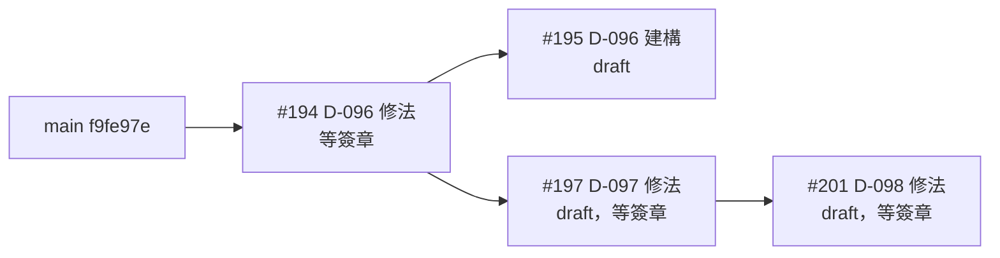

# 工作交接：2026-11-27 三個修法 PR 等簽章、建構先於裁決的缺口、事件的 `detail`

> 交接負責人：Claude Code（本 session，2026-11-26～27）。本文件只整理現況，沒有修改程式。
> 事實的權威來源依序是：`docs/01-requirements/decision-log.md`、GitHub PR 與 CI 紀錄、`docs/harness/25-topic-backlog.md`。本文件與它們衝突時，以它們為準。
> **2026-11-27 稍晚補充**：交接文件寫完之後又做了兩件不需要簽章的工作（及格線對新的偵測器重做、前端回應型別與 HTTP 契約的核對，#203）。結果在第 E-5、E-6 節；剩下還能做的事整理在第 J 節。第 A、D、E-3、H、I 節已跟著更新。
> **還沒有簽章合併的裁決（D-096、D-097、D-098）不在 `main` 的 `decision-log.md` 裡，尚未生效。** 本文件引用它們的地方，內容以各自 PR 的分支為準。

---

## A. 一頁摘要

| 項目 | 內容 |
|---|---|
| `main` | `f9fe97e`（PR #200 合併後） |
| 卡住的原因 | 負責人暫時無法用實體金鑰簽章。三個修法 PR 排成一條鏈，都在等簽章 |
| 開著的 PR | 等簽章的鏈 4 個：#194（D-096 修法）、#195（D-096 建構，draft）、#197（D-097 修法，draft）、#201（D-098 修法，draft）。不需要簽章的 2 個：#202（本文件）、#203（及格線實驗與前端契約核對） |
| 下一個動作 | 負責人簽 #194 並合併。之後的每一步見第 C 節 |
| 不需要簽章的工作 | 已合併：#191、#192、#193、#196、#198、#199、#200。等合併：#202、#203。還能做的列在第 J 節 |
| 最值得先看的發現 | 前端在真實的後端上有兩個行為錯誤（第 E-6 節 F-1、F-2）；閘門有三處弄壞了不會被發現（第 E-5 節） |
| `main` 的閘門 | 後端 `./gradlew test` 通過、已知失敗清單為空（本機 JDK 17，2026-11-27 在 #194 併入 `main` 之後的分支上）。CI 上 #194 的 `check`、`check (windows)`、`frontend-check`、`spec-check`、`law-selftest` 都成功 |

---

## B. 卡住的 PR

三個修法 PR 都把裁決加在 `decision-log.md` 的檔尾。各自從 `main` 開分支會衝突，所以疊成一條鏈：#201 疊在 #197 上，#197 疊在 #194 上；#195 也疊在 #194 上。



| PR | 分支 | 提交 | 內容 | 卡在哪裡 |
|---|---|---|---|---|
| #194 | `claude/happy-tesla-zdfi5t` | `60b5f19` | D-096：回應 dto 與列表的形狀維持現況、寫成規則；新增 ARCH-06（`application`、`reporting` 不得依賴 Jackson）；`api-spec.md` §3.7 | **負責人的簽章**。已與 `main` 同步 |
| #195（draft） | `claude/build-d096-scoresheet-return-types` | `ca7c4af` | D-096 第 4 點：`ScoreSheetController` 7 個方法的回傳型別寫明。行為不變 | #194 合併。不需要簽章 |
| #197（draft） | `claude/law-d097-build-after-ruling` | `c502d55` | D-097：建構 PR 要宣告依據的裁決，裁決要已在 base 生效。`law_check.py` 0.9.0、測試 24 個、清冊加 `@build-ruling required`、`AGENTS.md` §5.0.1、`CLAUDE.md` | #194 合併 → 更新分支 → **負責人的簽章** |
| #201（draft） | `claude/law-d098-event-detail` | `c936ba3` | D-098：事件的 `detail` 改成結構化（只有裁決，沒有規格、範例、閘門、程式的修改） | #197 合併 → 更新分支 → **負責人的簽章** |

### 內容雜湊

| PR | 內容雜湊 | 怎麼算的 |
|---|---|---|
| #194 | `sha256:68c0fa83dd5db9d8fb8c1d2b8a40225e791efd8ddde016060741b0bba6fb367c` | `law_check.py --base origin/main --head 60b5f19`。併入 `main` 前後相同 |
| #197 | `sha256:63444bbf5fd3641215aa4833170d945985f04b120e2ae66c7038600f1f0107b7` | 以 #194 的分支為 base 模擬。**僅供對照**，輪到它時要重算 |
| #201 | `sha256:accd8d0cbd90a639cb444d2cd37282e95caceb8115eba80e01e8c2fd22f27dc9` | 以 #197 的分支為 base 模擬。**僅供對照**，輪到它時要重算 |

### CI（2026-11-27 00:27～00:32 UTC 的執行）

四個 PR 的結果相同：

| 檢查 | 結果 |
|---|---|
| `check`、`check (windows)` | 成功 |
| `frontend-check` | 成功 |
| `spec-check` | 成功 |
| `law-selftest`、`law-selftest (windows)` | 成功 |
| `law-check` | **失敗**（預期） |

`law-check` 失敗的原因（本機判決的結果；沒有逐一打開 CI 的紀錄核對）：

- #194：只有「有 1 個有效的核准簽章」未通過。
- #195：分類為修法 PR，夾帶程式、沒有簽章。這是刻意的，見第 E-1 節。
- #197：差異裡有 2 筆修法紀錄（含 #194 的）。
- #201：差異裡有 3 筆修法紀錄。

---

## C. 解開的順序

| 步驟 | 動作 | 誰 | 備註 |
|---|---|---|---|
| 1 | 簽 #194、合併 | 負責人 | 指令見下方 |
| 2 | 確認 #195 的 `law-check` 轉為通過（分類為建構 PR），轉成 Ready、合併 | 接手的 session 確認，負責人合併 | 本機已模擬通過；CI 上還沒看過 |
| 3 | #197 的分支併入新的 `main`，重算內容雜湊並回報 | 接手的 session | 預期沒有衝突（已經同步到 `f9fe97e`） |
| 4 | 簽 #197、合併 | 負責人 | **合併之後，下一個 PR 起由 `law_check.py` 0.9.0 判決** |
| 5 | #201 的分支併入新的 `main`，重算內容雜湊並回報 | 接手的 session | |
| 6 | 簽 #201、合併 | 負責人 | |
| 7 | D-098 的建構：先向負責人確認第 6 點的範圍，再動工 | 接手的 session | 見第 F 節 |

簽 #194 的指令（負責人的電腦，分支名稱換成各 PR 的分支）：

```powershell
$BRANCH = 'claude/happy-tesla-zdfi5t'
python3 -I harness-core/law_approve.py --head origin/$BRANCH --signer tsengeagle --key C:\Users\tsengeagle\.ssh\law_amendment_sk_backup
```

注意：

- 簽章前後，分支上不能有律法檔案的修改，否則雜湊會變。只併入 `main`（沒有律法修改）不會改變雜湊，#194 已經驗證過一次。
- ruleset 要求分支與 `main` 同步才能合併。`main` 有新的合併時，鏈上的每個分支都要再同步一次。
- #197、#201 現在是 draft，輪到時要先轉成 Ready。

---

## D. 這個 session 完成的工作

狀態定義：**VERIFIED**＝有可核對的 CI 或本機執行紀錄；**IMPLEMENTED_NOT_VERIFIED**＝已實作但沒有驗證。

### D-1 已合併

| PR | 內容 | 狀態 | 證據 |
|---|---|---|---|
| #191 | 建構：D-095 逾期看目前階段的期限；解凍 4 個範例 | VERIFIED | 本機 `./gradlew test` 通過，D-095 的 13 個逾期範例都有執行 |
| #192 | 建構：D-084 第 9 點，前端移除 `finalConclusion`、`rereviewRequired`；清掉 5 份文件裡殘留的 `rereviewRequired` | VERIFIED | 本機 typecheck 通過、單元測試 236 個、E2E 18 通過 3 略過 |
| #193 | 文件：草稿 45（回應 dto 與列表的形狀） | — | 只有文件 |
| #196 | 文件：題目清單加入「建構不得先於它依據的裁決併入主線」 | — | 只有文件 |
| #198 | 建構：清掉 ARCH-02（3 筆）、ARCH-03（1 筆）凍結基線的舊違規 | VERIFIED | 本機 `./gradlew test` 通過；兩個基線檔變成空檔 |
| #199 | 文件：`03-harness-plan.md` 義務對照表與分期進度、`05-current-state.md` 的 2026-11-26 更新、題目清單加三題 | — | 數字的來源寫在 `03-harness-plan.md` 第六節「2026-11-26 的核對」 |
| #200 | 文件：草稿 47（事件的 `detail` 改成結構化） | — | 只有文件；事實是讀程式，沒有實測 |

### D-2 還沒合併（第 B 節）

| PR | 狀態 | 證據 |
|---|---|---|
| #194 | VERIFIED（本機） | ARCH-06 建立基線前失敗、之後通過；暫時在 `SamplingPreviewResult` 加 `@JsonInclude`，規則失敗，還原後通過；違規樣本測試 5 個通過 |
| #195 | VERIFIED（本機） | `./gradlew test` 通過 |
| #197 | VERIFIED（本機與 CI 的 `law-selftest`）；**0.9.0 沒有在 GitHub 上判決過任何 PR** | `harness-core/tests` 227 個通過；缺口的實測；回放 53 個已合併的 PR |
| #201 | — | 只有裁決與文件 |
| #202 | — | 本文件 |
| #203 | VERIFIED（本機） | 及格線實驗 28 組的結果與驅動腳本；前端 27 個呼叫的比對結果與腳本。只有文件，沒有改程式 |

### D-3 已知的紀錄錯誤

| 錯誤 | 處理 |
|---|---|
| 更新 #201 時，解衝突的腳本檢查失敗，但後面的提交與推送照樣執行，把帶著衝突標記的 `25-topic-backlog.md` 推上了 #201（提交 `14f1e93`） | 已修正（`c936ba3`）。四個分支的 `docs`、`law`、`harness-core`、`specs`、`AGENTS.md`、`CLAUDE.md` 都掃過，沒有殘留的衝突標記。該檔不是律法，雜湊不受影響。#201 的歷史裡會留下這兩個提交 |
| 草稿 45 第六節寫「33 個事件類別」「其餘 11 個」 | 草稿 47 更正為 32 個、10 個。**草稿 45 本身沒有回頭改** |
| 草稿 46 事實 12 寫「D-013～D-016 的狀態寫法不同，沒有逐一看」 | 查證後只是標題與狀態之間少一個空行，96 個裁決的狀態都讀得出來。寫在 D-097 的 Evidence |

---

## E. 這個 session 發現的缺口

### E-1 建構可以先於它依據的裁決併入主線（→ D-097，#197）

- **缺口**：建構 PR 只要不碰律法路徑、改的是已立法的檔案，`law-check` 就判為建構 PR 而通過，不管它依據的修法 PR 有沒有簽章合併。
- **怎麼發現的**：#194 等簽章時先做了 #195。#195 被擋下，是因為分支刻意疊在 #194 上；負責人指出這應該由閘門擋。
- **實測**（本機，沒有推送）：把 #195 的修改做成一個從 `main` 開出來的提交。0.8.0 判為建構 PR、通過；啟用新規則後未通過：「D-096 不在 base 的 decision-log.md」。
- **回放**：新規則套到淺層複製看得到的 53 個已合併 PR：修法 27 個不檢查；建構 24 個裡 2 個只改文件、21 個通過、1 個未通過（#175，清理沒有使用的 dto，應該寫 `Ruling: none`）；2 個無法評估。過去沒有發生過建構先於裁決，靠的是順序紀律。
- **現況**：#197 合併之前，這個缺口仍然開著。在那之前，依據待簽裁決的建構要照 #195 的作法：分支疊在修法分支上，PR 開成 draft。

### E-2 domain 的事件自己組稽核的 JSON 字串（→ D-098，#201）

- 32 個事件類別裡，27 個有 `detail`：`String.format` 17 個、字串相加 4 個、Jackson 5 個、由 use case 組好傳入 1 個。分類是用字串樣式掃的，只打開看了 11 個檔案。
- **潛在的缺陷**：`SamplingBatchFailedEvent` 用 `String.format` 把自由文字的 `failureReason` 帶進 JSON，內容有引號、反斜線或換行時會寫出不合法的 JSON（與 D-080 第 5 點修掉的同一種）。目前沒有任何行為會產生失敗的批次，走不到。
- **負責人決定不另外止血**，由 D-098 的建構一併修正。**母體來源的介接若先做，要先修這一處**（已寫進 D-098 的條文與題目清單）。

### E-3 已列進題目清單、還沒起草的三題（#199）

| 題目 | 事實 |
|---|---|
| 沒有範例涵蓋的規則 | 規格 384 條規則裡 35 條沒有任何範例（review-case 26、review-submission 4、sampling-batch 3、review-project 2）。`spec_lint.py` 只列出、不擋 |
| 及格線對新的偵測器重做一次 | **實驗已做（#203），結果見第 E-5 節。** 題目清單上這一題還沒有結案：ARCH-06、建構依據的裁決要等 #194、#197 合併後補做；沒有擋下的三處要不要補，還沒有裁決 |
| 漏網紀錄的維護 | `12-escaped-defects.md` 停在 2026-11-18 的 E-01～E-03，之後有沒有新的漏網沒有人記 |

### E-4 還沒有列進題目清單的

| # | 項目 | 說明 |
|---|---|---|
| 1 | ARCH-01、ARCH-04 的舊違規還在 | `ApiKeyAuthFilter`（`infrastructure`）使用 `interfaces` 的 `ApiResponse`；`ActorContextArgumentResolver`（`interfaces`）反過來引用這個 filter。ARCH-01 基線 1 筆、ARCH-04 基線 2 筆。把 filter 搬到 `interfaces` 要先把新檔案登記進 `law/coverage.txt`（要簽章）。負責人還沒有決定怎麼修 |
| 2 | 三個裁決都加在 `decision-log.md` 的檔尾，修法 PR 只能排成一條鏈 | 簽章一卡住，後面全部卡住；`main` 每前進一次，鏈上每個分支都要再同步。這是流程上的摩擦，不是閘門的漏洞 |
| 3 | 各草稿在 `docs/harness/README.md` 的索引、`25-topic-backlog.md` 改到相鄰的行，並行的 PR 幾乎每次都衝突 | 這個 session 解了 5 次；其中一次解錯（第 D-3 節） |
| 4 | `context-map.md:402` 還把 `ruleSnapshotRef` 列在 Sampling → Assignment and Review 的交換清單 | D-084 第 9 點移除的第三個欄位。#192 只處理 `finalConclusion`、`rereviewRequired` |
| 5 | 其他 AI 工具的指示檔沒有 D-097 的寫法 | #197 只改 `AGENTS.md`、`CLAUDE.md`。Copilot、Kiro 等留給 `03-harness-plan.md` 的 2-4 期 |
| 6 | `05-current-state.md` 只更新了最前面一節 | 頁面進度、Oracle、hosted（shell）模式、第五節其餘各項沒有核對。該檔已寫明 |
| 7 | 前端規格仍未納入問題側 | D-060 第 2 點：等後端 harness 完成後再納入。後端問題側現在沒有暫准的範圍 |

### E-5 及格線對新的偵測器重做（#203）

紀錄在 `docs/harness/03-harness-plan.md` 第六節「及格線對新的偵測器重做（2026-11-27）」；驅動腳本 `docs/review/tools-2026-11-27/gate_mutations.py`。`main` = `f9fe97e`，本機 JDK 17，獨立的 worktree，沒有任何修改被提交。

| 類別 | 組數 | 直接擋下 | 間接擋下 | 沒有擋下 |
|---|---:|---:|---:|---:|
| 弄壞偵測器 | 21 | 18 | 1 | 2 |
| 改需求不改程式 | 3 | 3 | 0 | 0 |
| 手寫違規 | 4 | 3 | 0 | 1 |

範例執行器、HTTP 契約比對器、判決程式、規格檢查本身的邏輯，挑到的每一處都有測試看著。沒有擋下的：

| # | 缺口 | 實驗 | 受不受律法保護 |
|---|---|---|---|
| 1 | **建置的測試閘門沒有自己的測試** | `build.gradle` 核對已知失敗清單的那一段改成不擋，再放一個會失敗的測試：建置通過，訊息是「失敗 1（清單 0）」 | 受（`build.gradle` 是 gate）。風險是核准者沒有看出來 |
| 2 | **驗收測試的接線沒有自己的測試** | `AcceptanceExamplesTest` 不把範例交給執行器。全部不執行：只有 HTTP 契約的涵蓋要求間接發現（21 個問題），沒有測試失敗。只跳過名稱以 `rejects` 開頭的範例（216 個）：建置通過 | 受（`acceptance/` 是 gate） |
| 3 | **涵蓋清單有六個範圍以整個目錄登記** | `domain/project/`、`application/project/`、`domain/scoresheet/`、`application/scoresheet/`、`application/audit/`、`interfaces/config/`。在裡面新增檔案（例如新的 use case），`law_check` 通過。試了其中四個目錄 | **不受**。建構 PR 就做得到 |

第 3 項最需要處理：它是唯一一個建構者不必碰律法就能利用的。修法是把這六個目錄改成逐檔登記（`law/coverage.txt`，要簽章），作法同 D-089 第 6 點。

### E-6 前端回應型別與 HTTP 契約的核對（#203）

報告在 `docs/review/frontend-http-contract-reconciliation-2026-11-27.md`；工具在 `docs/review/tools-2026-11-27/`。**所有發現都是讀程式得到的，沒有拿前端去打真實的後端。** 前端的單元測試與 E2E 都用自己寫的 mock，所以下面的差異不會讓任何現有的測試失敗。

| # | 發現 | 影響 | 嚴重度 |
|---|---|---|---|
| F-1 | 案件詳情：後端輸出 `owner`（`isOwner()` 被 Jackson 輸出成 `owner`，契約也寫 `owner`），前端讀 `isOwner` | 對真實的後端永遠是 `undefined`。案件的初審或複審醫師開案件詳情時，頁面模式是唯讀而不是受限檢視 | 高 |
| F-2 | `SYSTEM_ADMIN` 的案件詳情只有七個欄位（D-084、D-094），前端用同一個型別處理 | `item.submissions.map(...)` 丟出 `TypeError`，案件詳情與修正歷程頁載入失敗 | 高 |
| F-3 | 提交明細的 `masked`、`whitelist` 形狀裡 `answers` 是 null 或不存在，前端直接 `.map` | 目前只有 `full` 形狀被用到，走不到 | 潛在 |
| F-4 | 案件詳情的 `submissions[]` 沒有 `comment`、`supersededBySubmissionId`，前端有宣告 | 小 | 低 |
| F-5 | `medicalRecordType`、`sourceCaseKey` 契約可為 null，前端必填 | 只影響顯示 | 低 |
| F-6 | 後端仍在輸出 `rereviewContext.closedRevisionException`（D-032 已撤銷的概念） | 前端不讀。是後端的殘留 | 低 |

建議的修法（報告第六節，**負責人還沒有決定**）：F-1、F-2 都改前端，因為契約已經寫明後端的形狀，不需要修法。F-1 是小修改；F-2 要先對照七個欄位核對 UI-010、UI-014 的頁面規格。

`docs/06-frontend/frontend-backend-alignment-baseline.md` 第 113 行記載 `isOwner`「由 backend 提供」，欄位有提供，但名稱不同；該文件沒有更正。

這類漂移目前沒有閘門會擋。報告列了三個方向（E2E 的假資料由契約驗證、前端的型別由契約產生、比對腳本放進 `frontend-check`），都還沒有設計。它對應「前端納入問題側」（D-060 第 2 點），題目清單上還沒有這一題。

---

## F. 進行中的題目

以 `docs/harness/25-topic-backlog.md` 為準。下表是 #194、#197、#201 都合併之後的樣子；`main` 上的題目清單目前還把 D-097、D-098 兩題列在待辦。

| 題目 | 裁決 | 現況 | 下一步 |
|---|---|---|---|
| 回應 dto 與列表的形狀 | D-096（#194） | 修法等簽章；建構 #195 已做完 | 簽 #194 → 合併 #195 |
| 建構不得先於它依據的裁決併入主線 | D-097（#197） | 修法已備妥，沒有建構 PR | 簽 #197 |
| 事件的 `detail` 改成結構化 | D-098（#201） | 修法一（只有裁決）已備妥 | 簽 #201 → **向負責人確認第 6 點的範圍** → 建構 PR（特徵測試先行）→ 修法二（ARCH-06 加上 `domain`） |

D-098 的建構動工前要確認的（草稿 47 第七節）：

1. 逐一打開 32 個事件檔，確認分類。
2. 前端有沒有解析稽核的 `detail`（只用關鍵字找過）。
3. 現有的測試涵蓋了 27 個事件中的幾個。
4. `BigDecimal` 在科學記號情況下，現在的 `%s` 與 Jackson 的輸出是否相同。
5. 基底建構子怎麼換、是否一次改完（**負責人指示動工前再確定**）。

待辦（依序）：母體來源的介接（等上線前）、沒有範例涵蓋的規則、及格線對新的偵測器重做一次、漏網紀錄的維護。之後：訂定本專案 harness 的有界主張。D-097 的「這個機制擋不到的」五項與草稿 46 第六節可以直接引用。

---

## G. 環境與操作上的發現

| 發現 | 說明 |
|---|---|
| 雲端 session 的容器只有 JDK 21 | Gradle 7.6.4 在 JDK 21 上跑不起來（`Unsupported class file major version 65`）。要先 `apt-get update && apt-get install -y openjdk-17-jdk-headless`，再 `export JAVA_HOME=/usr/lib/jvm/java-17-openjdk-amd64` |
| 容器沒有 `ssh-keygen` | `harness-core/tests` 的 34 個簽章測試會出錯。`apt-get install -y openssh-client` 之後 203 個（#197 的分支上 227 個）全過 |
| 前端單元測試 | `CHROME_BIN` 指到一支包裝腳本（`/opt/pw-browsers/chromium --no-sandbox "$@"`），再跑 `npm run test:unit:ci -- --browsers=ChromeHeadless` |
| 前端 E2E | `QI_PLAYWRIGHT_CHROMIUM_PATH=/opt/pw-browsers/chromium npx playwright test` |
| ArchUnit 的凍結基線 | 規則的違規清到零時，基線檔變成空檔，不是被刪除，所以只縮短基線免修法。更新基線：`./gradlew test --tests '*ArchitectureRulesTest*' -PupdateArchBaseline` |
| 雲端 session 的分支限制 | 預設只能推到指定的一個分支。負責人 2026-11-26 同意每一題各開一個 `claude/…` 分支 |
| 淺層複製 | 本機只看得到 147 個提交（合併的 PR 53 個）。回放與回溯檢查都受這個限制 |
| 解衝突的腳本 | 檢查失敗時要讓後面的指令停下來（`set -e` 或用 `&&` 串起來）。第 D-3 節的錯誤就是因為用換行分隔 |

---

## H. 殘留的分支

這個 session 開的分支。**刪除要負責人同意，都沒有刪。**

| 分支 | 狀態 |
|---|---|
| `claude/happy-tesla-zdfi5t` | #194 的來源分支，使用中 |
| `claude/build-d096-scoresheet-return-types` | #195，使用中 |
| `claude/law-d097-build-after-ruling` | #197，使用中 |
| `claude/law-d098-event-detail` | #201，使用中 |
| `claude/backlog-build-before-law` | #196 已合併，可以刪 |
| `claude/build-shrink-arch-baseline` | #198 已合併，可以刪 |
| `claude/docs-harness-status-refresh` | #199 已合併，可以刪 |
| `claude/draft-47-event-detail` | #200 已合併，可以刪 |
| `claude/draft-46-build-after-ruling` | 沒有開 PR；內容已經在 #197 裡，可以刪 |
| `claude/handoff-2026-11-27` | #202，使用中 |
| `claude/gate-verification-and-fe-contract` | #203，使用中 |
| `build/d095-overdue` | 負責人的分支；內容已由 #191 合併（cherry-pick） |

遠端另有許多更早的 `claude/*`、`law/*`、`build/*` 分支，這次沒有盤點。

---

## I. 接手時的起點

1. 讀本文件第 A～C 節，再讀 `docs/harness/25-topic-backlog.md`。
2. 用 GitHub 查 #194、#195、#197、#201 的狀態，確認本文件的提交與雜湊是否仍然正確。`main` 若已經前進，鏈上的分支要再同步（第 C 節的注意事項）。
3. 負責人能簽章時，照第 C 節的順序一步一步做；每一步做完回報新的提交與雜湊，等負責人簽。
4. 負責人仍然無法簽章時，還能做的事在第 J 節。
5. 不要做的：
   - 不要對 #197、#201 重開分支或改寫歷史；只用 merge 同步。
   - 不要在 #197 合併前，從 `main` 開依據待簽裁決的建構分支。
   - 不要刪除任何分支。

---

## J. 不需要簽章、還能做的事

2026-11-27 向負責人提過六項，做完兩項（#203）。下面是剩下的，加上 #203 帶出來的新項目。**每一項動手前都要先問負責人**，除非標明「已同意」。

### J-1 建構（改程式，不碰律法）

| # | 工作 | 依據 | 狀態 | 備註 |
|---|---|---|---|---|
| 1 | 修 F-1：前端讀 `owner`，mock 與 E2E 的假資料一起改 | HTTP 契約（D-088） | 等負責人決定 | 小修改。改完用 `npm run typecheck`、單元測試、E2E 驗證。D-097 生效後提交標題要帶 `D-088` |
| 2 | 修 F-2：前端處理 `metadata` 形狀 | D-084、D-094 第 9 點 | 等負責人決定 | 不是小修改。先對照七個欄位核對 UI-010、UI-014 的頁面規格，寫出差異，再改程式 |
| 3 | 修 F-3～F-5：前端的型別照契約修正、`answers` 加 null 的判斷 | HTTP 契約 | 等負責人決定 | 可以與第 1 項一起做 |
| 4 | 刪除沒有使用的 `ApiErrorResponse`（`cases.service.ts`） | — | 等負責人決定 | `Ruling: none` 的清理 |

### J-2 只有文件或唯讀的查證

| # | 工作 | 產出 | 狀態 |
|---|---|---|---|
| 5 | D-098 建構前的唯讀查證（第 F 節的前四件） | 補進草稿 47 第七節 | 沒有做 |
| 6 | 漏網紀錄的回頭盤點 | 草稿：2026-11-18 之後修掉的缺陷哪些算漏網（候選：D-080 第 5 點、D-081、本文件 E-6 的 F-1、F-2），以及之後誰在什麼時候記 | 沒有做。**F-1、F-2 是這次新發現的漏網，還沒有記進 `12-escaped-defects.md`** |
| 7 | 35 條沒有範例的規則逐條分類 | 草稿：每條是「該補範例」還是「不需要範例」 | 沒有做 |
| 8 | ARCH-01、ARCH-04 舊違規的修法選項 | 草稿：`ApiKeyAuthFilter` 搬不搬、401 的本文誰組、共用常數放哪 | 沒有做 |
| 9 | 前端納入問題側的草稿 | 第 E-6 節最後一段的三個方向，寫成選項 | 沒有做。題目清單上還沒有這一題 |
| 10 | `context-map.md:402` 的 `ruleSnapshotRef` | 一行 | 等負責人判斷該刪還是該改成別的名稱 |

### J-3 做得出來、但要簽章才能合併的（可以先備好）

| # | 工作 | 律法路徑 |
|---|---|---|
| 11 | 涵蓋清單的六個目錄改成逐檔登記（第 E-5 節第 3 項） | `law/coverage.txt` |
| 12 | 建置的測試閘門加上自己的測試（第 E-5 節第 1 項） | `build.gradle` 或 `buildSrc/`，都是 gate。作法還沒有設計 |
| 13 | 驗收測試的接線加上自己的測試（第 E-5 節第 2 項） | `acceptance/`。例如檢查「執行器實際執行的範例數等於列出的範例數」 |
| 14 | `closedRevisionException` 從後端的輸出移除（F-6） | `specs/review-case/http.yaml`，用 `transition` 過渡；另加建構 |

這四項都會再多一個排隊等簽的修法 PR，而且第 11～13 項還沒有裁決。建議等 #194 那條鏈解開之後再開。

### J-4 有疑慮、沒有做的

- **D-098 的特徵測試**（把現在每個事件的 `detail` 字串釘住）：只新增測試、不改行為，技術上不碰律法。但它是 D-098 第 4 點的內容，D-098 還沒有生效。照負責人「建構不得先於裁決」的原則，沒有先做。

### 建議的順序

負責人仍然無法簽章時：第 1 項（F-1）→ 第 6 項（漏網紀錄，順便把 F-1、F-2 記進去）→ 第 2 項（F-2 的頁面規格核對）→ 第 5 項。

第 1 項排最前面，是因為它是目前已知唯一一個「使用者在真實環境會遇到」而且修起來很小的缺陷。
