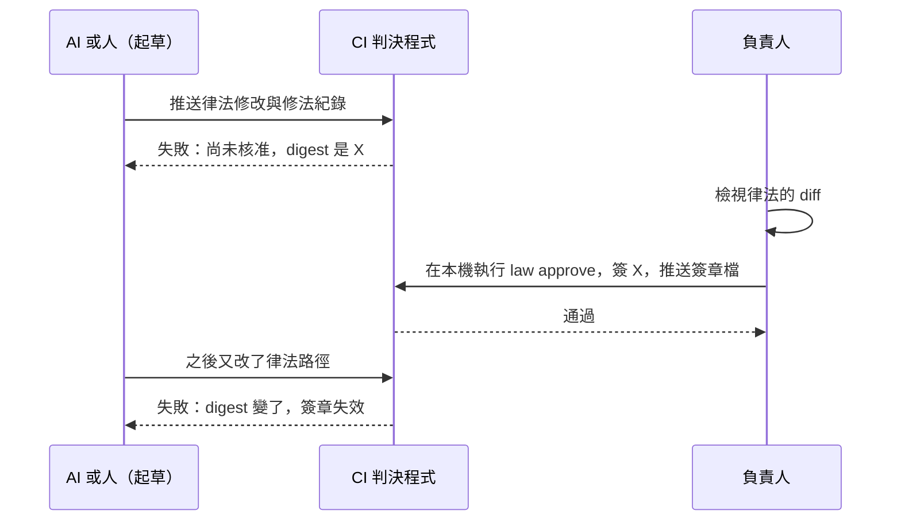

# 修法機制設計（草稿）

狀態：草稿。第 1 期已實作（2026-11-14），見第十節與 `law/README.md`；第 2 期以後尚未實作。

本文件回答一個問題：律法（裁決、規格、閘門、基線、給 AI 的指示）要怎麼改，才能確定每一次修改都經過人的同意，而且不綁定單一 AI 工具或單一 git 平台。

對應的義務是 P6（建構者不得自行修法）與 P4（建構期間律法不變）。

## 一、範圍與前提

2026-11-14 裁決的範圍：

| 項目 | 範圍 |
|---|---|
| git 平台 | GitHub 與 GitLab |
| AI 工具 | Copilot、Codex；之後加入 Kiro。Claude Code 已在使用 |
| code owner 核准 | 本 repo 目前只保留形式（見 `07-github-settings.md` 第二節） |

設計前提：

1. **有強制力的檢查不放在任何 AI 工具的 hook 裡。** 各工具的 hook 能力不同，而且只管得到自己。所有工具都會經過的只有 git、CI、合併三個點。
2. **AI 與人用同一個帳號時，平台的權限分不出兩者。** 核准必須靠一個 AI 拿不到的東西。
3. **判決是確定性的程式。** 判決路徑上沒有語言模型。
4. **不依賴付費功能。** 付費功能可以疊加，但拿掉之後機制仍然成立。

## 二、查證結果（2026-11-14）

設計前查了三件事。來源列在文件最後。

| 題目 | 查到的 | 對設計的影響 |
|---|---|---|
| GitLab 的 code owner 核准 | Code Owners 與合併請求的核准規則都標示為 Premium、Ultimate；保護分支是 Free | 在 GitLab Free 上，平台沒有「必須有人核准」的機制 |
| Copilot 開的 PR 由誰核准 | 要求 Copilot 開 PR 的那個人不能核准該 PR，他的核准不計入必要核准數；Copilot 自己不能核准或合併 | 單人 repo 即使讓 AI 用獨立身分開 PR，也沒有人能核准 |
| 各工具讀哪個指示檔 | Codex 讀 `AGENTS.md`（從 repo 根目錄一路串到工作目錄）；Kiro 讀 `.kiro/steering/`，也會讀 `AGENTS.md` 且一律載入 | `AGENTS.md` 可以當共同的告知管道 |

第二點推翻了先前的建議。先前建議「讓 AI 用另一個身分開 PR，負責人就能核准」，查證後在單人 repo 行不通。

結論：**平台的核准機制不能當主要防線。** 主要防線改為簽章，平台核准在有第二個人之後再疊加。

沒有查到的：

- Codex 在 GitLab 上開合併請求時顯示的作者身分。Codex 的 GitLab 支援目前是 beta。
- Kiro 的 hook 規格。只找到二手資料。
- Copilot 是否讀 `AGENTS.md`。本 repo 已有 `.github/copilot-instructions.md`，不受影響。
- 組織內 GitLab 的版本與方案。

## 三、律法清冊

一份檔案列出哪些路徑是律法、屬於哪一類。CI 的判決程式、`CODEOWNERS`、各工具的本機提醒都讀這一份，不各自維護清單。

位置：`law/manifest.txt`。

**實作時的調整**：下面的 YAML 是設計時的示意。判決程式只用 Python 標準函式庫，而標準函式庫不能讀 YAML，所以實際的清冊改成一行一筆的文字格式（和 `CODEOWNERS` 類似），修法紀錄改成 JSON。內容與規則不變。實際格式見 `law/manifest.txt` 與 `law/README.md`。

```yaml
# law/manifest.yaml（示意）
version: 1
classes:
  ruling:      # 裁決
    paths:
      - docs/01-requirements/decision-log.md
    rule: append-only
  spec:        # 規格
    paths:
      - specs/**
      - spec-draft/**
    rule: amendment-required
  gate:        # 閘門
    paths:
      - services/quality-inspection-service/build.gradle
      - services/quality-inspection-service/src/test/java/**/architecture/**
      - services/quality-inspection-service/src/test/resources/archunit.properties
      - .github/workflows/**
      - .gitlab-ci.yml
      - law/**
    rule: amendment-required
  baseline:    # 凍結基線
    paths:
      - services/quality-inspection-service/known-test-failures.txt
      - services/quality-inspection-service/src/test/resources/archunit_store/**
      - services/quality-inspection-service/src/test/resources/layer-import-baseline.txt
    rule: shrink-only
  tradition:   # 給 AI 的指示
    paths:
      - AGENTS.md
      - CLAUDE.md
      - .github/copilot-instructions.md
      - .ai/**
      - .kiro/steering/**
    rule: amendment-required
```

三種規則：

| 規則 | 意思 |
|---|---|
| `amendment-required` | 任何修改都要有一筆已核准的修法紀錄 |
| `append-only` | 只新增內容時仍要修法紀錄；刪除或改寫既有內容另外標示，核准時要特別看 |
| `shrink-only` | 只刪除行的修改免修法；新增或改寫行要修法紀錄 |

`shrink-only` 的理由：基線變短代表違規被修掉，這是建構工作的正常結果。如果連這個都要修法，建構的 PR 會全部變成修法 PR。

待決定：`docs/harness/` 本身、`docs/02-ddd` 到 `docs/04-testing` 要不要列入。建議先不列，等 `/specs` 上線、`docs/` 降為說明之後再定。

## 四、修法紀錄

每次修法一個檔案，放在 `law/amendments/`。

```yaml
# law/amendments/2026-11-14-arch-05.yaml（示意）
id: 2026-11-14-arch-05
decision: D-048            # 對應的裁決；純閘門修正可填 none 並在 reason 說明
reason: 新增 ARCH-05，限制 reporting 對 application 的依賴
drafted_by: claude-code    # 誰起草的，僅供紀錄
paths:                     # 這次修法涵蓋的律法路徑
  - services/quality-inspection-service/src/test/java/**/architecture/**
digest: sha256:…           # 由工具計算，見下
```

`digest` 把核准綁在確切的內容上。算法：取這個 PR 相對於 base 分支改動的所有律法路徑，每個路徑配上它在 head 的內容雜湊（刪除的檔案記為空），排序後整體再做一次雜湊。

核准之後律法路徑只要再改一個字，`digest` 就不同，核准失效。

## 五、核准：簽章

核准是對 `digest` 的簽章，放在修法紀錄旁邊（`<id>.yaml.sig`）。

| 項目 | 做法 |
|---|---|
| 簽章工具 | OpenSSH 的 `ssh-keygen -Y sign`、`-Y verify`。兩個平台的 CI 映像檔都有，不需要額外安裝 |
| 誰能簽 | `law/allowed_signers` 列出的公鑰。這個檔案本身是律法 |
| 驗章用哪一份公鑰清單 | **base 分支上的那一份**，不是 PR 帶來的 |
| 私鑰放哪裡 | AI 拿不到的地方。建議用需要實體觸碰的硬體金鑰（`sk-` 類型的 SSH 金鑰） |

流程：



這個做法和論文的結構一致：建構者可以起草修訂，但修訂在人接受之前不具效力。

**限制，照實寫**：

- 私鑰如果放在 AI 也在執行的那台機器上，而且 ssh-agent 是解鎖狀態，AI 就能簽。雲端執行的 AI（Copilot、Codex 的雲端模式）碰不到本機金鑰；本機執行的 AI（Claude Code、Kiro、Codex CLI）碰得到。所以才建議硬體金鑰。
- 人可以不看就簽。機制只能保證「有人同意」，不能保證「有人看懂」。
- 每次修法都要手動簽一次。這是刻意的成本。

## 六、CI 的判決規則

一支不依賴平台的腳本（建議 `law/check.sh` 或 Python），輸入是 base 與 head 兩個 commit。

判決步驟：

1. 讀 **base** 上的 `law/manifest.yaml`。
2. 列出 base 到 head 之間改動的檔案，分成律法路徑與非律法路徑。
3. 沒有改到律法路徑：通過。這是建構 PR。
4. 律法路徑的修改全部符合 `shrink-only` 的免修法條件：通過。
5. 其餘情況是修法 PR，依序檢查，任一不成立就失敗：
   - 有且只有一筆新增的修法紀錄。
   - 改動的律法路徑都在紀錄的 `paths` 範圍內。
   - `decision` 指向 `decision-log.md` 裡存在的編號，或是 `none`。
   - 紀錄的 `digest` 等於重新計算的值。
   - 簽章用 base 上的 `allowed_signers` 驗證通過。
6. 修法 PR 不得同時改非律法的程式（P4）。文件與修法紀錄本身除外。

輸出要列出：PR 的分類、涉及的律法路徑與類別、每一項檢查的結果。沒有評估到的項目要列出來，不能算通過。

第 6 點有一個實際問題：新增一條架構規則時，常常要同時修掉它抓到的違規，或把違規凍結進基線。建議的處理：凍結基線算律法修改，可以放在同一個修法 PR；修正式程式要另開 PR。

## 七、判決程式不能被 PR 自己改掉

這是整個機制最容易被忽略的洞。兩個平台預設都用 PR 分支上的 CI 設定來跑 CI，所以 PR 可以連判決程式一起改。

| 平台 | 做法 | 狀態 |
|---|---|---|
| GitHub | 修法檢查用 `pull_request_target` 觸發：它執行 base 分支上的 workflow。腳本只用 git 讀取差異，不執行 PR 裡的任何程式 | 機制是已知的；本 repo 尚未試過 |
| GitLab | 把專案的「CI/CD 設定檔」指向另一個受保護專案裡的檔案，或用合規管線 | **未查證**，包含是否需要付費方案 |
| 兩者共通的後援 | 合併進主分支之後再跑一次：用合併前的主分支上的判決程式，檢查這次合併帶進來的律法修改。失敗就發出警告 | 只能事後發現，不能事前阻擋 |

既有的 `backend-check` workflow 維持用 `pull_request` 觸發，因為它要執行 PR 的程式。兩者分開。

## 八、各工具的接法

| 層 | 內容 | Copilot | Codex | Kiro | Claude Code |
|---|---|---|---|---|---|
| 告知 | 一段固定文字：律法在哪裡、不得自行修改、修法要走什麼流程 | `.github/copilot-instructions.md` | `AGENTS.md` | `AGENTS.md`、`.kiro/steering/` | `CLAUDE.md` |
| 本機提醒 | 寫入律法路徑前擋下或提醒 | 未查證 | 未查證 | 未查證 | `PreToolUse` hook |
| 判決 | CI 的修法檢查 | 相同 | 相同 | 相同 | 相同 |
| 核准 | 簽章 | 相同 | 相同 | 相同 | 相同 |

告知的文字只維護一份，其他檔案引用它，避免四份各自漂移。

本機提醒是加快回饋用的，不是防線。沒有它，機制仍然成立：AI 改了律法，CI 會擋。所以這一層最後做，而且每個工具做之前先查它目前的 hook 規格。

另外加一個不分工具的 git `pre-commit` hook 當本機提醒。它可以被跳過，定位和上面相同。

## 九、與既有機制的關係

| 既有的東西 | 之後的角色 |
|---|---|
| `decision-log.md` | 不變。記錄為什麼；修法紀錄指向它 |
| `.github/CODEOWNERS` | 改由清冊產生，或由 CI 檢查兩者一致。有第二位核准者之後，可以啟用平台的強制核准，作為簽章之外的第二層 |
| `known-test-failures.txt` 與三份基線 | 納入清冊的 `baseline` 類別 |
| `openspec/` | 未定。可以拿它的 change 格式當修法紀錄的起草格式，也可以移除。本設計不依賴它 |
| `03-harness-plan.md` 第四節「law guard 不搬」 | 理由要改寫。原本的理由是「用 CODEOWNERS 和 branch protection 取代」，這個前提在單人 repo 不成立。新的理由是：防線放在 CI 與簽章，所以不需要在本機分析每一道 shell 指令 |

## 十、分期與驗收

每一期都有驗收項目。做法和 `04-definition-of-enough.md` 的及格線相同：親手弄壞一次，看它有沒有擋。

| 期 | 內容 | 驗收 |
|---|---|---|
| 1 | 清冊、判決腳本、GitHub 的接法。此時只做分類與結構檢查，不驗簽章 | 建構 PR 通過；只縮短基線的 PR 通過；改規則但沒有修法紀錄的 PR 失敗；修法 PR 夾帶正式程式的修改失敗；PR 自己改判決腳本，檢查仍以 base 的版本執行 |
| 2 | 簽章 | 沒有簽章的修法 PR 失敗；簽完之後再改律法，失敗；用不在清單上的金鑰簽，失敗；PR 自己把金鑰加進 `allowed_signers`，失敗 |
| 3 | GitLab 的接法 | 在一個 GitLab 專案上重做第 1、2 期的驗收 |
| 4 | 告知文字與本機提醒 | 每個工具各做一次：要求它修改一條架構規則，看它是起草修法紀錄，還是直接改 |

第 1 期做完，修法就看得見、有紀錄、有結構，但還擋不住偽造。第 2 期做完才有強制力。

## 十一、已決定與待決定

2026-11-14 已決定：

| 題目 | 決定 |
|---|---|
| 先做哪一期 | 第 1 期，已完成 |
| 簽章金鑰 | 負責人有實體金鑰，也有自然人憑證。第 2 期以實體金鑰的 SSH 簽章為主；自然人憑證是 X.509，要另外評估驗章工具 |
| GitLab | 先以雲端版（GitLab.com）為起點 |
| 判決程式的語言 | Python 3，只用標準函式庫 |
| 修法 PR 能不能夾帶「把新規則抓到的違規凍結進基線」 | 可以（基線是律法路徑） |
| `decision` 能不能填 `none` | 可以，要在 `reason` 說明 |

2026-11-14 追加的決定：

| 題目 | 決定 |
|---|---|
| 核心要不要獨立於專案之外 | 要。目標是任何 repo 都能安裝。先抽修法機制這個不分語言的核心；Java 與 Gradle 的部分等第二個 Java 專案再抽 |
| 核心放哪裡 | 先放在本 repo 的 `harness-core/`，養成可搬走的樣子，之後用 `git subtree split` 連同歷史拆成獨立的 repo |
| 留在專案的部分 | `law/manifest.txt`、`law/amendments/`，以及 2-2 新增的核准者公鑰清單 |
| 實體金鑰 | YubiKey，支援 FIDO2。2-2 用 `ed25519-sk` 類型的 SSH 金鑰；設定步驟由 AI 引導 |
| 必要檢查的繞過權限 | 不留。處置方式見 `07-github-settings.md` 第四節 |

`harness-core/` 要守的三條規則：

1. 裡面的程式不得引用目錄外的任何路徑；專案專屬的設定一律從清冊讀。
2. 它的測試只測自己，不依賴本專案的內容。
3. 本專案使用它的方式，要和將來從外部安裝時相同，只差在來源位置。

搬移分兩步，因為判決程式讀的是 base 分支上的清冊：先把 `harness-core/` 登記進清冊並合併，再搬檔案。

### 第 2-2 期的實作紀錄（2026-11-14）

和第五節的設計相比，實作上的差異：

| 項目 | 設計 | 實作 |
|---|---|---|
| 簽章存放 | `<id>.yaml.sig` | `<id>.<核准者名稱>.approval.json`，每位核准者一個檔案，內含方案、核准者名稱、內容雜湊、簽章。一個檔案帶齊驗證所需的欄位，之後加別的方案不用改檔名規則 |
| `digest` 放哪裡 | 寫在修法紀錄裡 | 不寫在修法紀錄裡。由判決程式計算並印在報告上，核准檔裡記錄核准者簽的值 |
| 雜湊涵蓋範圍 | 被改動的律法路徑 | 被改動的律法路徑，加上修法紀錄本身。紀錄的理由與範圍在核准後不能再改 |
| 用途標記 | 未提 | SSH 簽章的 namespace 固定為 `law-amendment`，別處產生的簽章不能拿來充當 |
| 檔案模式 | 未提 | 雜湊包含 git 的檔案模式。把律法檔案改成可執行、或換成內容相同的符號連結，都會讓簽章失效。來源是 PR #13 的自動審查意見 |
| 多位核准者 | 未提 | 核准檔的檔名帶核准者名稱，依序簽章不會互相覆蓋；同一位核准者簽兩次只算一個。來源同上 |

驗收（判決程式的測試，共 46 個；另把驗章邏輯故意改壞九處，九處都被測試抓到）：

| 驗收項目 | 結果 |
|---|---|
| 沒有簽章的修法失敗，報告印出內容雜湊 | 通過 |
| 清單上的核准者簽章後通過 | 通過 |
| 簽完之後再改律法檔案、再改修法紀錄、再加一個律法檔案，都失效 | 通過 |
| 用不在清單上的金鑰簽，失敗 | 通過 |
| PR 自己把金鑰加進核准者清單再簽，失敗 | 通過 |
| 竄改簽章、沿用別筆修法的核准檔、用途標記不對，都失敗 | 通過 |
| 只縮短基線不需要核准，也不讓已有的簽章失效 | 通過 |

還沒有驗證的：

- 測試用的是臨時產生的檔案金鑰。實體金鑰產生的簽章走同一條驗證路徑，但還沒有用真的 YubiKey 試過。
- 還沒有在 GitHub 上驗過一個帶簽章的修法 PR。要等本專案啟用之後。

啟用的步驟：負責人產生金鑰並提供公鑰（`harness-core/APPROVING.md`）→ 一個修法 PR 加入核准者清單與清冊的三行指示 → 合併後，之後的修法都要簽章。

仍待決定：

| # | 題目 | 建議 |
|---|---|---|
| 1 | GitLab.com 用哪個方案 | 需要你提供。Free 沒有核准規則，防線只能靠簽章 |
| 2 | 修法紀錄要不要用 OpenSpec 的 change 格式起草 | 先不用，等第 1 期用過幾次再評估 |
| 3 | `docs/harness/` 與 `docs/02-ddd` 到 `docs/04-testing` 要不要列入清冊 | 先不列 |
| 4 | `.github/CODEOWNERS` 要不要改由清冊產生 | 要，目前兩份是各自維護的 |

### 第 1 期的驗收紀錄（2026-11-14）

| 驗收項目 | 結果 | 怎麼驗的 |
|---|---|---|
| 建構 PR 通過 | 通過 | 判決程式的測試 |
| 只縮短基線的 PR 通過 | 通過 | 同上 |
| 改規則但沒有修法紀錄，失敗 | 通過 | 同上 |
| 修法 PR 夾帶程式修改，失敗 | 通過 | 同上 |
| PR 把路徑從清冊拿掉，仍以 base 的清冊判決 | 通過 | 同上 |
| PR 自己改判決程式，CI 仍執行 base 的版本 | 部分驗證 | 見下方「在 GitHub 上的執行紀錄」。已確認 CI 從 base 取判決程式；還沒有用一個「故意把判決程式改壞」的 PR 在 GitHub 上試過 |

### 在 GitHub 上的執行紀錄（2026-11-14）

| 執行 | 結果 | 說明 |
|---|---|---|
| PR #8 合併後，`main` 上的合併後檢查 | 失敗 | 原因未確定：可能是合併前判決程式不存在，也可能是下一列的權限問題 |
| PR #9 上的 `law-check`（第一次對 PR 執行） | 失敗 | workflow 的錯。這是私有 repo，關掉憑證保存之後，自行執行的 `git fetch` 沒有權限，判決程式沒有執行到。本機重演 CI 步驟時不需要驗證身分，所以沒有抓到 |
| PR #9 合併後，`main` 上的合併後檢查 | 通過 | 改寫後的 workflow：由 checkout 動作取出 commit，判決程式用 `git show` 從推送前的 commit 抽出。報告正確列出 6 個律法檔案與 8 項檢查，中文輸出正常 |
| 改寫後的 `law-check` 對 PR 執行（PR #10，純文件修改） | 通過 | 判決程式取自 base（`main`），輸出「建構 PR，沒有需要修法紀錄的律法修改」 |

PR #8 的自動審查另外找到兩個問題，已在 PR #9 修正：修法紀錄的內容是 JSON 的 `null` 時檢查被跳過；後端的 `gradlew` 啟動腳本沒有列入清冊。後者表示清冊是憑判斷列的，可能還有漏；2-2 開始前要盤點一次 CI 實際會執行到的檔案。

測試原本 25 個，PR #9 之後 26 個。另外把判決程式故意改壞七處，確認測試會失敗；第一輪有兩處改壞了測試仍然通過，已補強那兩個測試。

## 來源

- GitLab Code Owners：<https://docs.gitlab.com/user/project/codeowners>
- GitLab 合併請求核准規則：<https://docs.gitlab.com/user/project/merge_requests/approvals/rules/>
- GitHub，檢視 Copilot 建立的 PR：<https://docs.github.com/en/copilot/how-tos/use-copilot-agents/coding-agent/review-copilot-prs>
- GitHub，Copilot cloud agent 的風險與緩解：<https://docs.github.com/en/copilot/concepts/agents/cloud-agent/risks-and-mitigations>
- Kiro steering：<https://kiro.dev/docs/steering/>
- OpenAI Codex 的 GitLab 文件：<https://developers.openai.com/zh-Hant/docs/third-party/gitlab>

以上是搜尋結果的摘要，我沒有逐頁讀完原文。實作前，付費方案與預覽功能的細節要再對一次原文。
