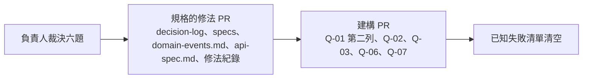

# 直向切片（抽選到初審提交）：待裁決的六題

狀態：**待負責人裁決**（2026-11-22 起草）。本文件不是律法；裁決後條文寫進 `decision-log.md`，以那裡為準。

## 一、背景

- D-066 把切片立法，建構 PR（#121）讓程式配合。`known-test-failures.txt` 從 34 個範例縮到 4 個，剩下的 4 個各在等一題裁決。
- 六題的原文在 `specs/review-case/OPEN-QUESTIONS.md`（Q-01、Q-02、Q-03、Q-05、Q-07）與 `specs/sampling-batch/OPEN-QUESTIONS.md`（Q-06）。對應的規則現在都是 `proposed`。
- 本文件逐題列出程式現況（2026-11-22，main = `922f256`）、權威文件、選項與建議。

## 二、總覽

| 題 | 問題 | 紅的範例 | 建議 | 要改哪裡 |
|---|---|---|---|---|
| Q-01 | `api-spec.md` 沒有代碼的三種錯誤 | `rejects_submit_of_a_review_already_submitted` | 第一、三列照程式；第二列改用 `CASE_NOT_IN_INITIAL_REVIEW_STAGE`（422） | 規格與 `api-spec.md`；第二列另外改程式 |
| Q-02 | 指派時沒有給 `reviewerId` 或 `dueAt` | `rejects_assign_without_a_reviewer` | `VALIDATION_ERROR`，由 domain 檢查 | 規格；建構 PR 改 `ReviewCase.assignReviewer` |
| Q-03 | 提交初審要不要發出 `InitialReviewCompleted` | `submitting_emits_exactly_two_events` | 要。照 `domain-events.md` §6.4 新增事件類別 | 規格；建構 PR 新增事件 |
| Q-05 | SYSTEM_ADMIN 的歷程白名單 | `admin_history_is_a_whitelist` | 照 `permission-matrix.md` §5.1，接受程式現有的七個欄位 | 只改規格 |
| Q-06 | `SamplingCandidatesPrepared`、`ReviewCasesSelected` 的欄位 | 無（`proposed` 的斷言） | 發出者的 identity 加 `detail` 現有的計數 | `domain-events.md`、規格；建構 PR 加 getter |
| Q-07 | `InitialReviewStarted`、`ReviewDraftSaved` 的欄位 | 無（`proposed` 的斷言） | identity 加對方的 id 與醫師；草稿不列分數 | `domain-events.md`、規格；建構 PR 加 getter |

除了 Q-05，每一題都要「規格的修法 PR → 建構 PR」兩步。順序見第九節。

## 三、Q-01：`api-spec.md` 沒有代碼的三種錯誤

### 查到的事實

| 情況 | 程式 | 例外類別（HTTP） | 規格（`proposed`） |
|---|---|---|---|
| 開始初審的人不是受指派的醫師 | `NOT_ASSIGNED_REVIEWER`（`StartInitialReviewUseCase`） | `AccessDeniedException`（403） | `NOT_ASSIGNED_REVIEWER`，`denied`（`RC-STI-01`） |
| 提交初審時案件不是初審中 | `CASE_NOT_IN_PROGRESS`（`SubmitInitialReviewUseCase`） | `DomainStateConflictException`（409） | `CASE_NOT_IN_INITIAL_REVIEW_STAGE`，`rule_violation`（`RC-SUB-02`） |
| 提交初審時必答題沒有作答 | `REQUIRED_ITEMS_NOT_ANSWERED`（`SubmitInitialReviewUseCase`） | `DomainRuleViolationException`（422） | `REQUIRED_ITEMS_NOT_ANSWERED`，`rule_violation`（`RC-SUB-03`） |

- 第一、三列：程式的代碼和分類都與規格相同，範例已經是綠的。缺的只是 `api-spec.md` §4.2 沒有列。
- 第二列：`api-spec.md` §4.2 的 `CASE_NOT_IN_INITIAL_REVIEW_STAGE`（422）寫的是「案件不在可開始初審狀態」，只講開始。程式的 `CASE_NOT_IN_PROGRESS` 不在 `api-spec.md`。它還用在另外兩處：`SaveInitialReviewDraftUseCase`（保存草稿時案件不是初審中）與 `ReviewCase.returnToInitialReview`（退回），都是 409。
- `api-spec.md` §4.2 的狀態類代碼（`CASE_NOT_ASSIGNABLE`、`CASE_NOT_IN_INITIAL_REVIEW_STAGE`、`CASE_NOT_IN_REREVIEW_STAGE`、`REVISION_NOT_ALLOWED`）都是 422。409 只給終態（`CASE_ALREADY_CLOSED`、`CASE_ALREADY_CANCELLED`）、`INVALID_STATE_TRANSITION` 與重複抽中。
- D-066 第 6 點已經把開始初審的狀態錯誤改成 `CASE_NOT_IN_INITIAL_REVIEW_STAGE`（422）。

### 第二列的選項

| 選項 | 做法 | 優點 | 缺點 |
|---|---|---|---|
| **A. 沿用 `CASE_NOT_IN_INITIAL_REVIEW_STAGE`（422）**（建議） | `api-spec.md` 把說明改成「案件不在該初審操作要求的狀態」；建構 PR 把 `SubmitInitialReviewUseCase` 改成這個代碼與 `DomainRuleViolationException` | 開始與提交用同一個代碼，和 `CASE_NOT_IN_REREVIEW_STAGE` 對稱；與 §4.2 狀態類代碼一律 422 一致；規格不用改 | 要改程式（已立法的 use case）；`api-spec.md` 的說明要放寬 |
| B. 照程式 `CASE_NOT_IN_PROGRESS`（409） | 規格改成 `CASE_NOT_IN_PROGRESS`，分類 `conflict`；補進 `api-spec.md` | 不改程式 | 同一類錯誤，開始回 422、提交回 409；代碼名稱沒有講初審，退回也用它 |

### 建議

- 第一列：`NOT_ASSIGNED_REVIEWER`（403），`decided`，補進 `api-spec.md` §4.2。
- 第二列：A。
- 第三列：`REQUIRED_ITEMS_NOT_ANSWERED`（422），`decided`，補進 `api-spec.md` §4.2。

### 順帶查到、不在本題

- 保存草稿時案件不是初審中：程式回 `CASE_NOT_IN_PROGRESS`（409），規格沒有這條規則。採 A 的話，同樣的道理也適用這裡，但規格要先加規則和範例，另外處理。
- 複審的對應情況用 `NOT_ASSIGNED_REREVIEWER`，程式是 `DomainRuleViolationException`（422）；初審的 `NOT_ASSIGNED_REVIEWER` 是 403。兩者不一致，等複審立法時處理。

### 待負責人決定

- **Q-01-1**：第一、三列照程式，標 `decided`？
- **Q-01-2**：第二列採 A？

## 四、Q-02：指派時沒有給 `reviewerId` 或 `dueAt`

### 查到的事實

| 來源 | 內容 |
|---|---|
| `api-spec.md` §10.3 | `dueAt` 必填 |
| `state-machine.md` §3.2 | 指派要有 reviewer |
| `api-spec.md` §4.2 | `VALIDATION_ERROR`（400）：欄位驗證失敗 |
| HTTP 層（`AssignReviewerRequest`） | `reviewerId` 有 `@NotBlank`、`dueAt` 有 `@NotNull`。`GlobalExceptionHandler` 把驗證失敗轉成 400 `VALIDATION_ERROR`。**從 HTTP 進來已經是 `VALIDATION_ERROR`** |
| use case 與 domain（`ReviewCase.assignReviewer`） | 先檢查狀態，再 `Objects.requireNonNull(reviewerId)`：`reviewerId` 是 null 時丟 `NullPointerException`，沒有錯誤代碼，HTTP 以外的呼叫會變成 500。`dueAt` 沒有檢查 |
| 已立法的先例 | `ReviewProject` 在 domain 丟 `DomainValidationException("VALIDATION_ERROR", ...)`（`specs/review-project/`） |
| 執行器 | 直接呼叫 use case，不經過 HTTP 的驗證，所以範例拿到的是 `NullPointerException` |

### 選項

| 選項 | 做法 | 優點 | 缺點 |
|---|---|---|---|
| **A. domain 檢查，`VALIDATION_ERROR`**（建議） | `RC-ASG-02` 改 `decided`；建構 PR 讓 `ReviewCase.assignReviewer` 對 null 的 `reviewerId`、`dueAt` 丟 `DomainValidationException("VALIDATION_ERROR")` | 規則在 domain，不依賴入口；和 `ReviewProject` 一致；HTTP 的結果不變 | 要改暫准範圍的 aggregate（只有這個方法） |
| B. 只在 HTTP 層 | 從 use case 的規格刪掉 `RC-ASG-02`；等 review-case 的 HTTP 契約立法時再寫 | 不改程式 | 有一個輸入檢查只存在於 controller 的註記，規格與範例都看不到 |

### 建議：A

- 順序：程式現在先檢查狀態、再檢查輸入。D-024 的順序是角色 → 載入 → 院區 → 領域規則，沒有規定輸入檢查放在哪裡。建議 domain 方法裡把輸入檢查放在狀態檢查之前。範例用的是待指派的案件，兩種順序結果相同。
- `reassignReviewer` 不在切片內，不動。

### 待負責人決定

- **Q-02-1**：採 A？

## 五、Q-03：提交初審要不要發出 `InitialReviewCompleted`

### 查到的事實

| 來源 | 內容 |
|---|---|
| `domain-events.md` §6.4 | `InitialReviewCompleted`，發出者 `ReviewCase`；條件是 `completeInitialReview(...)` 成功、初審提交為 `SUBMITTED`、狀態轉為 `INITIAL_REVIEW_COMPLETED`。最低必要欄位：`caseId`、`projectId`、`submissionId`、`reviewerId`、`totalScore`、`qualityThreshold` |
| `domain-events.md` §9.1、§9.2 | 兩條流程都是 `ReviewSubmissionSubmitted` 之後接 `InitialReviewCompleted` |
| `domain-events.md` §14 | 提交、固定、結案是不同的業務事實；「不新增事件名稱」講的是固定，不是提交 |
| 程式 | `SubmitInitialReviewUseCase` 呼叫 `reviewCase.completeInitialReview(...)`，但只發出 `ReviewSubmissionSubmitted`。`src/main` 沒有 `InitialReviewCompletedEvent` |
| 複審的對應 | `domain-events.md` 寫 `RereviewCompleted`，程式是 `RereviewSubmittedEvent`。名稱也對不上，不在切片內 |
| 稽核的遮罩 | `ListAuditTrailsUseCase`、`GetCaseLifecycleUseCase` 已經依 D-033 對有複審醫師角色的人拿掉 `detail`。新事件的 `detail` 帶分數，也在遮罩內 |
| 消費者 | 只有 `AuditTrailListener`。沒有 projection 依賴事件 |

### 選項

| 選項 | 做法 | 優點 | 缺點 |
|---|---|---|---|
| **A. 新增事件**（建議） | 規格的 `emits` 改 `decided`；建構 PR 新增 `InitialReviewCompletedEvent`，在 `completeInitialReview` 之後發出，欄位照 §6.4 | 照 `domain-events.md` 的流程；提交（submission 的事實）和初審完成（case 的事實）分開 | 稽核紀錄每次提交多一筆；要確認稽核頁不會重複顯示 |
| B. 不發出 | 修 `domain-events.md`：刪 §6.4，§9.1、§9.2 改流程；規格刪掉這個 `emits` | 不改程式 | 改的是權威文件，不是程式配合文件；兩個業務事實合成一個事件 |

### 建議：A

- 欄位照 §6.4。`qualityThreshold` 取自專案目前的版本（`ProjectVersion.getQualityThreshold()`，`FixInitialReviewUseCase` 也這樣取）；沒有品質線時是 null（D-019）。
- 規格要補一條規則（例如 `RC-SUB-S4`），斷言 `InitialReviewCompleted` 帶有 `caseId`、`submissionId`，`decided`。
- 名稱用 `InitialReviewCompleted`，不用程式風格的 `InitialReviewSubmitted`。

### 待負責人決定

- **Q-03-1**：採 A？
- **Q-03-2**：稽核頁的案件生命週期會多一筆「初審完成」。要不要在建構 PR 一起確認前端的顯示？（建議：要，只確認，不改設計。）

## 六、Q-05：SYSTEM_ADMIN 的歷程白名單

### 查到的事實

| 來源 | 內容 |
|---|---|
| `permission-matrix.md` §5.1（O3-C 已裁決） | 白名單是「共用的基本欄位加上頁面的延伸欄位」。共用欄位有 `caseId`、`caseStatus`、`projectName`、`hospitalId`、**`reviewerId`**、`rereviewerId`、`updatedAt`；UI-014 的延伸欄位有 `stage`、`revisionNo`、`submittedAt`、`submittedBy`、`isCurrentEffective` |
| `api-spec.md` §13.2 | 一個回應範例：`submissionId`、`stage`、`revisionNo`、`status`、`submittedAt`。不分角色，也沒有分數與評語，所以它是範例，不是 SYSTEM_ADMIN 的白名單 |
| 程式 `GetRevisionHistoryUseCase` | 每一筆：`submissionId`、`stage`、`reviewerId`、`status`、`revisionNo`、`submittedAt`、`supersededBySubmissionId`；分數與評語是 null |
| 前端 | `isCurrentEffective` 由 `status === 'SUBMITTED' && !supersededBySubmissionId` 算出來 |
| 權威順序（backend CLAUDE.md） | `permission-matrix.md`（第 6 位）在 `api-spec.md`（第 9 位）之前 |
| 規格 | `RC-VIS-05` 的 `only` 照 `api-spec.md` 的範例，所以 `reviewerId` 被判為多出來的欄位 |

### 選項

| 選項 | 做法 | 優點 | 缺點 |
|---|---|---|---|
| **A. 照 `permission-matrix.md`，接受程式的七個欄位**（建議） | `RC-VIS-05` 的 `only` 改成程式的七個欄位，`decided`。對應：`submittedBy` 就是 `reviewerId`；`isCurrentEffective` 由 `status` 與 `supersededBySubmissionId` 表示；`submissionId` 是每一筆的 identity | 依較高的權威；不改程式也不改前端 | `api-spec.md` §13.2 要補一句 SYSTEM_ADMIN 看到的欄位 |
| B. 照 `api-spec.md` 的範例 | 程式對 SYSTEM_ADMIN 拿掉 `reviewerId`、`supersededBySubmissionId` | 規格不用改 | 違反較高權威允許的範圍；前端算不出 `isCurrentEffective` |
| C. 照 `permission-matrix.md` 的字面 | API 改成輸出 `submittedBy`、`isCurrentEffective` | 名稱完全一致 | API 與前端都要改，改的只是名稱 |

### 建議：A

- 只改規格與 `api-spec.md`，不用建構 PR。

### 待負責人決定

- **Q-05-1**：採 A？

## 七、Q-06：`SamplingCandidatesPrepared`、`ReviewCasesSelected` 的欄位

### 查到的事實

| 來源 | 內容 |
|---|---|
| `domain-events.md` §5.2 | 沒有最低必要欄位；發布條件寫「`populationCount`／`eligibleCount`／`excludedCount` 已可確定」 |
| `domain-events.md` §5.3 | 沒有最低必要欄位；補充說「代表被選中」 |
| 程式的 `detail` | `SamplingCandidatesPrepared`：`populationCount`、`eligibleCount`、`excludedCount`。`ReviewCasesSelected`：`selectedCount` |
| 程式的屬性（#121 之後） | 兩者都只有 `batchId` |
| 相鄰的事件 | §5.4 `SamplingBatchCompleted` 的最低必要欄位有這四個計數 |

### 建議

- `SamplingCandidatesPrepared`：`batchId`、`populationCount`、`eligibleCount`、`excludedCount`。
- `ReviewCasesSelected`：`batchId`、`selectedCount`。
- 都是程式 `detail` 已經有的值。建構 PR 只要加欄位與 getter，`detail` 不變（照 D-066 第 2 點的做法）。
- 補進 `domain-events.md` §5.2、§5.3；`SB-EXE-S4` 改 `decided`，範例可以多斷言計數。

### 順帶查到、不在本題

- `SamplingBatchCompleted` 的 `detail` 少了 `eligibleCount`、`excludedCount`，與 §5.4 不一致（草案 16 已記錄）。可以在同一個建構 PR 補，但會改變稽核紀錄的內容，要另外裁決。

### 待負責人決定

- **Q-06-1**：採上面的欄位？

## 八、Q-07：`InitialReviewStarted`、`ReviewDraftSaved` 的欄位

### 查到的事實

| 來源 | 內容 |
|---|---|
| `domain-events.md` §6.3 | `InitialReviewStarted`，發出者 `ReviewCase`；沒有最低必要欄位 |
| `domain-events.md` §7.1 | `ReviewDraftSaved`，發出者 `ReviewSubmission`；沒有最低必要欄位；「是否發布可視草稿稽核需求決定」 |
| 程式的 `detail` | `InitialReviewStarted`：`reviewerId`、`submissionId`。`ReviewDraftSaved`：`caseId`、`totalScore` |
| 相鄰的事件 | §7.2 `ReviewSubmissionSubmitted`：`submissionId`、`caseId`、`stage`、`reviewerId`、`totalScore` |
| D-033 | 草稿分數是初審分數，對複審醫師要遮罩；稽核頁已經遮罩 `detail` |

### 建議

- `InitialReviewStarted`：`caseId`、`submissionId`、`reviewerId`。開始初審會建立 submission，所以兩邊的 id 都是這個事實的一部分。
- `ReviewDraftSaved`：`submissionId`、`caseId`。`totalScore` 不列為必要欄位：草稿分數會一直變，又是要遮罩的資料，事件不需要對外保證它。程式的 `detail` 照舊帶它，稽核不變。
- 補進 `domain-events.md` §6.3、§7.1；`RC-STI-S3`、`RC-DRF-S2` 改 `decided`。建構 PR 只加欄位與 getter。

### 待負責人決定

- **Q-07-1**：採上面的欄位？
- **Q-07-2**：`ReviewDraftSaved` 不列 `totalScore`？（建議：不列。）

## 九、裁決後的順序

1. **規格的修法 PR**：`decision-log.md` 新增一條（D-067），六題的規則改成 `decided`，刪除 `OPEN-QUESTIONS.md` 的對應題目，同步修改 `domain-events.md` 與 `api-spec.md`。Q-05 在這一步就變綠，從清單刪除。
   - 如果 Q-06、Q-07 的範例多斷言了新欄位，那些範例會變紅，要在同一個 PR 加進已知失敗清單（D-066 第 5 點的做法）。
2. **建構 PR**：照各題的建議改程式，每變綠一個就從清單刪一行。全部做完時，`known-test-failures.txt` 的 D-066 段落應該是空的。

### 還沒有查證的

- 採 Q-03 A 之後，稽核頁、案件生命週期頁的顯示（Q-03-2）。
- 採 Q-01 A 之後的前端：2026-11-22 查過 `cases.service.ts` 的 `submitInitialReview` 與 `cases-initial-review/` 的元件，沒有依 `CASE_NOT_IN_PROGRESS` 或 409 處理提交失敗。其他頁面沒有查。
- 六題的範例在規格改完後實際的紅綠，要在修法 PR 裡實際跑過才知道。
