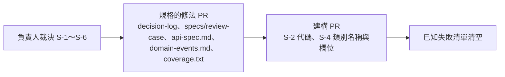

# 複審切片（初審固定到複審結案）：範圍與程式對不上的地方

狀態：**已裁決**（2026-11-22）。負責人對 S-1、S-2、S-4～S-6 照建議裁決；S-3 不照建議，改成 422，代碼與初審對稱，一併修 D-053（見第五節的裁決）。條文寫進 `decision-log.md` 的 D-069，以那裡為準。本文件不是律法，下面保留起草時的版本（main = `b351b03`）。題號 S-1～S-6 只在本文件使用。

## 一、背景

- D-066～D-068 立法了抽選到初審提交的直向切片，範例全部是綠的，`known-test-failures.txt` 是空的。
- 負責人 2026-11-22 同意下一個切片的方向：送複審 → 開始複審 → 存草稿 → 送出 → 結案。
- `law/coverage.txt` 現況：本切片的 use case 都在 `application/reviewcase/`、`domain/reviewcase/` 的暫准範圍。`specs/review-case/model.yaml` 的 `deferred_transitions` 列了這些轉移。
- 本文件只查程式現況與權威文件，列出立法前要裁決的地方。流程照 D-066：先規格的修法 PR，再建構 PR（P4）。

## 二、總覽

| 題 | 問題 | 建議 |
|---|---|---|
| S-1 | 切片範圍：送複審前要先固定初審（D-054），所以要把「固定初審」與「指派複審醫師」也納入 | 納入七支 use case；其餘複審相關的不納入 |
| S-2 | 指派複審醫師、開始複審的狀態錯誤，程式的代碼不在 `api-spec.md` | 改用 `api-spec.md` 已有的 422 代碼，與初審的對應操作一致 |
| S-3 | 草稿、提交、結案用 `CASE_NOT_REREVIEW_IN_PROGRESS`（409），與 D-067「狀態類一律 422」不同 | 維持 409，D-053 已明文裁決；只記下不一致（**裁決：不照建議，改成 422**） |
| S-4 | 事件類別的名稱與 `domain-events.md` 不同，初審固定事件沒有文件 | 規格用文件的名稱，建構 PR 改類別名稱；固定事件補進文件 |
| S-5 | 永久盲審（D-033）與讀過初審的人不得受派（D-055 第 5 點） | 盲審用 `absent` 立規則；D-055 第 5 點延後 |
| S-6 | 品質線與加權取專案「目前的版本」，不是案件建立時的版本 | 與 D-068 第 4 點同一題，不立規則，延後 |

## 三、S-1：切片範圍

### 查到的事實

| 來源 | 內容 |
|---|---|
| `ReviewCase.sendToRereview` | 要求 `INITIAL_REVIEW_COMPLETED` 且初審已固定（`requireInitialReviewFixed`，否則 `INVALID_STATE_TRANSITION`） |
| D-054 第 3 點 | 固定成功時判斷品質線：分數 > 品質線就自動進 `PENDING_REREVIEW`，並發布進複審事件（第 8 點） |
| `ReviewCase.startRereview` | 要求 `PENDING_REREVIEW` 且已指派複審醫師（`NO_REREVIEWER_ASSIGNED`） |
| `SubmitRereviewUseCase` | 計分、算加權 `finalScore`，案件維持 `REREVIEW_IN_PROGRESS`（D-032、D-053 第 4 點） |
| `CloseRereviewUseCase` | 只有目前有效複審結果的提交者能結案；錯誤代碼照 D-053 第 5 點 |

所以「送複審」前面一定要經過固定初審，「開始複審」前面一定要經過指派複審醫師。範例只能經由 use case 建立狀態，這兩支不立法就做不出後面的情境。

### 建議的範圍

| 納入（改為 `legislated`） | 不納入（維持暫准，列在 `deferred_transitions`） |
|---|---|
| `FixInitialReviewUseCase`（含自動進複審） | `ReassignRereviewerUseCase` |
| `SendToRereviewUseCase`（手工送複審） | `ReviseRereviewUseCase`、`ReviseInitialReviewUseCase` |
| `AssignRereviewerUseCase` | `CloseWithoutRereviewUseCase` |
| `StartRereviewUseCase` | `CancelReviewCaseUseCase` |
| `SaveRereviewDraftUseCase` | `ReturnInitialReviewUseCase`、`ReopenInitialReviewUseCase` |
| `SubmitRereviewUseCase` | 讀取遮罩（案件詳情、提交明細） |
| `CloseRereviewUseCase` | |

- 不納入的理由：revision 牽涉 `REVISION_ACTOR_MISMATCH`（TS-RV-004）的代碼還沒裁決；退回仍用 `CASE_NOT_IN_PROGRESS`；不經複審結案與取消是另一條路徑。

### 待負責人決定

- **S-1-1**：照上表的範圍？
- **S-1-2**：不經複審結案（`CloseWithoutRereview`）也是「固定之後」的出口，要不要一起納入？（建議：不納入，切片只走複審這條路。）

## 四、S-2：指派複審醫師、開始複審的狀態錯誤

### 查到的事實

| 操作 | 程式 | `api-spec.md` §4.2 | 初審的對應操作（已立法） |
|---|---|---|---|
| 指派複審醫師，案件不是 `PENDING_REREVIEW` | `CASE_NOT_PENDING_REREVIEW`（409），不在 §4.2 | `CASE_NOT_ASSIGNABLE`（422）「案件目前不可指派」 | 指派初審醫師用 `CASE_NOT_ASSIGNABLE`（422） |
| 開始複審，案件不是 `PENDING_REREVIEW` | `CASE_NOT_PENDING_REREVIEW`（409） | `CASE_NOT_IN_REREVIEW_STAGE`（422）「案件不在可開始複審狀態」 | 開始初審用 `CASE_NOT_IN_INITIAL_REVIEW_STAGE`（422，D-067） |
| 開始複審，還沒有指派 | `NO_REREVIEWER_ASSIGNED`（422），不在 §4.2 | 沒有 | 沒有對應 |
| 指派的複審醫師是初審醫師 | `REREVIEWER_SAME_AS_REVIEWER`（422），不在 §4.2 | 沒有（規則在 D-017） | 沒有對應 |

### 選項

| 選項 | 做法 | 優點 | 缺點 |
|---|---|---|---|
| **A. 用 `api-spec.md` 的代碼**（建議） | 指派 → `CASE_NOT_ASSIGNABLE`，開始 → `CASE_NOT_IN_REREVIEW_STAGE`，都是 422；建構 PR 改 domain 的兩處代碼與例外類別 | 與初審的對應操作一致；不新增代碼；理由與 D-067 相同 | 要改 domain（`assignRereviewer`、`reassignRereviewer`、`startRereview` 共用同一個代碼，改派不在切片，但會一起變） |
| B. 照程式 | `CASE_NOT_PENDING_REREVIEW`（409）補進 §4.2 | 不改程式 | §4.2 已有的兩個代碼變成沒人用；初審與複審不一致 |

另外兩個不在 §4.2 的代碼（`NO_REREVIEWER_ASSIGNED`、`REREVIEWER_SAME_AS_REVIEWER`）照程式，422，補進 §4.2。

### 待負責人決定

- **S-2-1**：採 A？
- **S-2-2**：改派共用 `assignRereviewer` 的檢查，代碼會一起變。可以接受改派在暫准範圍裡跟著改？（建議：可以，只改代碼，不改行為。）

## 五、S-3：草稿、提交、結案的狀態錯誤

### 查到的事實

| 來源 | 內容 |
|---|---|
| 程式 | 保存複審草稿、提交複審、複審結案：案件不是 `REREVIEW_IN_PROGRESS` 時丟 `CASE_NOT_REREVIEW_IN_PROGRESS`（409） |
| D-053 第 5 點 | 結案的錯誤代碼表明列 `CASE_NOT_REREVIEW_IN_PROGRESS`，並說「都是現有複審提交與複審 revision 已在使用的代碼」 |
| `api-spec.md` 結案端點 | `CASE_NOT_REREVIEW_IN_PROGRESS`，409 |
| D-067 第 1 點 | 初審的狀態錯誤改成 422（`rule_violation`） |

### 建議：維持 409，不改

- D-053 是明文裁決，改它要另外修法。這次只在裁決記下「初審是 422、複審是 409」的不一致，等有理由統一時再處理。
- `SUBMISSION_NOT_DRAFT`、`SUBMISSION_NOT_SUBMITTED`、`CONFLICT`、`NOT_SUBMISSION_OWNER` 也照程式與 D-053。前兩個若不在 §4.2，補進去。

### 待負責人決定

- **S-3**：維持 409？還是這次一起改成 422，並修 D-053？

### 裁決（2026-11-22）：改成 422，共用一個代碼

- 開始複審、保存複審草稿、提交複審、複審結案的狀態錯誤，共用 `CASE_NOT_IN_REREVIEW_STAGE`（422，`rule_violation`）。`api-spec.md` §4.2 的說明放寬為「案件不在該複審操作要求的狀態」，與初審的 `CASE_NOT_IN_INITIAL_REVIEW_STAGE`（D-067、D-068）對稱。S-2 的開始複審因此也用這個代碼。
- `CASE_NOT_REREVIEW_IN_PROGRESS` 停用。修 D-053 第 5 點的代碼表；`api-spec.md` 結案端點的錯誤表（約第 1904 行）改成 `CASE_NOT_IN_REREVIEW_STAGE`、422。
- 用到的地方（2026-11-22 查證）：`SaveRereviewDraftUseCase:50`、`SubmitRereviewUseCase:70`、`CloseRereviewUseCase:58`、`ReviewCase:364`（`completeRereview`）、`ReviewCase:384`（`closeAfterRereview`）；測試 `CloseRereviewUseCaseTest:217`、`ReviewCaseRereviewTest:314`。前端沒有用到。建構 PR 一併改，例外類別改成 `DomainRuleViolationException`。
- `SUBMISSION_NOT_DRAFT`、`SUBMISSION_NOT_SUBMITTED`、`CONFLICT`、`NOT_SUBMISSION_OWNER` 不在本題，照 D-053 維持不變。

## 六、S-4：事件的名稱與欄位

### 查到的事實

| `domain-events.md` | 程式的類別 | 程式的 `detail` |
|---|---|---|
| （沒有） | `InitialReviewFixedEvent` | 依 D-054 第 8 點，不記分數 |
| §6.5 `ReviewCaseEscalatedToRereview`，最低必要欄位 `caseId`、`projectId`、`triggeredBySubmissionId`、`initialScore`、`qualityThreshold` | `CaseEscalatedToRereviewEvent` | 手工：`{"trigger":"manual"}`；固定時自動：帶品質線 |
| §6.6 `RereviewerAssigned` | `RereviewerAssignedEvent` | `rereviewerId` |
| §6.7 `RereviewStarted` | `RereviewStartedEvent` | `submissionId` |
| §6.8 `RereviewCompleted` | `RereviewSubmittedEvent` | `rereviewScore`、`finalScore` |
| §6.9 `ReviewCaseClosed`（兩條結案路徑共用） | `RereviewCaseClosedEvent`；不經複審結案另有 `CaseClosedWithoutRereviewEvent` | `submissionId` |

- §6.5 的發布條件只寫了固定時自動進複審；手工送複審發布同一個事件，文件沒寫。

### 事件類別與稽核內容的關係（2026-11-22 查證）

| 位置 | 內容 |
|---|---|
| 執行器（`specs/README.md` 第 348、403 行） | 規格的事件 `X` 對到類別 `XEvent`。所以規格要用文件的名稱，類別就要改名 |
| `AuditTrailListener` | 唯一的事件監聽者（`@EventListener` 收全部 `DomainEvent`）。寫進稽核的是 `entityType`、`entityId`、`action`、`detail`、操作者、院區、時間，**不存類別名稱** |
| `action` | 每個事件類別在建構式寫死的字串，例如 `RereviewSubmittedEvent` 是 `"REREVIEW_SUBMITTED"`、`RereviewCaseClosedEvent` 是 `"CASE_CLOSED_AFTER_REREVIEW"`。和類別名稱沒有連動 |
| 稽核查詢（`AuditTrailQueryAdapter:76`） | `GET /audit-trails` 的 `eventName` 參數直接比對 `action`。`api-spec.md` §14.2 只列參數名稱，沒有定義值 |
| 程式裡讀 `action` 的地方 | 只有測試：`CloseRereviewUseCaseTest:142`、`FixInitialReviewUseCaseTest:120`、`FixInitialReviewConcurrencyTest:139`、`:177`、`PermanentBlindReviewReadApiTest:292`、`:450`。正式程式沒有依 `action` 分支 |
| 用類別名稱的地方 | 沒有 `getSimpleName`；只有發出事件的四支 use case 與兩支測試 import 類別 |
| 前端 | 沒有用到這些類別名稱、`action` 字串或 `eventName` 參數。前端的 `INITIAL_REVIEW_FIXED` 是案件詳情的 `blockedReason`（`initial-review-page.component.ts:117`），與事件無關 |
| 先例（D-066） | 切片的事件加了屬性，`action` 沒改：`InitialReviewCompletedEvent` 是 `"INITIAL_REVIEW_COMPLETED"`、`SamplingBatchCompletedEvent` 是 `"COMPLETED"`、`ReviewCaseAssignedEvent` 是 `"ASSIGNED"`。`action` 的命名本來就不一致，有的帶前綴、有的沒有 |

結論：**只改類別名稱，稽核紀錄不變**。只要 `action` 字串與 `detail` 不改，稽核的內容、稽核查詢的結果都和現在一樣。要注意的是 `eventName` 這個參數名稱讓人以為值是 `domain-events.md` 的事件名稱（例如 `ReviewCaseClosed`），實際上是 `action`（例如 `CASE_CLOSED_AFTER_REREVIEW`）。這是稽核查詢的問題，不在本切片。

### 選項

| 選項 | 做法 | 優點 | 缺點 |
|---|---|---|---|
| **A. 規格用文件的名稱，程式改類別名稱**（建議） | `RereviewSubmittedEvent` → `RereviewCompletedEvent`、`CaseEscalatedToRereviewEvent` → `ReviewCaseEscalatedToRereviewEvent`；`RereviewCaseClosedEvent` → `ReviewCaseClosedEvent`（不經複審結案的類別不在切片，不動）。`action` 字串與 `detail` 不改 | 與 `specs/README.md` 第十節「程式要使用規格的名稱」一致，同 D-066 的 M-2；稽核紀錄不變（見上） | 建構 PR 要改名；兩條結案路徑暫時是兩個不同的類別，但 `action` 本來就不同（`CASE_CLOSED_AFTER_REREVIEW`、`CASE_CLOSED_WITHOUT_REREVIEW`） |
| B. 改文件配合程式 | `domain-events.md` 改成程式的名稱 | 不改程式 | 改權威文件去配合程式 |

- 欄位：照 D-066 第 2 點的做法。§6.5 有最低必要欄位，規格斷言這些欄位，標 `decided`；手工送複審時 `triggeredBySubmissionId`、`qualityThreshold` 是 null。其他事件只斷言 `caseId`，標 `proposed`。
- `InitialReviewFixed`：`domain-events.md` 補一節（`caseId`、`submissionId`，不帶分數，D-054 第 8 點），屬於規格的修法 PR。

### 待負責人決定

- **S-4-1**：採 A？
- **S-4-2**：§6.5 補上「手工送複審也發布本事件」？
- **S-4-3**：`action` 字串維持不改，稽核紀錄逐字不變，照 D-066 的做法由測試確認？（建議：是。`eventName` 的值要不要對齊 `domain-events.md`，等稽核查詢立法時處理。）

## 七、S-5：盲審與讀過初審的人

### 查到的事實

| 來源 | 內容 |
|---|---|
| D-033、D-053 第 2 點 | 複審醫師的回應不得有 `finalScore` 或可反推初審分數的資訊 |
| `SubmitRereviewResult`、`CloseRereviewResult` | 沒有 `finalScore`；`RereviewApiTest:300`、`:337` 斷言它不存在 |
| `specs/README.md`（版本 2 的斷言） | 有 `absent`：選到的屬性必須不存在或為 null |
| `AssignRereviewerUseCase` | 讀過本案完整初審的人受派時丟 `REREVIEWER_HAS_READ_INITIAL`（D-055 第 5 點）。讀取紀錄由完整初審的讀取產生（提交明細），不在本切片 |

### 建議

- 盲審：提交複審、複審結案的成功範例加 `absent: [finalScore, initialReviewScore]`，規則標 `decided`。
- D-055 第 5 點：做不出「讀過初審」的狀態，延後到讀取遮罩立法，記在 `deferred_behaviors`。`REREVIEWER_SAME_AS_REVIEWER`（D-017）做得出來，納入。

### 待負責人決定

- **S-5**：照建議？

## 八、S-6：品質線與加權取專案目前的版本

- `FixInitialReviewUseCase` 用 `project.getCurrentVersion().getQualityThreshold()`；`SubmitRereviewUseCase` 用 `project.getCurrentVersion()` 的兩個權重。案件記了 `scoreSheetVersionRef`，沒有記專案版本。
- 只有 `prepareDraftVersion` 能讓「目前的版本」變成另一個，它沒有呼叫者（D-068 第 4 點）。所以現在走不到不一致。
- **建議**：不立規則，併入 D-068 第 4 點，等專案版本管理立法時一起決定（案件要不要記專案版本）。
- **S-6**：照建議？

## 九、裁決後的順序

1. **規格的修法 PR**：`decision-log.md` 新增一條（D-069）；`specs/review-case/` 加七支 use case 的規則與範例，`model.yaml` 把對應的轉移從 `deferred_transitions` 移出；`api-spec.md` §4.2 補代碼；`domain-events.md` 補 §6.5 與初審固定事件；`law/coverage.txt` 把七支 use case 與對應的事件類別列為 `legislated`。紅的範例列進已知失敗清單。
2. **建構 PR**：S-2 改 domain 的代碼；S-4 改類別名稱、加欄位與取得方法。改完把清單清空。

### 還沒有查證的

- 七支 use case 的 `execute` 都收 `Command` 物件。照 D-066 M-1-2，立法時要攤平參數，建構 PR 的範圍會比上面列的大。
- 紅的範例有多少個，要在修法 PR 裡實際跑過才知道。
